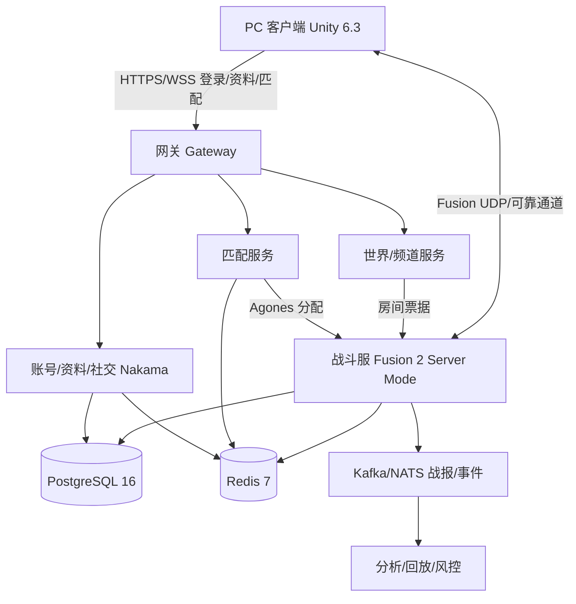
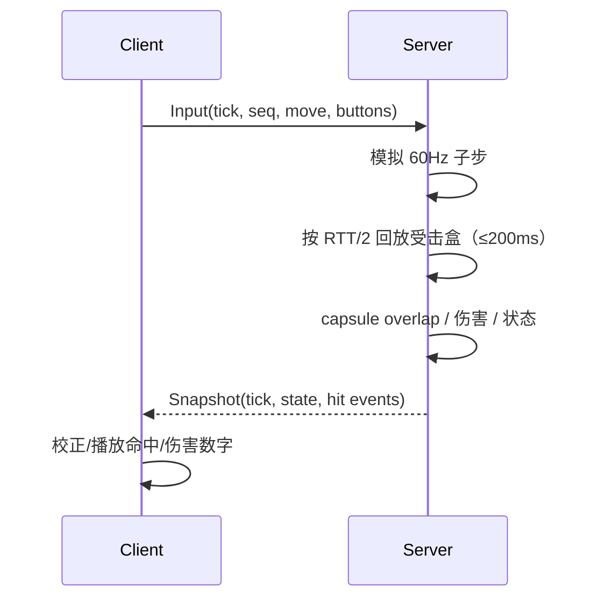
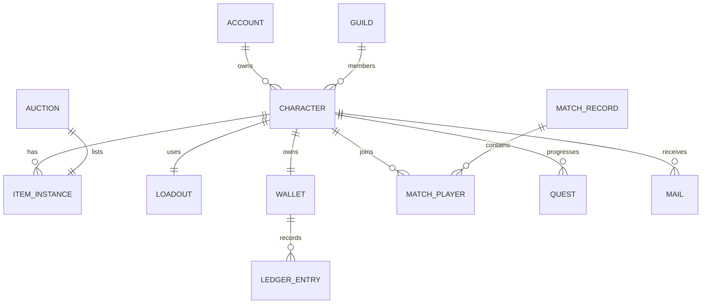
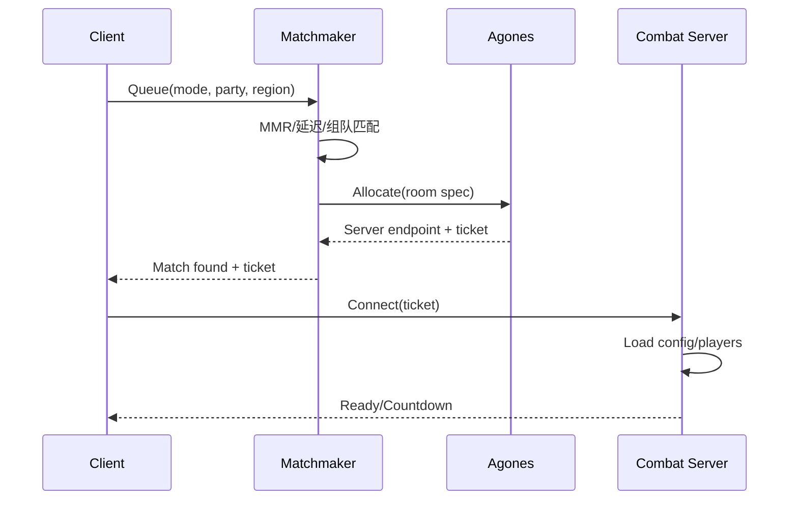

# 技术设计文档（TDD）

> 目标：指导 M0 原型与后续生产。数字以 `docs/00` 为准；架构决策见 `docs/05`/`docs/decisions/`。
>
> 关键约束：PC/Steam、Unity 6.3 LTS、Fusion 2 Server Mode、30Hz 网络 tick、60fps 客户端、2.5D 固定正交、全键盘、服务器权威、不卖属性。

---

## 0. 结论摘要

- **客户端**：Unity 6.3 LTS + URP；固定 45–55° 正交相机；全键盘 Input System；数据驱动战斗；60fps。
- **战斗**：服务器权威；30Hz 网络 tick + 60Hz 战斗子步；地面 capsule/cylinder + 高度状态；命中盒回放 ≤200ms。
- **联网**：Fusion 2 Server Mode；客户端预测/服务器校正；AOI；Agones 编排；Linux headless。
- **后端**：Nakama（账号/社交/匹配/排行）+ 自定义经济/拍卖服务；PostgreSQL 16 + Redis 7 + Kafka/NATS。
- **部署**：K8s + Agones；NA/EU/SEA；蓝绿/金丝雀；Prometheus/Grafana/Loki/Sentry/OpenTelemetry。
- **第一验证点**：M0 在 100ms/2% 丢包下完成连段/防御/击杀，键盘-only，无鼠标。

---

## 1. 范围、目标与非目标

### 1.1 范围

- PC 客户端、战斗服、后端服务、数据模型、API、部署、测试、成本。
- 2.5D 俯视、全键盘、装备=招式、4/8 人 PvE、8–16 人 PvP、城镇/野外频道。
- M0–M4 技术里程碑与退出标准。

### 1.2 目标

| 指标 | 目标 |
|---|---|
| 客户端帧率 | 1080p 60fps @ GTX 1060/RX 580 |
| 网络 tick | 30Hz（网络）；60Hz 战斗子步 |
| 输入延迟 | 本地 <50ms；同区 RTT <80ms |
| 命中回放 | ≤200ms |
| 房间 | 城镇 50；野外 30；PvE 4；PvP 8–16；RAID 8 |
| 规模 | 软 launch 2k CCU；1.0 10k CCU |
| 可用性 | 99.9%（首版）；P0 故障 <30 分钟恢复 |

### 1.3 非目标

- 不做自由 3D 镜头/自由飞行/无缝开放世界。
- 不做鼠标瞄准/鼠标镜头。
- 不做首版主机/移动；手柄 post-1.0 评估/接入。
- 不做全量 rollback/确定性物理；只回滚命中判定。

---

## 2. 总体架构



**分层**：

1. **客户端**：Unity、URP、Input System、Addressables、UI Toolkit、Fusion 客户端。
2. **网关**：TLS 终止、鉴权、限流、路由、会话；无状态。
3. **Meta**：Nakama（账号/好友/公会/聊天/排行/基础匹配）；自定义经济/拍卖/结算服务。
4. **世界/频道**：城镇/野外频道、AOI、NPC、事件；可用 Fusion 房间或后期自定义世界服。
5. **战斗服**：Fusion Server Mode；PvE/PvP 房间；AI/掉落/命中权威。
6. **数据**：PostgreSQL（持久化/账本）、Redis（会话/在线/队列/限流）、Kafka/NATS（事件/战报）。
7. **编排**：Agones 管理战斗服舰队；K8s 管理无状态服务；多区。

---

## 3. 客户端架构

### 3.1 工程结构

```text
Assets/
  Core/                 # 共享战斗核心（纯 C#，可单测）
    Combat/             # 状态机/帧数据/伤害/命中
    Data/               # 招式/装备/敌人定义
    Net/                # 输入帧/快照/序列化
  Game/
    Bootstrap/          # 启动/登录/场景
    Camera/             # 固定正交相机/缩放/遮挡
    Input/              # 键盘映射/重映射/冲突检测
    UI/                 # HUD/背包/匹配/聊天
    World/              # 城镇/野外/副本
    FX/                 # 像素 VFX/命中停顿/屏震
  Content/              # Addressables/配置
  Tests/                # EditMode/PlayMode
```

- 程序集划分：`Core` 不依赖 UnityEngine（或仅数学）；`Game` 依赖 Core；`Tests` 引用 Core。
- 数据：ScriptableObject 编辑 → 导出 JSON/二进制；服务器加载同一份配置；版本号/哈希。
- Addressables：角色/装备/场景/UI 分包；热更/预下载。

### 3.2 渲染

- URP；正交相机；Pixel Perfect（UI/VFX，不强制全屏）。
- 自定义 shader：色板/描边/ramp 光照/点采样/低分辨率渲染 0.6–0.75。
- 不启用 PBR/后处理堆叠；Bloom/DoF 可选，不能破坏像素风。
- 角色 3–8k tris；贴图 64–128px；环境 128–256px；32–64 色板。

### 3.3 相机

- 固定 **pitch=50°、yaw=45°** 正交；orthographic size 7–9，默认 8；角色 70–90px 只对默认 size8/pitch50/1.0× 成立（78.1px；H_eff=1.8m）。
- 键盘 `+/-` 缩放 0.8–1.2×；有限平移/跟随；不旋转、无鼠标；70–90px 不跨缩放保持。
- 遮挡物淡出；角色轮廓/影子保留；屏幕边缘指示器；14m 锁定目标可能在屏外，用边缘指示。
- 20/30m zoom：`S≥d·sin(pitch)`（脚点）/`S≥(d·sin p+1.8cos p)·1080/1032`（全身）；p50 约 17/26。
- 相机不参与战斗判定；只做表现。

### 3.4 动画

- 8–12fps 阶梯动画；2–4 帧预备；命中停顿 50–100ms；屏震。
- 共享骨架；按武器原型复用动画；装备插槽/模块化。
- 动画事件驱动命中/特效/音效；服务器用帧数据，不依赖动画事件。

### 3.4.1 角色/纸娃娃与 UGC 纹理（ADR-013）

```text
AvatarBase (prefab)
  ├─ Body (skinned mesh) + Skeleton + Animator（共享 10 动作）
  ├─ AvatarAssembler (slots)
  │    hair / face / head_accessory / top / bottom / shoes / gloves / cape / weapon_main / weapon_offhand
  └─ UGC service (per slot, fixed UV)
```

- `AvatarItemDefinition`（ScriptableObject）：`itemId/slot/visualPrefab/baseMaterial/defaultAlbedo/uvTemplate/allowUgcTexture/hiddenBodyRegions`。
- 装备 mesh 要么 skinned 到共享骨架，要么挂到骨骼 socket；同一 Animator，不为装备新增动作。
- 外观与战斗核心解耦：外观只发 `itemId + dye + textureHash`；服务器校验 itemId/槽位/拥有关系。
- UGC：客户端上传固定尺寸 PNG → 服务端校验（尺寸/格式/大小/解码超时/内容审核）→ 存 hash/URL；客户端只从可信 URL 拉取；不允许上传几何/骨骼/可执行文件。
- 网络同步只同步外观 ID/纹理 hash，不同步整张贴图；战斗中按需下载/缓存。
- 2D 纸娃娃若启用，需要新 ADR 取代 ADR-010；不在本 TDD 的默认实现。
- 详细设计：[docs/09](09-角色与模块化装备系统.md)。

---

## 4. 输入系统（全键盘）

### 4.1 输入帧

```csharp
struct InputFrame {
  public uint Tick;          // client tick
  public ushort Sequence;
  public uint ClientTimeMs;  // 输入时间戳（格挡/组合判定）
  public sbyte MoveX;        // -1/0/1
  public sbyte MoveY;        // -1/0/1
  public ushort Pressed;     // 本帧按下边沿
  public ushort Released;    // 本帧抬起边沿
  public ushort Held;        // 持续按住状态
  public byte ComboBuffer;   // 最近输入/组合提示
  public byte TargetId;      // 软锁定目标（可选）
}
```

- 客户端 60Hz 采样；发送最近 3 帧冗余；服务器 **60Hz 子步**执行，30Hz 只做快照。
- 移动是屏幕相对 8 方向；朝向由移动/攻击/软锁定决定。
- 组合在客户端/服务器用同一张优先级表判定；服务器以 `ClientTimeMs` 做格挡/组合容差。

**组合优先级（首版）**：

| 组合 | 优先 | 规则 |
|---|---|---|
| Z+X+C | 必杀 | 优先于防御/特殊/普攻；Z 按住时 C+X 不判防御 |
| C+X | 防御 | 仅经典；两键同按闭区间 **±50ms**；仅 Z 未按住时成立 |
| Z+方向+C / Z+方向+X | 特殊 3/4 | 方向在 C/X 前 ≤3f（50ms）新鲜输入 |
| Z+C / Z+X | 特殊 1/2 | 无新鲜方向，或方向已按住 >3f（移动中） |
| 方向+C / 方向+X+C | 现代技能 3/4 | 方向 ≤3f 新鲜输入 |
| C / X+C | 现代技能 1/2 | 无新鲜方向，或移动中 |
| 双击方向 | 冲刺 | 250ms debounce |
| Z tap / hold | 轻按软锁 / 按住修饰 | tap ≤150ms |
| C vs F | C 只攻击；F 交互/拾取 | 移除 C 拾取绑定 |

> **方向窗口**：方向先于 C/X ≤3f 判方向版（3/4）；方向已按住 >3f 判基础版（1/2）；失败回退基础版。自检覆盖：方向+Z+C、方向+Z+X、方向+C、方向+X+C。

- **全键盘验收**：3 款键盘（全键无冲/6KRO/薄膜）各 100 次组合输入，成功率 ≥99%；丢键提示顺序输入/改键。

### 4.2 经典布局映射

| 动作 | 默认 | 替代 |
|---|---|---|
| 移动 | 方向键/WASD | 重映射 |
| 冲刺 | 双击方向 | Shift |
| 瞄准/软锁定 | Z | — |
| 重击 | X | — |
| 轻击 | C | — |
| 跳跃 | V | — |
| 防御 | C+X | Space |
| 特殊 1/2 | Z+C / Z+X | — |
| 特殊 3/4 | Z+方向+C / Z+方向+X | — |
| 必杀 | Z+X+C | — |
| 交互 | F | — |
| 切换目标 | Q/Tab | — |
| 缩放 | +/- | — |

> 现代布局：Z 轻、X 重、C 技能 1、X+C 技能 2、方向+C 技能 3、方向+X+C 技能 4、Z+X+C 必杀、Alt 软锁定、Space 防御、Shift 冲刺、F 交互、Q/Tab 切换、+/- 缩放；同样无鼠标。必杀支持顺序输入 Z→X→C（≤250ms）。

### 4.3 冲突/rollover

- C+X 同时按：Input System 组合键 + 时间窗（**±50ms，闭区间，两键同按**）；仅 Z 未按住时判防御；Z 按住时 Z+X+C 必杀优先；检测键盘 ghosting。
- Space 替代防御；Shift 替代冲刺；键位重映射/恢复默认；2KRO/薄膜档默认 Space 防御 + 顺序输入提示。
- 启动时键位测试：同时按 C/X/方向/V、“方向+Z+X+C”、方向+Z+C、方向+Z+X、方向+C、方向+X+C，检测是否丢键；丢键提示顺序输入（Z→X→C）/改键。
- 顺序必杀干净条件：`Z↓→X↓→C↓`，C−Z≤250ms，C−X≤3f(50ms)（距 X **按下**），且不触发防御抢判；X 已松开时 C−X≤50ms 即可；引擎需意图缓冲/取消，避免中间普攻先提交。
- UI 默认键盘导航；Tab/Shift+Tab/Enter/Esc/方向键/PageUp/PageDown；聊天/IME 聚焦时屏蔽战斗键；鼠标仅可选（显示光标），不依赖。
- 手柄预留：同一套 Action Map，post-1.0 接入；不阻塞 1.0。

### 4.4 网络输入

- 客户端只发输入，不发位置/伤害。
- 服务器校验：速度/加速度/冷却/资源/状态/目标/输入频率。
- 输入缓冲 2–3 帧；服务器缺帧用上一帧；超时/异常频率标记。

---

## 5. 战斗模拟

### 5.1 时间步

- 网络 tick：30Hz（33.3ms）。
- 战斗子步：60Hz（每 tick 2 子步），用于帧数据/命中/状态。
- 客户端：60fps 表现 + 预测；服务器：60Hz 子步模拟、30Hz 快照。
- 排位 1v1/3v3 推荐 60Hz 网络 tick（模型收益明确；成本/M0 A/B 后再定是否默认）。

### 5.2 状态机

```text
Idle/Move/Dash/Jump/Air/Guard/PerfectGuard/GuardBreak/
Attack/Skill/Ultimate/Hitstun/Knockdown/Getup/Grab/Grabbed/Dead
```

- 状态转移由输入+帧数据+服务器判定；客户端预测，服务器权威。
- 霸体/无敌帧/取消窗口数据驱动。
- 受身/倒地/起身有固定窗口；网络延迟用回放补偿。

### 5.3 数据驱动招式

```json
{
  "id": "sword_light_1",
  "weapon": "sword",
  "input": "light",
  "startup": 8,
  "active": 3,
  "recovery": 12,
  "damage": 30,
  "hitstun": 14,
  "guardDamage": 10,
  "mp": 0,
  "cancel": { "start": 8, "end": 12 },
  "hitbox": { "type": "capsule", "radius": 0.6, "height": 1.4, "offset": [0, 0, 1.2] },
  "tags": ["light", "combo_start"]
}
```

- 60fps 帧；服务器按子步推进；客户端按帧数据预测。
- 版本号/哈希；服务器拒绝不匹配配置。
- 数值平衡可热更（配置），但需版本/审计。

### 5.4 命中判定

- 地面 capsule/cylinder + 高度状态；不用 Rigidbody 堆叠。
- 命中盒/受击盒由服务器权威；客户端只做表现。
- 延迟补偿：服务器保留 1s 命中盒历史（60Hz），按 RTT/2 + 插值回放，上限 200ms。
- 防御时序：完美格挡本地 100ms/在线 150ms（9f）+ **0.5 tick 容差**（30Hz≤16.7ms/60Hz≤8.3ms）；用输入时间戳；防御交互回放 cap **200ms**/defender-favoring；**100ms 在线不上线**；30Hz 不稳定时 1v1/3v3 排位推荐 60Hz。
- M0 验收：RTT 80/100ms 成功率 ≥70%、误判 ≤5%；误判=真实输入不在窗口内却被判完美；人群=训练型 σ≈25ms，σ=50 单列；与 `validation/netcode/results.csv` 对账，偏差 >10pp 先查 A3/A5/A6。
- M0 验收：RTT 80/100ms 下完美格挡成功率 ≥70%、误判 ≤5%；不达标调窗口/60Hz/回放 cap。
- 命中优先级：无敌帧 > 防御 > 霸体 > 普通命中；背击/侧击修正。
- 多段命中：每段独立判定；连段衰减；防止无限连。

### 5.5 伤害/状态

- 公式见 `docs/02` §4.5；服务器计算，客户端显示。
- 状态：感电/冻结/中毒/灼烧/减速/破防/眩晕；叠层/抗性/递减。
- 治疗/护盾/复活；PvE/PvP 不同系数。

### 5.6 AI（PvE）

- 服务器侧行为树/状态机；仇恨/巡逻/技能选择/阶段。
- 难度参数：反应时间/技能频率/伤害/血量；可配置。
- Boss 阶段/预警/狂暴；服务器权威。

### 5.7 回放/战斗日志

- 记录输入/种子/配置版本/快照；支持观战/举报/平衡分析。
- 回放不依赖客户端动画事件；以服务器状态为准。
- 存储：对象存储/Kafka；保留期/隐私策略。

---

## 6. 联网同步

### 6.1 拓扑

- Fusion 2 Server Mode；客户端通过 Fusion 连接；专用服务器 Linux headless。
- 房间类型：城镇/野外频道（长期）；副本/PvP（按需）；RAID。
- 服务器权威：位置/状态/伤害/掉落/结果；客户端预测移动/攻击表现。

### 6.2 预测/校正

- 客户端预测本地移动/技能前摇；服务器快照校正；平滑插值。
- 远程玩家：插值/外推；AOI 内同步；超出范围不更新。
- 输入确认/回滚：只回滚未确认输入的表现；服务器状态为准。
- 传送/击飞/抓取：服务器强制校正；客户端表现容错。

### 6.3 命中盒回放



### 6.4 AOI/频道

- 城镇/野外按网格/距离 AOI；只同步附近实体。
- 频道：同地图多实例；50/30 人；切换/合流。
- 副本/PvP：独立房间；匹配分配；结束后回收。
- 跨区：战斗区域化；社交全局；延迟阈值；最终一致。

### 6.5 重连/容错

- 断线 60s 内可重连；房间保留/票据；状态恢复。
- 服务器崩溃：房间判负/重开；补偿；不回滚经济。
- 超时/挂机：踢出/惩罚；PvP 判负。

---

## 7. 后端服务

### 7.1 服务拆分

| 服务 | 职责 | 技术 |
|---|---|---|
| Gateway | TLS/鉴权/限流/路由/会话 | Go/Envoy |
| Auth/Profile | 账号/角色/好友/公会/聊天/排行 | Nakama |
| Inventory/Equipment | 背包/装备/核心/符文/外观 | 自定义 Go/C# |
| Economy/Wallet | 货币/账本/商城/订单 | 自定义 Go/C# |
| Auction | 拍卖/税费/结算 | 自定义 Go/C# |
| Matchmaking | MMR/组队/区域/房间分配 | 自定义 Go + Nakama |
| Combat Orchestration | Agones 分配/房间生命周期 | Go |
| Result | 结算/掉落/赛季积分 | 自定义 + 队列 |
| Mail | 系统奖励/补偿/交易 | 自定义/Nakama |
| Analytics | 事件/战报/风控 | Kafka + 数仓 |

- Nakama 负责通用社交/身份；经济/拍卖/结算必须自定义，保证账本/幂等/审计。
- Hiro 可选：若采用，评估许可/锁定；核心账本仍建议自控。

### 7.2 数据一致性

- 双录账本：每笔货币/物品变动有借/贷；总额可审计。
- 幂等：订单/结算/支付用 idempotency key；重复请求返回同一结果。
- 事务：钱包+背包+订单在同一事务/补偿；outbox 发事件。
- 防复制：唯一 item_instance id；交易锁；审计；异常回滚。
- 最终一致：战斗结果异步落库；关键奖励用事务/重试。

---

## 8. 数据模型



### 8.1 核心表

| 表 | 关键字段 | 说明 |
|---|---|---|
| account | id, platform_id, created_at, status | 账号 |
| character | id, account_id, name, level, exp, gear_score, created_at | 角色 |
| item_instance | id, owner_id, item_def_id, rarity, level, bound, created_at | 唯一实例 |
| inventory | id, character_id, item_instance_id, slot, state | 背包 |
| loadout | id, character_id, weapon_id, core_id, armor_ids, rune_ids | 配装 |
| wallet | id, character_id, gold, honor, raid_token, crystal | 货币 |
| ledger_entry | id, wallet_id, currency, delta, reason, ref_id, created_at | 双录 |
| match_record | id, mode, map, region, started_at, ended_at, result | 对局（避免 SQL 保留字 match） |
| match_player | match_id, character_id, team, score, result, rewards | 参与者 |
| quest | id, character_id, quest_def_id, progress, state | 任务 |
| guild | id, name, leader_id, level, created_at | 公会 |
| guild_member | guild_id, character_id, role, joined_at | 成员 |
| auction | id, seller_id, item_instance_id, price, state, expires_at | 拍卖 |
| mail | id, character_id, title, body, attachments, state | 邮件 |

### 8.2 索引/约束

> **Schema 约定（首版）**：`account.platform_id` 统一平台账号（Steam/其他都走 platform_id，不写死 steam_id）；`wallet` 首版按 `character_id`，如需账号共享钱包可扩展 `owner_type/owner_id`，`ledger_entry(wallet_id)` 不变；`match_record` 避免 SQL 保留字 `match`。

- `character.name` 唯一；`account.platform_id` 唯一。
- `item_instance.id` 主键；`inventory(character_id, slot)` 唯一。
- `ledger_entry(ref_id)` 幂等索引；`wallet` 乐观锁版本。
- `match_player(match_id, character_id)` 唯一。
- 软删除/审计字段；不物理删除账本。

---

## 9. API/协议

### 9.1 风格

- Meta：HTTPS REST/JSON；实时：WSS（Fusion）；内部：gRPC/消息。
- 版本：`/v1/`；错误码：`{ code, message, request_id }`。
- 鉴权：JWT/会话；服务器票据；短过期/刷新。
- 幂等：`Idempotency-Key`；重试安全。
- 限流：按账号/IP/接口；防刷。

### 9.2 示例

```http
POST /v1/auth/login
{ "platform": "steam", "ticket": "..." }
→ { "account_id": "...", "session": "...", "characters": [...] }

GET /v1/characters/{id}/loadout
→ { "weapon": "...", "core": "...", "armor": [...], "runes": [...] }

POST /v1/matchmaking/queue
{ "mode": "pvp_3v3", "character_id": "...", "region": "sea" }
→ { "ticket": "...", "estimated_wait": 12 }

POST /v1/matches/{id}/result
{ "winner": "A", "stats": [...], "idempotency_key": "..." }
→ { "rewards": [...], "rating_delta": 12 }
```

- 战斗结果只由服务器/战斗服上报；客户端不直接提交奖励。
- 支付回调验签/幂等/审计；不信任客户端。

---

## 10. 匹配与编排

- 匹配键：模式/段位/区域/延迟/组队；扩展搜索。
- MMR：Glicko/TrueSkill 类；赛季软重置；组队加权。
- 房间：Agones Fleet；预热池；分配超时重试；空房回收。
- 城镇/野外：长期房间/频道；按人数开新频道。
- 跨区：优先同区；高延迟降级/提示；社交全局。



---

## 11. 反作弊与安全

- 服务器权威：客户端只发输入；不接受位置/伤害/掉落。
- 校验：速度/加速度/瞬移/冷却/资源/输入频率/目标距离/视线。
- 回放/统计：异常命中率/胜率/经济流水；人工复核。
- 客户端反作弊：EAC/BattlEye 1.0 前评估；内核/用户态权衡。
- 经济：双录账本/幂等/审计/限额；防 RMT/复制。
- 支付：首发 Steam；后续平台/区域扩展；验签/幂等/对账；不存卡号。
- 隐私：最小采集/脱敏/保留期；GDPR/当地合规。
- 安全测试：渗透/依赖扫描/密钥管理/权限最小化。

---

## 12. 部署与运维

- K8s + Agones；Linux headless；Docker；多区（NA/EU/SEA）。
- CI/CD：GitHub Actions；构建/测试/镜像/部署；蓝绿/金丝雀。
- 配置/密钥：ConfigMap/Secret；不写仓库；轮换。
- 观测：Prometheus/Grafana（指标）、Loki（日志）、Sentry（错误）、OpenTelemetry（追踪）、Kafka（事件）。
- 告警：匹配失败/房间分配失败/延迟/错误率/支付/经济异常。
- 备份/容灾：PostgreSQL PITR；Redis 持久化；跨区备份；RTO/RPO 目标。
- 回滚：镜像/配置/数据库迁移回滚；发布清单。

---

## 13. 性能、容量与成本

### 13.1 预算

| 项 | 预算 |
|---|---|
| 客户端 CPU | 60fps；主线程 <16.6ms |
| 客户端 GPU | 1080p 60fps @ GTX 1060/RX 580 |
| 内存 | 8GB 目标；包体 10GB |
| 服务器 tick | 30Hz 网络；60Hz 子步；16 人房 <10ms/tick |
| 城镇 | 50 人 <20ms/tick |
| 带宽 | 下行 ~10KB/s、上行 ~2KB/s/玩家 |
| RTT | 同区 <80ms；排位阈值 |

### 13.2 容量公式

```text
房间数 R = CCU × 在战率 / (房容量 × 填充率)
单节点房数 = 核数 × 利用率 / (每 tick CPU 秒 × tick 率)
节点数 = ceil(R / 单节点房数) × 1.3 冗余
```

示例（假设）：10k CCU × 60% / (16 × 85%) ≈ 441 房；8c16g、2ms/tick、30Hz、60% 利用率 ≈ 80 房/节点 → 约 6–8 节点（含冗余）。实际以压测为准。

### 13.3 成本（假设，需报价核实）

| 项 | 1k CCU | 10k CCU | 50k CCU |
|---|---|---|---|
| Fusion/网络 | $0–500 | $2.5k–5k | $15k–30k |
| 战斗服算力 | $500–1k | $3k–6k | $15k–30k |
| 出网 | $500–1k | $5k–10k | $25k–50k |
| DB/Redis/观测/多区 | $500–1.5k | $5k–10k | $20k–35k |
| 合计/月 | $1.5k–4k | $15k–31k | $75k–145k |

> 仅作服务器/网络预算量级；**不含 AI 推理/工具、外包、市场、发行分成、税费**。低值=单区/低出网/简版观测；高值=多区/高出网/完整观测。完整后端模型估算约 1k $3.9k、10k $30.9k、50k $139.5k（模型，不是报价）；Fusion/出网/区域差异大，以官方报价与压测为准。出网常高于算力，AOI/量化/区域化是重点。
>
> **AI-native 执行**：技术侧 1 名 Human Architect + AI agents，token 预算不设上限；AI 推理/工具/CI 成本单列（10k CCU 量级约 $5k–30k/月，按用量），不作为技术门槛。

---

## 14. 测试策略

### 14.1 分层

- 单元：伤害/帧数据/状态机/账本/匹配。
- 集成：登录→角色→匹配→战斗→结算→背包。
- 网络：0/50/100/200ms；0/1/2/5% 丢包；抖动 0/30/60ms。
- 压测：2k/10k CCU 模拟；房间/匹配/DB。
- 泡测：24–72 小时；内存/连接/经济。
- 混沌：战斗服杀进程/DB 主从切换/Redis 故障。
- 安全：渗透/依赖/密钥/支付/反作弊。
- 兼容：Win10/11、GPU、分辨率、键盘 rollover、输入法。
- 键盘-only：全流程无鼠标；经典/自定义键位。

### 14.2 退出标准

- M0：100ms/2% 丢包完成连段/防御/击杀；键盘-only；无 P0。
- M1：2k CCU 压测；核心循环端到端；经济账本对账。
- M2：8 人 PvP/副本/匹配稳定；反作弊基础；P0=0。
- M3：5k CCU；D1/D7 达标；本地化/支付。
- M4：10k CCU；多区；回滚演练。

---

## 15. 里程碑

| 阶段 | 时间 | 技术目标 | 退出标准 |
|---|---|---|---|
| M0 原型 | 0–2 月 | Unity+Fusion 2 人房/2 核心/1 图 | 100ms/2% 丢包；键盘-only；手感通过 |
| M1 垂直切片 | 2–5 月 | 4 人副本/城镇/持久化/Agones | 2k CCU；端到端 |
| M2 Alpha | 5–9 月 | 8 人 PvP/2 副本/2 PvP 模式/匹配/反作弊 | 稳定/可观测/账本 |
| M3 Beta | 9–18 月 | 内容/LiveOps/本地化/多区准备 | 5k CCU；P0=0 |
| EA | 12–15 月 | EA 范围（1 野外/2 副本/6 核心） | 可付费/可回滚/Telemetry |
| M4 上线 | 18–24 月 | 1.0/多区/容灾 | 10k CCU；回滚演练 |

---

## 16. 风险与备选

| 风险 | 影响 | 对策/备选 |
|---|---|---|
| Fusion 30Hz 手感不足 | 连段/防御 | 60Hz 排位；优化回放；备选 FishNet/自研 |
| 键盘 C+X 冲突 | 防御按不出 | Space 替代/重映射/rollover 测试 |
| 必杀组合键丢键 | 必杀按不出 | 顺序输入 Z→X→C；自检/改键 |
| 2.5D 高度判定 | 误判/不可读 | capsule+高度状态；影子/预览；原型调参 |
| 出网成本 | 预算 | AOI/量化/区域化/压缩；监控 |
| 经济复制/外挂 | 信任 | 双录账本/幂等/审计/反作弊 |
| 多区延迟 | 体验 | 区域化战斗/社交全局/阈值 |
| Unity 许可/版本 | 成本/支持 | 评估 LTS/许可；抽象渲染层 |
| 供应商锁定 | 迁移 | 抽象网络/后端接口；保留 FishNet/自研 |

---

## 17. ADR 引用

- ADR-001/002/003：2.5D/相机/平面。
- ADR-004：全键盘。
- ADR-007：Unity。
- ADR-008：Fusion/30Hz。
- ADR-009：后端。
- ADR-010：美术。
- 详见 `docs/05` 与 `docs/decisions/`。

---

## 18. 附录

### 18.1 配置/版本

- 战斗配置版本号/哈希；服务器/客户端必须一致。
- 热更配置需审计/回滚；不改客户端代码。
- 数据迁移：向前兼容/双写/回滚。

### 18.2 观测指标

- 客户端：fps/卡顿/崩溃/输入延迟/内存。
- 服务器：tick 时长/房间数/匹配时长/重连/错误率。
- 网络：RTT/丢包/带宽/回放命中率。
- 经济：货币产出/消耗/通胀/异常交易。
- 反作弊：命中率/胜率/举报/封禁。

### 18.3 开放问题

- 60Hz 排位是否默认。
- 城镇/野外用 Fusion 房间还是自定义世界服。
- Hiro 是否采用。
- 多区/国服部署。
- EAC/BattlEye 选型。
- 回放保留期/隐私。

---

## 19. 来源

- [Unity 6.3 LTS](https://unity.com/blog/unity-6-3-lts-is-now-available)
- [Unity 6 支持周期](https://unity.com/releases/unity-6/support)
- [Photon Fusion 2](https://doc.photonengine.com/fusion/v2/fusion-intro)
- [Fusion 2 拓扑](https://doc.photonengine.com/fusion/v2/fusion-choose)
- [Photon 定价](https://doc.photonengine.com/photon/current/pricing)
- [Nakama 文档](https://heroiclabs.com/docs/nakama/)
- [Agones 文档](https://agones.dev/site/docs/overview/)
- [Kubernetes 文档](https://kubernetes.io/docs/)
- [PostgreSQL 16](https://www.postgresql.org/docs/16/)
- [Redis 7](https://redis.io/docs/latest/)
- [OWASP LLM Top 10](https://genai.owasp.org/llm-top-10/)
- [NIST AI RMF](https://www.nist.gov/itl/ai-risk-management-framework)
