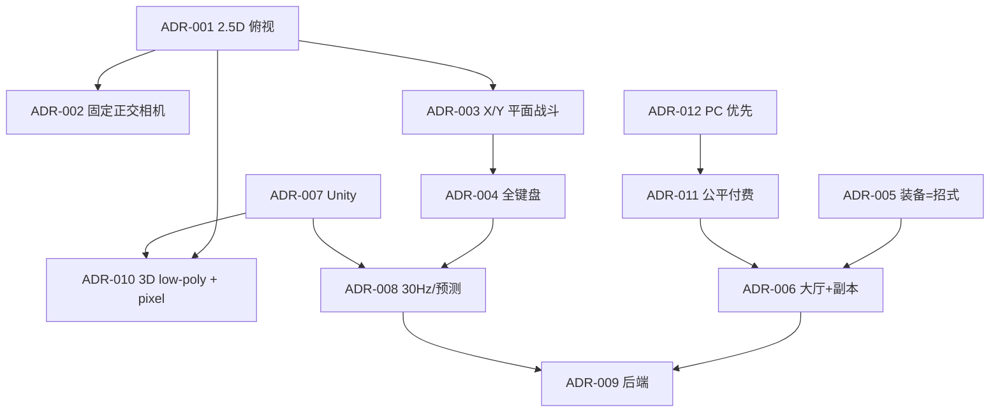

# 关键决策记录（ADR）索引

> 每条 ADR 的正文在 `docs/decisions/`。ADR 一旦 accepted，变更需新 ADR + Human 批准；旧 ADR 标 `superseded`，不删除。
>
> 本索引回答：我们做了哪些不可逆/高影响决策？为什么？代价是什么？什么时候复访？
>
> **批准记录**：Human 于 2026-10-17 批准修订版 3 计划（含 2.5D 俯视、全键盘、Unity/Fusion/Nakama、3D 像素路线等方向）；ADR-001–012 以此为方向批准。具体数字校准见 [DR-001](decisions/DR-001-baseline-0.1.2.md)（pending Human）；DR-001 item 14（AI-native 执行/成本模型）已于 2026-10-17 由 Human 确认；items 1–13 仍 pending。批准前 `docs/00` 0.2.0 仍为 draft。

---

## 1. 决策一览

| ADR | 决策 | 状态 | 影响范围 | 复访触发 |
|---|---|---|---|---|
| [ADR-001](decisions/ADR-001-2.5d-top-down.md) | 2.5D 斜俯视，而非真 3D 自由镜头 | accepted | 相机/战斗/美术/联网 | 原型手感/可读性不达标 |
| [ADR-002](decisions/ADR-002-fixed-orthographic-camera.md) | 固定 45–55° 正交相机，键盘缩放/平移、不旋转 | accepted | 相机/关卡/美术/UI | 可读性测试失败 |
| [ADR-003](decisions/ADR-003-xy-plane-combat.md) | X/Y 平面战斗，Z 轴仅跳跃/击飞/高低差 | accepted | 战斗/判定/联网 | 空战/高度不可读 |
| [ADR-004](decisions/ADR-004-keyboard-only-classic-layout.md) | 全键盘经典英豪布局；鼠标不参与战斗/镜头 | accepted | 输入/UI/QA/无障碍 | 键盘冲突/玩家反馈 |
| [ADR-005](decisions/ADR-005-equipment-as-moveset.md) | 装备=招式，不做固定职业 | accepted | 战斗/掉落/平衡/内容 | 平衡失控/新手门槛 |
| [ADR-006](decisions/ADR-006-lobby-channels-instances.md) | 大厅+频道+副本/竞技场，不做无缝大世界 | accepted | 世界/联网/服务器 | 人口/留存/技术验证 |
| [ADR-007](decisions/ADR-007-unity-6-lts.md) | Unity 6.3 LTS + URP | accepted | 客户端/工具/授权 | 许可/性能/团队变化 |
| [ADR-008](decisions/ADR-008-fusion2-30hz.md) | Fusion 2 Server Mode + 30Hz 基线 | accepted | 联网/服务器/成本 | 手感/成本/迁移触发 |
| [ADR-009](decisions/ADR-009-backend-stack.md) | Nakama + PostgreSQL/Redis + Agones/K8s | accepted | 账号/社交/经济/部署 | 扩展/成本/合规 |
| [ADR-010](decisions/ADR-010-3d-lowpoly-pixel.md) | 3D 低多边形+像素贴图，不做 voxel/2D billboard | accepted | 美术/管线/预算 | 风格测试/成本 |
| [ADR-011](decisions/ADR-011-f2p-cosmetics.md) | F2P + 外观/战令/创始人包，不卖属性 | accepted | 商业/经济/口碑 | 收入/规模/Human 改向 |
| [ADR-012](decisions/ADR-012-pc-steam-first.md) | PC/Steam 优先，全球先发、国服后置 | accepted | 平台/区域/发行 | 国服/主机/合规变化 |

---

## 2. 决策之间的关系

**关键依赖**：
- 没有 2.5D/全键盘，就不需要这套 30Hz/软锁定/键盘冲突设计。
- 没有装备=招式，就不需要 12 核心/20 防具/数据驱动招式管线。
- 没有公平付费，就需要重做经济/掉落/赛季激励。

---

## 3. 新 ADR 流程

1. 提案人写 `docs/decisions/ADR-###-slug.md`（用 `_templates/adr.md`）。
2. 标 `proposed`；在 `docs/07` 关联 REQ，在 `docs/backlog.md` 建 TASK。
3. Tech Lead/Product Lead 评审；高风险需 Human。
4. 通过后标 `accepted`，更新本索引、`docs/00`、追踪矩阵。
5. 旧 ADR 标 `superseded`，写替代关系；不删除。
6. 变更后同步受影响的 PRD/TDD/美术/任务。

**禁止**：
- 无 ADR 的不可逆架构变更。
- 在草稿里“顺手改”基线。
- 删除历史 ADR。

---

## 4. ADR 质量检查

- [ ] 背景/约束清楚
- [ ] 至少 2 个选项，含优缺点/风险
- [ ] 决策明确
- [ ] 后果（正面/负面/跟进）
- [ ] 复访触发条件
- [ ] 关联 REQ/影响范围
- [ ] 来源/证据
- [ ] Human 批准（高风险）

---

## 5. 待决策（未来）

| 主题 | 为什么现在不定 | 触发 |
|---|---|---|
| 是否支持手柄/主机 | 先 PC/键盘验证；1.0 不强制手柄 | post-1.0/平台合作 |
| Baseline 0.1.2 变更（DR-001） | 起草期一致性修正；待 Human 批准 | 批准后冻结/转 ADR-013 |
| 技术验证后基线修正（DR-002） | 相机 1.8m/yaw 45°/14m 指示；C+X vs 必杀优先级；格挡 150ms/cap200/0.5 tick；键盘 QA | **approved 2026-10-18**；已同步 00/02/03/04/07 + ADR-002/004/008；B6 真实键盘 QA 仍 open |
| UGC 编辑器/市场细节 | 先做皮肤，S2 再评估 | 1.0 后 |
| 国服发行商/版号 | 先全球 | 国服计划 |
| 是否用 Hiro | 先 Nakama 核心，评估许可 | 后端原型 |
| 60Hz 排位 | 先 30Hz 验证 | 排位测试 |
| 是否引入 AI NPC/生成内容 | 另立专题 | 产品需求 |
| 电竞赛事投入 | 先社区赛事 | 1.0 后 |
