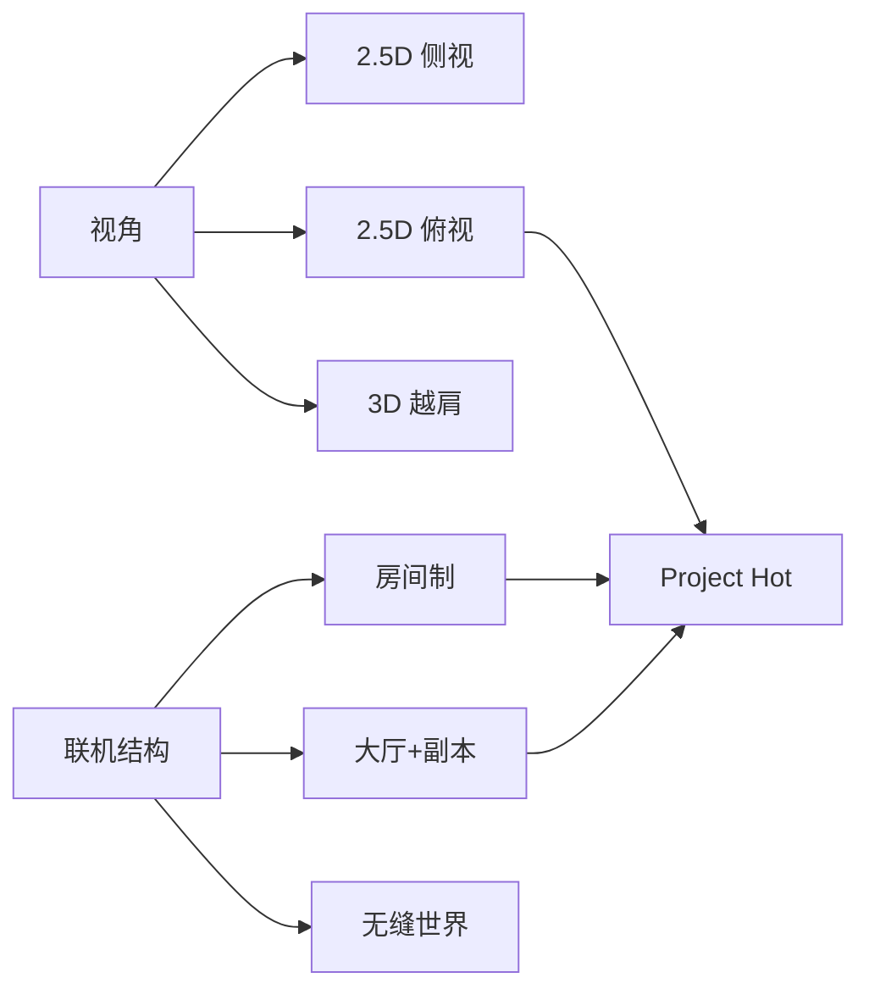

# 竞品调研与机会分析

> 用途：为 `docs/01` 提供可评审草稿；为 PRD 提供「吸收/避免」清单。
> 数字与范围以 `docs/00` 为准；本文只做竞品事实、推断与设计启示，不写 PRD/TDD 细节。
> 标注：句末 S 编号=可核对来源；`【推断】`=作者分析；`【待核实】`=无一手来源或存在版本/地区差异。

---

## 1. 结论摘要

### 1.1 机会窗口

**2.5D 俯视动作 MMO 的结构是成熟的，但「装备=招式 + 全键盘 ZXCV + 3D 像素 + 公平付费」的组合仍是空位。**

- 2.5D 俯视有 Lost Ark、Ragnarok Online、Tree of Savior 三个长线样本，证明斜俯视足以承载副本、RAID、PvP 与社交；但三者分别是「职业+技能树」「点击/技能条」「职业+Build」，都不是「一件装备换一套招式」。
- 侧视读招品类（热血英豪、热斗传说、Lost Saga、GetAmped 2）证明了 ZXCV 式低门槛读招与房间制 PvP 的生命力，却反复被 P2W、英雄/装备膨胀、代理迁移和画面老化拖累。
- 单机俯视动作（Diablo III/IV、Hades）证明了地面预警、冲刺 i-frame、房间节奏的可读性上限，但它们不承担 MMO 的长线经济与社交。

因此，机会不是「再做一款俯视 MMO」，而是把侧视品类的读招操作移植到俯视战场：让 ZXCV 的距离/朝向/硬直判断在 360° 战场上成立，同时用 MMO 的副本与社交承接长线。这件事没人做成，是因为它同时要求动作、联网、内容管线三条能力，而不是只换一个镜头。

一句话定位：**用 2.5D 俯视解决「看得清」，用全键盘 ZXCV 解决「读得懂」，用装备=招式解决「更新得起」，用公平付费解决「留得住」。**

### 1.2 三条最重要的教训

| # | 教训 | 关键证据 | 对本项目的含义 |
|---|---|---|---|
| 1 | 护城河是「装备=招式」的内容管线，不是视角或美术 | 热血英豪运营二十余年，靠周更武器/月更职业与皮肤编辑器形成内容管线（S05、S03）；Lost Ark 用职业+三脚架+卡牌维持更新（S14、S15） | 1.0 的 8 武器/12 核心必须共用骨架、招式表、数值曲线；管线成本决定赛季节奏 |
| 2 | 公平付费是长线生死线，技巧游戏一旦卖强度就会失去技巧用户 | 热血英豪「倒闭装」无保底、带霸体，技巧玩家被数值碾压，新人断流（S05）；Lost Ark 订阅档可选增益含 +1600 武器攻击等（S16）；Lost Saga 商城直售永久英雄与 +10 武器包（S12） | 不卖属性、不抽强度、不做霸体特权；PvP 归一化；外观/战令/创始人包是收入主渠道 |
| 3 | 人口结构决定匹配，房间制/分区/换代理会把人口切碎 | Lost Saga NA 2019-09-13 停运（S12）；热斗传说多次更换发行商（S10，待核实）；GetAmped 2 日服于 2020 年停运（S07） | 单一大服+频道+4/8 人副本+可合流活动；账号连续、不轻易换代理/分区 |

三条教训对应三条硬约束：管线先于美术、公平先于收入、结构先于内容量。任何一条被违反，短期数据可能好看，长期一定回到「卖强度—人口跌—停更」的循环。这也解释了为什么本项目把「装备=招式」写进 ADR-005、把「不卖属性」写进 ADR-011：它们不是道德选择，而是从竞品死因反推的生存条件。

---

## 2. 研究方法

### 2.1 样本选择

共 13 个档案（Diablo III/IV 合并为一条），按「机制相关性」而非热度选取：

| 类别 | 样本 | 选择理由 |
|---|---|---|
| 2.5D 侧视读招 | 热血英豪、Lost Saga、MapleStory | 直接对照 ZXCV/装备=招式/长线 IP |
| 3D 房间动作 | 热斗传说、GetAmped 2 | 对照「3D 化是否破坏读招」与多层 Build |
| 2.5D 俯视 MMO/ARPG | Lost Ark、Ragnarok Online、Tree of Savior、Diablo III/IV、Hades | 对照相机、预警、副本节奏、Build 深度 |
| 大厅+副本 | PSO2 NGS、Vindictus | 对照低人口抗性、4→12 合流、城镇→副本动线 |
| 美术/管线 | Hytale | 对照低多边形+像素贴图的可执行管线 |

补充参考（不入档案）：KurtzPel（只做竞技场导致 PvE 薄）、Naraka: Bladepoint（一条易读猜拳撑起 3D 近战），用于失败模式与读招设计的旁证。

反例样本用于校准边界：Trove（voxel+自由建造，美术辨识强、动作读招弱）、Dofus/Wakfu（2D 等距+回合制，俯视可读性强、实时动作弱）。它们提醒：差异本身不是机会，只有当差异能同时服务「读招、长线、公平付费」时才是。

### 2.2 来源与核验

- 优先级：**官方公告/官网/商店页 > 一手媒体（4Gamer 等）> 评测媒体 > 社区维基/论坛**。
- 官方页优先核对「日期、人数、模式、在售商品、相机/操作说明」；媒体评测只用于「体验评价」；社区资料只用于「现象存在」，不作唯一依据。
- 核验日期：2026-10-17。商店页、公告页会变动，引用时保留链接与页面标题。
- 在线人数、收入、留存无可靠公开数据，本文**不引用、不估算**；涉及「人口下降」只写可观察现象（停运、合服、讨论），不写具体数字。
- 来源冲突时按「官方 > 一手媒体 > 评测 > 社区」取舍；仍冲突则并列写出并标【待核实】，不取平均值、不编中间数。
- 本文只转述机制与公开数据，不复制竞品文案/资产/UI；竞品名称仅用于识别与评论。

### 2.3 标注规则

| 标注 | 含义 | 使用方式 |
|---|---|---|
| 有 S 编号 | 来源页可直接核对 | 句末附 S 编号；日期/人数以来源页为准 |
| 【推断】 | 作者基于机制与现象的分析 | 明确写「推断」，不冒充数据 |
| 【待核实】 | 版本/地区差异大，或无一手来源 | 不进入结论，只作风险提示 |

> 本文不单独写「【事实】」标签：句末有 S 编号即视为事实标注；无 S 编号的评价一律按【推断】处理，无法核实的写【待核实】。对无法打开的链接（如下线官网/停运页），以媒体转述+页面标题为据，并标【待核实】；不把搜索摘要当全文。

### 2.4 已知更正与局限

- **GetAmped 2 日期**：研究简报写「2010–2020、2020-06-04 停运」；4Gamer 记载日本服务 2008-11-06 上线、2020-08-27 结束（S07、S08）。本文以 4Gamer 为准；英文版 2020-06-04 停运**待核实**。
- **Ragnarok Online 相机**：简报写「固定相机」；官方指南明确支持鼠标旋转 360°、调俯仰、缩放（S19）。本文按官方记为「可旋转等距相机」，这恰好说明它是点击战斗而非动作战斗。
- **局限**：未做玩家访谈、未取得后台数据；区域服差异大；部分停运游戏官网已下线，只能依赖媒体/社区记录。

---

## 3. 品类地图

品类地图有两个轴：**视角**（决定可读性与操作映射）与**联机结构**（决定人口与内容节奏）。二者常被混为一谈。

| 品类 | 代表 | 相机/操作 | 优势 | 代价/风险 | 对本项目 |
|---|---|---|---|---|---|
| 2.5D 侧视 | 热血英豪、Lost Saga、MapleStory | 固定侧视；键盘/鼠标 | 剪影清楚、读招直观、下沉门槛低 | 纵深与绕后弱；3D 化易失去可读性 | 保留「读招」，改俯视补纵深 |
| 2.5D 俯视 | Lost Ark、RO、ToS、Diablo、Hades | 斜俯视；8 方向/点击/键鼠 | 战场信息密度高、适合副本与多人 | 遮挡/高度难读；鼠标相机与动作冲突 | **主赛道**；固定相机+高度规则 |
| 3D 越肩 | Vindictus、PSO2 NGS | 第三人称；键鼠/手柄 | 沉浸、Boss 演出强 | 镜头与锁定成本高；键盘-only 难 | 不采用；只借副本动线 |
| 房间制 | 热血英豪、热斗传说、GetAmped 2、Lost Saga | 大厅→房间→开局 | 开局快、社交强、规则可控 | 人口碎片化、等待时间长 | 保留竞技场房间；副本用匹配 |
| 大厅+副本 | PSO2 NGS、Vindictus、Lost Ark | 城镇/柜台→任务→副本 | 抗低人口、内容可分层 | 动线长、主城空置 | **采用**；大厅+频道+4/8 人 |

三类视角的取舍：3D 越肩沉浸感最强，但镜头/锁定/键位复杂度与「全键盘、无鼠标镜头」直接冲突；2.5D 侧视读招最清楚，但绕后、高低差、多人混战的空间表达弱；2.5D 俯视在两者之间——用固定相机换可预测性，用高度规则换立体感。选俯视不是因为它更「高级」，而是因为它让键盘-only 与 8 方向读招同时成立。

联机结构同理：纯房间制开局快，但非高峰时段容易空房；无缝世界有沉浸感，但 12–18 人团队无法承担内容密度与服务器成本；大厅+频道+副本是折中——用频道维持「有人在」的感觉，用副本保证密度，用合流/定时活动兜底低人口。

**空位判断【推断】**：侧视读招品类有「操作深度」但缺「俯视战场与 MMO 内容」；俯视 MMO 有「内容结构」但缺「装备=招式的读招操作」。把两者的强项拼起来、并把付费从强度改成外观，是本项目的机会窗口。这也是为什么我们不把「像素」本身当卖点，而把它当作降低资产成本、提高辨识度的手段。

---

## 4. 竞品档案

> 每款按「视角/相机、操作、战斗、装备/Build、联机结构、商业化、优点、失败/风险、启示」九项压缩。未附 S 编号的评价均为【推断】。

### 4.1 热血英豪 GetAmped（CyberStep，2002 年起，待核实）

- **视角/相机**：2.5D 侧视，3D 角色与场景（S05）；镜头不参与瞄准【推断】。
- **操作**：方向键移动；Z 瞄准、X 强攻、C 弱攻、V 跳；C+X 防御、Z+X/C 特殊、Z+X+C 必杀、双击方向冲刺（历史操作表，转引自项目简报；现行官方指南未列完整键位，**待核实**）。
- **战斗**：读招、连段、防御、投技/背摔、浮空、地形机关；胜负高度依赖距离与出招时机（S05）。
- **装备/Build**：一件装备=一套招式+必杀；官方现有 12 个基础风格（格斗家、军人、间谍、超人、装甲、超能力者、未来力士、宇宙刑警、人造人、忍者、小鬼、兽人）加精英/宿敌风格（S02）；外观与招式分离；皮肤编辑器支持头/眼/鼻/口/体/饰品模块、666 个停格动作、10 种动画与 `.skin` 文件（S03）。
- **联机结构**：大厅/频道+房间 PvP，另有挑战 PvE（S04）；周更武器、月更职业（S05）；2007 年起举办世界大会，巅峰期 11 国参与（S05）。
- **商业化**：F2P+道具；后期出现仅抽奖、无保底的「倒闭装」，带霸体等特权，售价可达数千至万元级，技巧玩家被数值碾压（S05）；官方站另设「アンプドガチャ」入口（S13，页面显示准备中）。
- **优点**：装备=招式的内容管线极强；皮肤 UGC 形成表达与社区；ZXCV 低门槛、读招上限高。
- **失败/风险**：强度抽奖、霸体特权、强化/徽章叠加、外挂与维护事故、老手壁垒导致新人断流（S05；社区记录另见 S06，**待核实**）。
- **启示**：保留「装备=招式+ZXCV」，但必须把「强度获取」从付费与抽奖中剥离；外观 UGC 可以做，但要有审核与版权机制。

### 4.2 热斗传说 Rumble Fighter（Nimonix，2007 年起，待核实）

- **视角/相机**：3D 房间竞技场，自由移动与镜头（S10、S11）。
- **操作**：键盘为主、房间内近战；具体键位与镜头控制**待核实**。
- **战斗**：连招、投技、变身/圣卷技能；节奏偏快，强调浮空与追打（S11，媒体评测）。
- **装备/Build**：职业（Job）+圣卷（Sacred Scroll，变身/招式）+外核（ExoCore，属性/被动）三层；层数越多，组合与平衡面越大（S10）。
- **联机结构**：8 人房间、多 PvP 模式，另有波次/Boss/生存类 PvE（S10，**待核实**具体模式）。
- **商业化**：商城出售属性与独占连招的争议长期存在；发行商多次更替（OGPlanet→GamesCampus→Redfox），账号与社区迁移造成流失（S10，**待核实**年份）。
- **优点**：三层 Build 提供高表达；房间制开局快；PvP 模式丰富。
- **失败/风险**：层数越多，平衡与付费越难；换代理导致账号连续性与社区信任受损；地区服多已关停（**待核实**）。
- **启示**：Build 层数控制在 2–3 层（武器+核心+防具/符文），不做「职业+圣卷+外核」式叠床架屋；单一大服、账号不随代理迁移。

### 4.3 GetAmped 2（CyberStep，2008–2020）

- **视角/相机**：3D 场景与角色，最多约 20 人（项目简报；4Gamer 未给人数，**待核实**）。
- **操作**：3D 自由移动+键盘出招；媒体评测认为镜头不直观、操作门槛高（转引自研究简报，**待核实**）。
- **战斗**：保留系列读招与连段，但 3D 化后距离/朝向判断变难；PvE 有 Mega Force/Arcade，PvP 有 Deathmatch/Dogfight/Tournament（简报，**待核实**）。
- **装备/Build**：职业/装备+自定义皮肤；强度与外观并行（S08）。
- **联机结构**：房间制，最多约 20 人；大厅/频道。
- **商业化**：F2P+道具；后期被指 P2W（简报，**待核实**）。
- **运营状态**：日本服务 2008-11-06 上线，2020-08-27 结束；停运前停止新注册与付费点销售（S07、S08、S09）。
- **优点**：证明了系列 IP 与自定义皮肤的可迁移性；PvE 模式尝试早。
- **失败/风险**：3D 化牺牲了侧视的读招清晰度；镜头/操作门槛劝退；被指 P2W 与内容老化叠加（**待核实**）。
- **启示**：视角改动必须服务「读招」而不是「看起来更 3D」；20 人规模对动作可读性是负担，4/8 人更合适。

### 4.4 Lost Saga（IO Entertainment，2009 年起，待核实）

- **视角/相机**：3D 横版，侧视战场，可换线/换英雄（S12）。
- **操作**：键盘移动/攻击，实时切换英雄（常用 1–0 等快捷键）；换人需该英雄装备齐全（简报，**待核实**）。
- **战斗**：英雄专属招式与必杀，不同英雄必杀可串连；强调浮空与换人连段（简报）。
- **装备/Build**：英雄×四件装备×强化×宠物×时装，多层成长（简报）。
- **联机结构**：房间制 PvP/PvE；NA 由 Smilegate West 运营（S12）。
- **商业化**：商城直售永久英雄、+10 武器包、随机装备胶囊等；2015 年公告以 ZP 计价（S12）。
- **运营状态**：NA 服务 2019-09-13 关闭（S12）；韩服等地区仍在运营（**待核实**）。
- **优点**：换英雄带来极高角色表达与组合深度；横版读招清晰。
- **失败/风险**：英雄/装备双膨胀，新人组不出可用阵容；收集变成入场券；NA 因「无法维持期望质量」停运（S12）。
- **启示**：收集不能成为入场券；提供租用/统一数值的竞技模式；英雄/装备数量要与新手引导同步。

### 4.5 Lost Ark（Smilegate RPG，2019 年起，待核实）

- **视角/相机**：2.5D 斜俯视、8 方向移动（S14）；固定视角、不可自由旋转（公开资料，**待核实**）。
- **操作**：键鼠；移动+技能键，冲刺/闪避；无鼠标瞄准的硬性依赖（S14）。
- **战斗**：动作 ARPG 式技能循环、Boss 地面预警、机制分工；RAID 多阶段（S14）。
- **装备/Build**：职业+技能三脚架（每技能三层自定义）+装备强化/刻印+卡牌（900+ 张，S15）；成长以垂直强化为主（**推断**）。
- **联机结构**：大厅/频道+4 人副本+8 人 RAID+1v1/3v3 PvP（S14）。
- **商业化**：F2P；Crystalline Aura Plus 订阅含便利与可选限时增益（如武器攻击 +1600、攻速/移速 +5%，或 HP/治疗、防御加成，S16）；创始人包含水晶、金币、材料（S16）；官方 FAQ 提供随机商品概率查询（S17）。
- **优点**：2.5D 俯视的可读性与演出上限被验证；RAID 机制与预警成为品类标准；多阶段演出适合直播/短视频传播；内容量支撑长线。
- **失败/风险**：垂直强化+日常/周常形成进度压力；订阅带增益与材料包引发「付费加速」争议；新手追进度成本高；Bot/经济问题长期存在（**推断**）。
- **启示**：借相机、预警、RAID 结构与副本节奏；**不借**订阅增益、强化军备竞赛与「不肝就掉队」的进度设计。

### 4.6 Ragnarok Online（Gravity，2002 年起，待核实）

- **视角/相机**：2.5D 等距俯视；官方指南支持鼠标旋转 360°、调俯仰、缩放（S19）。
- **操作**：鼠标点击移动/攻击+键盘快捷键（F1–F9 技能/道具等，S20）；无动作闪避。
- **战斗**：数值/技能/属性克制为主，站位与技能循环为辅；GvG 以人数与职业配比为核心（S18）。
- **装备/Build**：职业树+属性点+技能点+卡片/精炼；Build 深度来自长期积累（**推断**）。
- **联机结构**：服务器城镇/野外+组队+公会；WoE 每周两次、20 座城堡（S18）。
- **商业化**：F2P+现金商城（Kafra Shop）/VIP（S19 页面导航可见）。
- **优点**：社交/GvG 结构极稳；卡片、公会与攻城战提供长期目标；美术辨识度高；20 余年长线。
- **失败/风险**：画面与操作老化；外挂/私服/版本碎片；鼠标相机与点击战斗无法满足动作手感。
- **启示**：学它的社交/GvG 长线与「一座城养一个公会」的目标感；**不学**鼠标相机与点击战斗——这正是我们要用固定相机+全键盘替换的部分。

### 4.7 Tree of Savior（IMCGAMES，2016 年起，待核实）

- **视角/相机**：2.5D 斜俯视（S21）；固定/半固定相机【推断】；键鼠。
- **操作**：鼠标移动/指向+键盘技能；动作性弱于 Lost Ark（**推断**）。
- **战斗**：职业/技能组合、地面 AOE、队伍配合；Build 深度高（S21）。
- **装备/Build**：多职业树+技能加点+装备/宝石；官方称经历 Re:Build 大规模重构（S21）。
- **联机结构**：频道+队伍+副本+PvP；队伍规模**待核实**。
- **商业化**：F2P+TP 现金包；当前官方公告在售包含强化材料、副本入场券、装备收集箱等进度类商品（S21）。
- **优点**：Build 深度与职业数量形成差异化；美术风格统一。
- **失败/风险**：职业/技能平衡与内容重复导致人口下滑（社区讨论 S22，**待核实**）；付费包卖进度材料，削弱「技巧」叙事。
- **启示**：Build 深度必须配「推荐 Build/洗点/训练场」；不要用现金包卖强化材料与入场券。

### 4.8 Diablo III / IV（Blizzard）

- **视角/相机**：3D 俯视/等距（S23、S24）；固定角度为主【推断】。
- **操作**：键鼠/手柄；移动+技能+闪避（D4 有 evade）。
- **战斗**：技能循环、精英词缀、地面预警、Boss 阶段；D4 区分赛季/永恒领域（S24）。
- **装备/Build**：职业+技能树+传奇/暗金+词缀；D4 有淬炼/精造等长期追求（S24）。
- **联机结构**：单机为主+最多 4 人组队；开放世界分区（S24）。
- **商业化**：买断+资料片+外观/赛季通行证（S24）。
- **优点**：俯视动作的可读性标杆；预警、精英词缀、掉落反馈成熟。
- **失败/风险**：数值膨胀/赛季重置/单机社交弱；不适合直接做 MMO（**推断**）。
- **启示**：只借「动作可读性」——地面预警、精英词缀、冲刺/闪避、房间节奏；不借数值膨胀与赛季清零。

### 4.9 Hades（Supergiant Games）

- **视角/相机**：俯视 2.5D（S25）；固定/轻度跟随【推断】。
- **操作**：手柄/键鼠；攻击+特殊+冲刺+投掷。
- **战斗**：房间制遭遇、冲刺 i-frame、祝福（Boon）组合、Boss 阶段（S25）。
- **装备/Build**：武器+祝福+饰品，局内构建、局外解锁（**推断**）。
- **联机结构**：单机。
- **商业化**：买断。
- **优点**：房间节奏与「每局都有新组合」的 Build 表达；预警与冲刺反馈极清晰。
- **失败/风险**：Roguelike 重置与单机结构不适合 MMO 长线（**推断**）。
- **启示**：借「房间节奏+冲刺无敌帧+祝福式 Build 组合」；不借重置与单机。

### 4.10 PSO2: New Genesis（SEGA，2021 年起，待核实）

- **视角/相机**：3D 越肩/第三人称，动作战斗（S26）。
- **操作**：键鼠/手柄；连段+PA/技能+闪避。
- **战斗**：动作连段、Boss 部位破坏、多人协战（S26）。
- **装备/Build**：职业/武器/单元/技能；养成线多（**待核实**）。
- **联机结构**：大厅+任务柜台；4 人队伍，可合流至多人区/紧急任务（PSO2 经典版官方公告提到 12 人，NGS 当前上限**待核实**）；定时活动聚人（S26、S27）。
- **商业化**：AC 抽奖（scratch）+外观+便利（**待核实**）。
- **优点**：低人口抗性强；4→12 合流与定时事件制造「服务器有事发生」的感觉；定时紧急任务提供明确的登录理由。
- **失败/风险**：开放区域内容密度不足、更新节奏慢；3D 越肩对键盘-only 不友好（**推断**）。
- **启示**：大厅+副本+合流+定时活动，是抗人口波动的结构性方案；我们以 4/8 人副本+频道事件实现。

### 4.11 Vindictus（Nexon，2010 年起，待核实）

- **视角/相机**：3D 越肩，动作战斗（S28）。
- **操作**：键鼠；轻重击+闪避+抓取/投技。
- **战斗**：Boss 战为主，强调走位、闪避与部位；副本短局（**推断**）。
- **装备/Build**：职业/武器/防具+强化；强化等级是长期追求（简报，**待核实**）。
- **联机结构**：城镇→码头→4 人副本/RAID（S28）。
- **商业化**：F2P+外观/便利/强化相关道具；疲劳值与强化成功率是长期争议点（简报，**待核实**具体数值）。
- **优点**：城镇→码头的动线清晰；4 人 RAID 的演出与配合强。
- **失败/风险**：疲劳限制与强化赌博与「技巧」叙事冲突；内容更新依赖赛季（**推断**）。
- **启示**：借「城镇→副本入口→4 人 RAID」动线；去掉疲劳与强化破碎，改成不破碎的横向成长。

### 4.12 MapleStory（Nexon，2003 年起）

- **视角/相机**：2D 横版像素，固定侧视（S29、S30）。
- **操作**：键盘为主；移动/跳跃/技能。
- **战斗**：平台跳跃+技能刷怪+Boss 机制；动作性低于英豪类（**推断**）。
- **装备/Build**：职业+技能+装备潜力/卷轴/星力等长期养成（**待核实**具体系统版本）。
- **联机结构**：频道/服务器+组队+公会+Boss 匹配。
- **商业化**：F2P+现金商城（时装/宠物/便利/概率道具）；外观是核心收入（**推断**）。
- **优点**：强剪影与装备辨识；20 年 IP/活动/时装复利；像素美术的长线生命力。
- **失败/风险**：数值膨胀、肝度、概率道具争议；不适合直接复制其养成深度。
- **启示**：学「剪影/装备辨识/长线活动」，不学「数值膨胀/概率道具」。

### 4.13 Hytale（Hypixel Studios，2026 EA）

- **视角/相机**：3D 第一/第三人称，低多边形+像素贴图（S31）。
- **操作**：键鼠；动作战斗+建造。
- **战斗**：动作+沙盒；官方称 Early Access 聚焦探索、响应式战斗、建造（S32）。
- **装备/Build**：沙盒装备/建造；非 MMO 式 Build（**推断**）。
- **联机结构**：玩家自建服务器+官方服务器（后续）；UGC/小游戏（S32）。
- **商业化**：买断制 Early Access（S31）。
- **优点**：Blockbench 建模/动画管线成熟；低多边形+像素贴图可量产；UGC 生态强（S32）。
- **失败/风险**：沙盒与 MMO 结构差异大；美术管线参数（如 64px/32px per unit、无 PBR）来自研究简报，官方页未给具体数值（**待核实**）。
- **启示**：3D 低多边形+像素贴图是可行管线；用 Blockbench 做资产与动画；UGC 工具从第一天就按「可审核、可分成」设计。

---

## 5. 横向矩阵

> 缩写：房=房间制；厅=大厅+副本；固=固定相机；旋=可旋转；越=越肩；横=横版。人数为公开资料/简报，标 `?` 者**待核实**。

| 竞品 | 视角/相机 | 操作 | 装备层数 | PvP 规模 | PvE | 联机结构 | 美术 | 商业模式 | 运营状态 |
|---|---|---|---|---|---|---|---|---|---|
| 热血英豪 | 2.5D 侧视/固 | 方向键+ZXCV | 装备=招式（1 层+风格） | 房间? | 挑战 | 房+频道 | 卡通 3D | F2P+道具/抽奖 | 运营中（小体量） |
| 热斗传说 | 3D 房间 | 键盘（?） | 职业+圣卷+外核（3 层） | 8 人 | 波次/Boss | 房 | 3D 卡通 | F2P+属性争议 | 多数地区停运（?） |
| GetAmped 2 | 3D（?） | 键盘（?） | 职业/装备+皮肤 | 约 20 人（?） | Mega Force/Arcade | 房 | 3D 卡通 | F2P+道具（P2W 争议） | 2020 停运 |
| Lost Saga | 3D 横版 | 键盘+换英雄 | 英雄×4 装备×强化×宠物×时装 | 房? | 有 | 房 | 3D 卡通 | F2P+英雄/装备直售 | 韩服运营?；NA 2019 停运 |
| Lost Ark | 2.5D 俯视/固 | 键鼠 8 方向 | 职业+三脚架+装备+卡牌 | 1v1/3v3 | 4 人副本/8 人 RAID | 厅+频道 | 2.5D 写实卡通 | F2P+订阅/礼包/概率 | 运营中 |
| RO | 2.5D 俯视/旋 | 鼠标点击+快捷键 | 职业+属性/技能+卡片/精炼 | WoE 大规模 | 野外/副本 | 厅+野外 | 2.5D 像素 | F2P+商城/VIP | 运营中 |
| ToS | 2.5D 俯视/半固 | 键鼠 | 多职业树+技能+装备 | 有（?） | 副本 | 厅+频道 | 2.5D 卡通 | F2P+TP 进度包 | 运营中 |
| Diablo IV | 3D 俯视/固 | 键鼠/手柄 | 职业+技能+传奇/词缀 | 无 MMO PvP | 单机/4 人 | 单机+组队 | 3D 写实 | 买断+资料片+通行证 | 运营中 |
| Hades | 俯视 2.5D | 手柄/键鼠 | 武器+祝福 | 无 | 房间 Roguelike | 单机 | 2D/3D 手绘 | 买断 | 已发售 |
| PSO2 NGS | 3D 越肩 | 键鼠/手柄 | 职业/武器/单元 | 有（?） | 4/12 人任务（?） | 厅+合流 | 3D 动漫 | F2P+AC 抽奖（?） | 运营中 |
| Vindictus | 3D 越肩 | 键鼠 | 职业+装备+强化 | 无（?） | 4 人 RAID | 厅+码头 | 3D 写实 | F2P+便利/强化 | 运营中 |
| MapleStory | 2D 横版 | 键盘 | 职业+装备潜力/星力 | 有（?） | 刷怪/Boss | 频道+组队 | 2D 像素 | F2P+时装/概率 | 运营中 |
| Hytale | 3D 低多边形 | 键鼠 | 沙盒装备 | 服务器 PvP | 探索/小游戏 | 玩家服务器 | 低多边形+像素 | 买断 EA | 2026 EA |

**读矩阵的三点【推断】**：

1. 「2.5D 俯视+固定相机」的样本（Lost Ark/ToS/Diablo）都活下来了，但它们的操作是「技能栏/键鼠」，不是 ZXCV 读招；这正是空位。
2. 「装备=招式」的样本（英豪/Lost Saga）都因「收集+强化+付费膨胀」把技巧游戏变成数值游戏；我们必须在系统层切断这条路径。
3. 「大厅+副本」比「纯房间」抗人口；但大厅必须有事可做（交易/公会/训练/定时活动），否则主城空置。

矩阵的读法：不要横向比「谁内容多」，要比「谁的循环更抗人口、抗断供」；内容量可以后来补，结构与付费一旦错了很难改。

对 Project Hot 的三条直接结论：①竞技场保留房间制，但副本必须匹配+跨频道；②大厅要设计「无事可做也有事可做」的轻社交（训练场/木桩/外观展示）；③常规战斗以 4 人为最小单位、8 人为上限，16 人仅用于技术验证/特殊模式，避免 20 人房的可读性灾难。

---

## 6. 失败模式

| 失败模式 | 机制 | 证据 | 预防设计 |
|---|---|---|---|
| P2W | 卖属性、卖独占连招、抽奖无保底、霸体特权 | 英豪「倒闭装」（S05）；Lost Ark 订阅增益（S16）；Lost Saga 永久英雄/+10 武器包（S12）；ToS 进度包（S21） | 只卖外观/战令/创始人包；PvP 归一化；概率公示且不做强度抽奖 |
| 内容断供 | PvE 太薄、更新慢、只做竞技场 | KurtzPel（简报）；ToS 人口下滑（S22，待核实）；Lost Ark 垂直强化拉长内容寿命（推断） | 8–15 分钟副本+赛季节奏；1.0 4 副本/5 Boss；每季 1 副本/1 核心 |
| 人口碎片化 | 分区、房间、频道过多、匹配阈值 | Lost Saga NA 停运（S12）；GetAmped 2 大房间/停运（简报，待核实；S07）；热斗传说地区服关停（S10，待核实） | 单一大服+频道；4/8 人小房；跨频道组队；低人口合流/定时活动 |
| 代理断层 | 换发行商、账号迁移、社区割裂 | 热斗传说三易代理（S10，待核实）；英豪国服代理（S05） | 自研自发/长期发行绑定；账号全局唯一；不轻易分区 |
| 新手壁垒 | 老手技巧+收集门槛+系统复杂 | 英豪老手内卷、新人断流（S05）；Lost Saga 阵容门槛（简报）；ToS 多职业树门槛（S21；推断） | 训练场/指令表/推荐 Build/租用核心；新手保护匹配 |
| 外挂/经济崩 | 客户端权威、复制/脚本、随机箱套利 | 英豪社区记录外挂与维护事故（S06，待核实）；Lost Ark Bot 问题（推断） | 服务器权威；输入校验；回放审计；双录账本；拍卖税 |
| 技术债/画面老化 | 老引擎、维护事故、数据回滚 | 英豪 55 小时维护/数据回滚（S06，社区记录，待核实）；GetAmped 2 停运（S07） | 新引擎+数据驱动；灰度/回滚；资产管线预算；不堆历史包袱 |

**共同死因链【推断】**：卖强度 → 技巧用户流失 → 只剩付费/老手 → 新人被碾压 → 匹配人口跌破阈值 → 内容更新摊薄 → 停运/换代理。打断链条的两个关键点是「不卖强度」与「新手可进入」。

三个可观测阈值（建议值，待原型验证）：①匹配等待长期超过 90 秒，房间制开始空转；②同一分段内「必选装备/英雄」超过 2 件，新手开始被排除；③赛季内容消耗速度快于产出 1.5 倍，更新开始断供。三者任一出现，应先调结构与产出，而不是加付费点。

对应的技术/运营护栏：服务器权威+回放审计防外挂；双录账本+拍卖税防经济崩；数据驱动+灰度发布防技术债；每个赛季预留固定产能做平衡与修复，而不是全部排新内容。外挂的根源是客户端权威与收益闭环；只要伤害/掉落/交易在服务器判定，外挂的收益就被压缩。

---

## 7. 机会定位

**定位句**：2.5D 俯视 + 装备=招式 + 全键盘 ZXCV + 3D 像素 + 公平付费 + PvE/PvP 双循环 + UGC（后期）。

| 要素 | 为什么是机会 | 风险/前提 |
|---|---|---|
| 2.5D 俯视 | 解决侧视纵深不足，保留战场信息密度；固定相机让键盘操作可预测 | 遮挡/高度必须规则化；相机不能自由旋转 |
| 装备=招式 | 内容管线可模块化；一件核心=一种打法；老玩家认知直接迁移 | 平衡组合爆炸；需要模拟/赛季调参 |
| 全键盘 ZXCV | 与英豪老玩家肌肉记忆一致；无鼠标依赖；直播可读 | 键位冲突/键盘 rollover；需要重映射与 QA |
| 3D 像素 | 低多边形+像素贴图可量产；与 2D 像素 IP 形成辨识 | 斜俯视下剪影/装备辨识；风格测试先行 |
| 公平付费 | 把「技巧」重新变成核心资产；外观/战令可长线 | 收入模型需验证；不能暗中卖进度 |
| 双循环 | PvE 供内容/掉落，PvP 供技巧/赛季；互相导流 | PvE 不能太薄；PvP 不能只有硬核 |
| UGC（后期） | 皮肤/招式组合/赛事延长寿命 | 审核/版权/分成/税务；不能影响强度 |

为什么是现在：①PC 端 2.5D 动作 MMO 在 Lost Ark 之后形成稳定用户心智；②低多边形+像素贴图管线（Blockbench/Unity）把角色与装备成本压到小团队可承受；③玩家对抽卡/卖强度的疲劳达到高点，公平付费成为差异化；④直播/短视频需要「一眼看懂」的读招，ZXCV 的按键叙事天然适合传播。

护城河的顺序：先有「装备=招式的管线」，再有「赛季/赛事的内容节奏」，最后才是 UGC 与 IP。反过来做（先堆美术、先做开放世界）会重蹈「内容断供/人口碎片」的覆辙。不做无缝开放世界，是为了把有限产能集中在副本/竞技场/大厅三类可复用场景。

目标用户的迁移路径：英豪老玩家因为「外挂/倒闭装/没人」离开，先被「ZXCV 手感+公平付费」召回；俯视 MMO 玩家因为「操作太站桩/Build 太固定」离开，被「一件核心换一种打法」吸引；像素/低多边形玩家被美术辨识吸引，再用赛季与 UGC 留下。

**不成立的条件【推断】**：若 2.5D 固定相机在原型中无法支撑「绕后/高低差/击飞」的读招；若 ZXCV 在 100ms/2% 丢包下无法稳定连段；若外观收入无法覆盖服务器与内容成本——三者任一不成立，需要回到 ADR 复评，而不是加卖属性。

---

## 8. 20 条「吸收/避免」

> 对应 PRD 章节为 `docs/07` 规划的落点（02 §2.5/§2.6/§3/§4/§9/§11），合并后由 PRD Lead 复核。REQ 为追踪矩阵现有 ID。

| # | 来源教训 | 决策 | 落到 PRD 的具体系统 | REQ |
|---|---|---|---|---|
| 1 | 英豪靠装备=招式形成内容管线（S02、S05） | 吸收：武器原型+战斗核心共用骨架/招式表/数值曲线 | 02 §3 装备与 Build；数据驱动招式 | REQ-CBT-001 |
| 2 | 英豪后期数值碾压（S05） | 吸收：传说给独特机制，不给纯数值；强度横向 | 02 §3 稀有度/掉落 | REQ-CBT-005 |
| 3 | Lost Ark 订阅带增益（S16） | 避免：不卖属性、不卖强化材料、不抽强度 | 02 §11 商业化；商城清单 | REQ-BIZ-001 |
| 4 | 英豪「倒闭装」无保底（S05） | 避免：不做无保底强度抽奖；概率公示 | 02 §11 商业化/抽奖规则 | REQ-BIZ-001 |
| 5 | 英豪霸体特权（S05） | 避免：不做霸体类机制特权；用防御/完美格挡替代 | 02 §2 战斗状态机 | REQ-CBT-002 |
| 6 | 英豪强化/徽章叠加（S05、S06） | 吸收：强化 +0–+10 不破碎；材料只来自 PvE | 02 §3 强化；经济产销 | REQ-CBT-005 |
| 7 | 英豪 ZXCV 低门槛高上限（S05） | 吸收：默认经典布局；Z 软锁定、C/X 轻重、V 跳 | 02 §2.6 全键盘 | REQ-CTL-001/002 |
| 8 | 英豪防御/投技/浮空猜拳（S05） | 吸收：防御锥、完美格挡、冲刺、投技、受身 | 02 §2 战斗通用规则 | REQ-CBT-002 |
| 9 | 英豪无限连/社区争议（S06） | 吸收：连段衰减、取消窗口、受身 | 02 §2 帧数据/伤害公式 | REQ-CBT-004 |
| 10 | 英豪/RO 相机差异（S19、S05） | 吸收+差异化：固定 45–55° 正交；不旋转；高度/遮挡规则 | 02 §2.5 相机；§8 关卡 | REQ-VIS-001/003 |
| 11 | Lost Ark/Hades 地面预警（S14、S25） | 吸收：Boss 预警、精英词缀、冲刺 i-frame | 02 §2/§4 副本机制 | REQ-CBT-002/MMO-002 |
| 12 | Hytale 低多边形+像素管线（S32；参数见简报，待核实） | 吸收：Blockbench 管线、模块化资产、贴图内光影 | 02 §9 美术；04 管线 | REQ-ART-002/003 |
| 13 | Lost Ark/PSO2 副本节奏（S14、S26、S27） | 吸收：4 人 8–15 分钟；RAID 15–25 分钟；赛季增量 | 02 §4 副本；§12 路线图 | REQ-MMO-002 |
| 14 | PSO2/Vindictus 大厅+副本（S26、S28） | 吸收：城镇大厅+频道+匹配；不做无缝大世界 | 02 §4 MMO 结构 | REQ-MMO-001 |
| 15 | PSO2 系 4→多人合流/定时活动（S26、S27） | 吸收：4/8 人房+频道事件/世界 Boss；低人口合流 | 02 §4 野外/事件；匹配 | REQ-MMO-002 |
| 16 | 热斗传说换代理/分区（S10） | 吸收：单一大服、账号全局唯一、频道而非分区 | 02 §4 服务器结构；03 部署 | REQ-TECH-003 |
| 17 | Lost Saga 英雄/装备直售+收集门槛（S12；简报，待核实） | 避免：不做「没有某英雄/装备就不能玩」；租用/试用 | 02 §3 新手 Build；§4 竞技场 | REQ-CBT-001 |
| 18 | 英豪/ToS 新手壁垒（S05、S21） | 吸收：训练场、指令表、推荐 Build、租用核心 | 02 §10 UX/新手引导 | REQ-CTL-001/QA-001 |
| 19 | 英豪外挂/维护事故（S06，待核实） | 吸收：服务器权威、回放、输入校验、双录账本 | 02 §14 风险；03 安全/经济 | REQ-TECH-001/004 |
| 20 | 英豪皮肤编辑器/UGC（S03） | 吸收（后期）：模块化皮肤、审核、版权、分成 | 02 §4 UGC；§11 商业化 | REQ-MMO-005/BIZ-003 |

执行顺序建议：M0 先验证 ZXCV+固定相机的读招（2 人/1 图/2 核心）；M1 再验证 4 人副本与「掉落→Build」闭环；M2 才加 3v3/8 人 FFA 与赛季；UGC 放到 S2。任何阶段都不以「卖强度」换收入。

验收口径：每个阶段都用「键盘-only 可完成 + 100ms/2% 丢包可玩 + 无付费强度」三条硬指标，不达标不进入下一阶段；这三条同时是 Research/Design/Technical Gate 的输入。

---

## 9. 来源

> 官方/一手优先；社区资料仅用于现象，已标「待核实」。链接核验日期 2026-10-17。

| ID | 来源 | 类型 | 用途 | 链接 |
|---|---|---|---|---|
| S01 | GetAmped 官方基本操作/角色编辑 | 官方 | 风格/装备/外观分离 | [链接](http://www.getamped.jp/guide/gameplay/operation/charaedit.html) |
| S02 | GetAmped 官方风格列表 | 官方 | 12 基础风格+精英/宿敌 | [链接](http://www.getamped.jp/gamedata/style_basis.html) |
| S03 | GetAmped 官方皮肤编辑器 | 官方 | 666 停格/10 动画/.skin | [链接](http://www.getamped.jp/guide/skin/skin01.html) |
| S04 | GetAmped 官方入门指南 | 官方 | 游戏结构/大厅 | [链接](http://www.getamped.jp/guide/howto.html) |
| S05 | 17173《热血英豪》回顾（网易转载，2025-06-24） | 媒体 | 2002 上线、周更/月更、倒闭装、P2W | [链接](http://www.163.com/dy/article/K2QF37GK0526D7OK.html) |
| S06 | namu.wiki 热血英豪问题点（社区） | 社区 | 强化/供给箱/外挂/维护事故（待核实） | [链接](https://d.namu.moe/w/%EA%B2%9F%EC%95%B0%ED%94%84%EB%93%9C/%EB%AC%B8%EC%A0%9C%EC%A0%90%20%EB%B0%8F%20%EC%82%AC%EA%B1%B4%20%EC%82%AC%EA%B3%A0) |
| S07 | 4Gamer：GetAmped 2 服务 8/27 结束 | 媒体（一手公告转述） | 2020-08-27 停运 | [链接](https://www.4gamer.net/games/040/G004070/20200521089/) |
| S08 | 4Gamer：GetAmped 2 作品页 | 媒体 | 2008-11-06 上线/F2P+道具 | [链接](https://www.4gamer.net/games/040/G004070/) |
| S09 | GetAmped 2 官方站 | 官方 | 停运公告入口 | [链接](https://getamped2.jp/) |
| S10 | Rumble Fighter（Simple Wikipedia） | 百科 | 3D 8 人/职业+圣卷+外核/代理 | [链接](https://simple.wikipedia.org/wiki/Rumble_Fighter) |
| S11 | Critical Gamer：Rumble Fighter 评测（2009） | 媒体 | 战斗/模式体验 | [链接](https://criticalgamer.co.uk/2009/12/03/rumble-fighter-review/) |
| S12 | Lost Saga NA：Steam 停运公告/更新公告 | 官方（发行商） | 2019-09-13 停运；英雄/+10 武器包/胶囊 | [链接](https://store.steampowered.com/oldnews/?appids=266150&appgroupname=Lost+Saga+NA&feed=steam_community_announcements) |
| S13 | GetAmped 官方扭蛋入口 | 官方 | 抽奖入口（页面准备中） | [链接](http://www.getamped.jp/gacha) |
| S14 | Lost Ark 官方 About | 官方 | 2.5D、职业、副本/RAID/PvP | [链接](https://www.playlostark.com/en-us/game/about) |
| S15 | Lost Ark 官方 Guide | 官方 | 50 级后副本/守卫 raid/卡牌 900+ | [链接](https://www.playlostark.com/en-us/game/guide) |
| S16 | Lost Ark 官方 Shop | 官方 | 订阅增益/创始人包/材料 | [链接](https://www.playlostark.com/en-us/shop) |
| S17 | Lost Ark 官方 FAQ | 官方 | 随机商品概率查询/购买 | [链接](https://www.playlostark.com/en-us/game/faq) |
| S18 | RO 官方 WoE | 官方 | 20 城堡/每周两次/Emperium | [链接](http://renewal.playragnarok.com/gameguide/features_warofemperium.aspx) |
| S19 | RO 官方相机控制 | 官方 | 鼠标旋转 360°/俯仰/缩放 | [链接](https://renewal.playragnarok.com/gameguide/howtoplay_interface05.aspx) |
| S20 | RO 官方快捷键 | 官方 | 点击+快捷键操作 | [链接](https://renewal.playragnarok.com/gameguide/howtoplay_interface03.aspx) |
| S21 | Tree of Savior 官方站 | 官方 | 2026 仍在更新/Re:Build/TP 包 | [链接](https://treeofsavior.com/page/main/) |
| S22 | Tree of Savior Steam 讨论 | 社区 | 人口下滑讨论（待核实） | [链接](https://steamcommunity.com/app/372000/discussions/0/686366256251560410/) |
| S23 | Diablo III 官方 | 官方 | 俯视 ARPG 基线 | [链接](https://diablo3.blizzard.com/en-us/) |
| S24 | Diablo IV 官方 | 官方 | 赛季/永恒/职业/装备 | [链接](https://diablo4.blizzard.com/en-us/) |
| S25 | Hades 官方 | 官方 | Roguelike/房间/Build | [链接](https://www.supergiantgames.com/games/hades/) |
| S26 | PSO2 NGS 官方 | 官方 | 大厅+任务柜台/动作 | [链接](https://pso2.com/) |
| S27 | PSO2 官方公告：12 人紧急任务 | 官方 | 12 人合流 | [链接](https://pso2.jp/players/news/20160/) |
| S28 | Vindictus 官方 | 官方 | 城镇→码头→4 人副本 | [链接](https://vindictus.nexon.net/) |
| S29 | MapleStory 20 周年官方（日服） | 官方 | 20 年长线 | [链接](https://maplestory.nexon.co.jp/campaign/anniversary_20th/) |
| S30 | Korea Herald：MapleStory 20 年 | 媒体 | 2003 上线/长线 IP | [链接](https://www.koreaherald.com/article/3114474) |
| S31 | Hytale 官方首页 | 官方 | EA/沙盒/服务器 | [链接](https://hytale.com/) |
| S32 | Hytale 官方 The Game | 官方 | Blockbench/玩家服务器/UGC | [链接](https://hytale.com/game) |

> 合计 32 条链接：官方/发行商 24 条、媒体 5 条、社区 2 条、百科 1 条。S06/S13/S22 为弱来源，已在正文标注。
