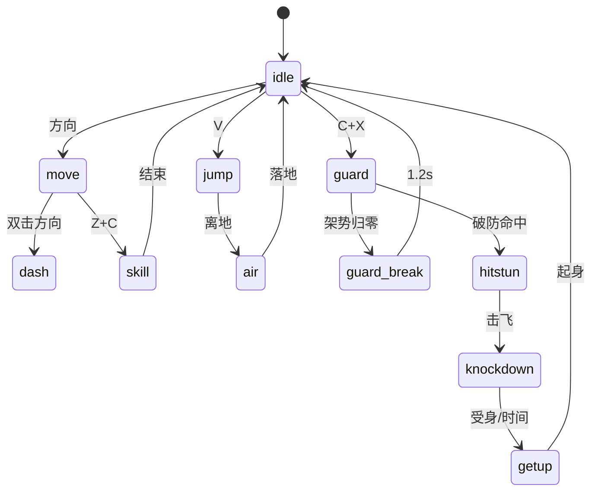

# 02a — 战斗 / 装备 / 成长（PRD 草稿）

> `TASK-011`｜Product Designer（C2）｜draft，待独立评审
> 上游：[`docs/00`](../00-设计基线与术语.md)、[ADR-002](../decisions/ADR-002-fixed-orthographic-camera.md)、[ADR-003](../decisions/ADR-003-xy-plane-combat.md)、[ADR-004](../decisions/ADR-004-keyboard-only-classic-layout.md)、[ADR-005](../decisions/ADR-005-equipment-as-moveset.md)
> 边界：只写战斗、装备、成长、训练/无障碍；MMO、经济、商业化、路线图归 C3 的 `02b`（§1.3）。

## 0. 结论先行

| # | 结论 | 去向 |
|---|---|---|
| 1 | 相机固定 50° 俯角、固定朝向、正交尺寸默认 8.0；不旋转、无鼠标 | §2 |
| 2 | 战斗只在 X/Y 平面；Z 只做跳跃、击飞、高低差 | §2.5、§4 |
| 3 | 经典布局默认；必杀支持同时按与顺序输入 | §3 |
| 4 | C+X 冲突用 40ms 窗口 + Space/Shift 替代 + 键位自检 | §3.5 |
| 5 | 12 态状态机；服务器 30Hz 权威，客户端只发输入 | §4 |
| 6 | 剑原型 10 招 + 防御/完美格挡沿用基线，另加 6 个派生招（草案） | §5 |
| 7 | 公式不改；架势上限与 HP 基准标为假设/待决 | §6、§10 |
| 8 | 装备 5 槽位组/8 件；8 武器、12 核心、20 防具套 | §7 |
| 9 | 成长横向解锁；竞技场归一化，等级不转化为 PvP 数值 | §8 |
| 10 | 不写经济/商业化/路线图，接口在 §1.3 冻结 | §1.3 |

**不改基线**：【基线】数字直接引用 `docs/00`；新增标【草案】。冲突时以 `docs/00` 为准并停稿升级。
**标记**：【假设 A-xx】待验证；【待决 D-xx】需决策；【PD-xx】本稿设计决策。

## 1. 范围、非范围与分工

### 1.1 目标

把 `docs/00` §3–§5 展开为可实现、可验收的 PRD：全键盘在 2.5D 斜俯视下完成读招、防御、连段、Build 与成长；工程、美术、QA 可直接拆任务与用例。

### 1.2 范围 / 非范围

| 包含 | 不包含（去向） |
|---|---|
| 相机、可读性、遮挡、高度、边缘指示 | 渲染/shader 实现（TDD/美术） |
| 经典/现代布局、组合键、重映射、UI 键盘导航 | 输入代码、手柄（TDD；手柄 1.0 后） |
| 8 方向、状态机、资源、防御/完美格挡/破防/浮空 | 同步算法、回滚、反作弊（TDD） |
| 剑原型帧数据、派生招、帧↔tick 换算 | 动画、VFX 制作（美术/TDD） |
| 伤害公式、连段衰减、PvP 归一化 | 数值模拟工具、平衡自动化（TDD） |
| 5 槽位组、8 武器、12 核心、20 防具套、符文、稀有度、强化、套装、2 Build | 掉落率、材料价格、拍卖税（`02b`） |
| 1–50 级、装备评分、mastery、横向 endgame | 赛季奖励、战令、营收、路线图（`02b`） |
| 训练场、指令表、连段挑战、键位检测、无障碍 | 教学文案本地化、客服（运营） |

### 1.3 与 C3（`02b`）的分工

| 议题 | 02a（C2） | 02b（C3） | 接口约束 |
|---|---|---|---|
| 副本/竞技场 | 战斗规则、PvP 归一化 | 模式、人数、时长、匹配、奖励 | 不得改帧数据/公式/归一化原则 |
| 掉落 | 品阶、强化规则、套装分层 | 来源、频率、保底、周常 | 只定「从哪掉、掉多少」，不定属性 |
| 经济 | 强化不破碎、不卖材料原则 | 货币、拍卖、税、产销 | 不得引入属性售卖 |
| 商业化 | 外观与强度分离 | 定价、战令、创始人包 | 不得卖强化材料/强度抽奖 |
| 赛季 | 平衡杠杆、归一化调参需求 | 赛季长度、奖励、LiveOps | 规则 02a 提，排期 02b 定 |
| 内容规模 | 8/12/20 的玩法定义 | EA/1.0 排期、产能、成本 | 数量沿用 `docs/00` §7 |
| 路线图/KPI | 不写 | 全部 | 02a 不承诺时间与收入 |

**冻结接口**：02b 不得改 ①5 槽位组/8 件；②8/12/20 数量；③+0–+10 不破碎；④PvP 归一化、不卖属性；⑤帧数据与伤害公式。变更走 ADR + Human。
冲突处理：02a/02b 数字不一致时回到 `docs/00`；仍不一致则停稿，提 decision request，不在任一草稿内改基线。

### 1.4 需求映射

| REQ | 章节 | 覆盖 |
|---|---|---|
| REQ-VIS-001/003 | §2 | 相机、高度、遮挡、边缘 |
| REQ-CTL-001–004 | §3 | 经典/现代、锁定、重映射、冲突 |
| REQ-CBT-001/002 | §4、§5、§7 | 状态机、帧数据、装备=招式 |
| REQ-CBT-003/004 | §6、§8 | 公式、归一化、不卖属性 |
| REQ-CBT-005 | §7.6–§7.8 | 稀有度、强化、无 P2W |
| REQ-QA-001/004 | §3.7、§9 | 键盘-only、无障碍 |

新增建议（未改 `docs/07`，待登记）：`REQ-CBT-006` 状态机与资源、`REQ-CBT-007` 训练场、`REQ-CBT-008` mastery、`REQ-CTL-005` UI 键盘导航、`REQ-QA-005` 色盲/闪烁。

### 1.5 章节验收

| 验收 | 标准 |
|---|---|
| 全键盘 | 无鼠标完成登录→战斗→装备→再匹配 |
| 帧数据 | 10 招 + 防御/完美格挡 + 6 派生在训练场可复现 |
| 装备 | 2 个 Build 可通关同难度副本 |
| PvP | 模板下 3–5 套连段分胜负 |
| 训练 | 指令表/键位检测/连段挑战可用 |
| 边界 | 无经济/商业化/路线图内容 |

## 2. 2.5D 相机与可读性

### 2.1 相机参数

| 项 | 基线 `docs/00` §3.1 | 本稿默认【草案】 | 说明 |
|---|---|---|---|
| 俯角 | 45–55° | 50° | 固定 |
| 朝向 yaw | 不旋转 | 0°（屏幕上方=北）【PD-01】 | 8 方向对齐屏幕 |
| 投影 | 正交 | 正交 | 低 FOV 透视仅风格测试备选 |
| 正交尺寸 | 7–9 | 8.0 | 可视高度 16m |
| 角色身高 | 1.5m | 1.5m | 见 §2.2 |
| 角色占屏 | 8–12% | 9.4% | 1.5/16 |
| 缩放 | 0.8–1.2×，键盘 | 1.0×，步进 0.05 | 战斗内建议 0.85–1.15（D-03） |
| 平移 | 有限平移/跟随 | 跟随 +0.8m 死区，最大 3m | 不越关卡边界 |
| 旋转/鼠标 | 不旋转、不参与 | 同 | 滚轮不缩放 |

### 2.2 占屏与缩放边界

| 正交尺寸 | 可视高度 | 1.5m 占屏 | 判定 |
|---|---|---|---|
| 7.0 | 14m | 10.7% | 基线内 |
| 8.0 | 16m | 9.4% | 默认 |
| 9.0 | 18m | 8.3% | 基线内 |
| 6.4（0.8×） | 12.8m | 11.7% | 仍在 8–12% 内，接近上限 |
| 9.6（1.2×） | 19.2m | 7.8% | 略低于 8%，观察用 |
| 0.85–1.15× | 13.6–18.4m | 11.0–8.2% | 建议战斗内 |

结论：0.8× 仍在 8–12% 内（11.7%），1.2× 会降到 7.8%。因此战斗内夹 0.85–1.15，保证全程 8–12%；0.8/1.2 保留给观察、拍照与教学（D-03）。

### 2.3 键盘缩放/平移

| 输入 | 行为 | 数值 |
|---|---|---|
| `+`/`-`（含小键盘） | 缩放 | ±0.05/次 |
| `0` | 复位缩放 | 1.0×【草案】 |
| `Ctrl`+方向 | 镜头微调 | ≤3m，松手 0.5s 回中【草案/PD-02】 |
| 3s 无输入 | 回中 | 0.3s 缓动 |
| 鼠标 | 无效 | — |

### 2.4 遮挡淡出

| 对象 | 触发 | 表现 | 恢复 |
|---|---|---|---|
| 屋顶/檐 | 覆盖玩家 ≥30% | alpha 0.25–0.4，0.15s 淡出 | 0.3s |
| 树冠 | 同上 | 网点抖动，不糊化 | 0.3s |
| 高墙/柱 | 同上 | 只淡出朝镜头一侧 | 0.3s |
| 半高掩体 | 覆盖下半身 | 不淡出，加轮廓 | — |
| 多层叠加 | 最多 3 层 | 按距离排序，第 4 层起只描边 | — |

硬规则：玩家本体永不淡出；淡出只影响表现，不改碰撞与命中（服务器判定分离）。

### 2.5 高度、阴影与落点

| 高度带 | 状态 | 表现 | 判定 |
|---|---|---|---|
| 0–0.3m | 地面 | 正常阴影 | X/Y 平面 |
| 0.3–1.2m | 跳跃 | 阴影 0.8、变淡 | 空中轻/重可用 |
| 1.2–2.5m | 击飞/浮空 | 阴影 0.55、偏移 0.35×高度、高度条 | 可追 1–2 段 |
| >2.5m | 高抛 | 高度条 + 边缘指示 | 不新增空战 |

- 落地前 0.35s 出现落点环；空中追击计入 `ComboScale`，不额外加乘区。
- 高低差只影响落点与遮挡，不改变 X/Y 判定；Z 不用于瞄准。来源：`docs/00` §3.2、[ADR-003](../decisions/ADR-003-xy-plane-combat.md)。

### 2.6 屏幕边缘指示

| 类型 | 形状 | 优先级 | 备注 |
|---|---|---|---|
| 锁定目标 | 菱形 | 1 | 带距离 |
| 危险预警 | 三角 | 1 | 取更近者 |
| 队友 | 圆点 | 2 | 副本/团队 |
| Boss/精英 | 双菱形 | 2 | 屏外显示 |
| 出口/目标 | 门形 | 3 | 任务中 |
| 可交互 | 方块 | 4 | 6m 内 |

最多 8 个，同优先级取近；颜色永远配形状，满足色盲冗余。

### 2.7 可读性验收

| 测试 | 条件 | 通过标准 |
|---|---|---|
| 剪影 | 10/20/30m、3 套装备 | 帽子/肩甲/武器/披风可辨 |
| 遮挡 | 屋顶/树冠/墙柱 | 玩家始终可见、无闪烁 |
| 高度 | 跳跃/击飞/高低差 | 80% 受测者判断对落点 |
| 色盲 | 红绿/蓝黄模拟 | 不靠颜色可分辨 |
| VFX | 4 人混战 | 遮挡 <25%，闪光 <3Hz |
| 边缘 | 30m 外目标 | 3s 内找到 |

### 2.8 相机与关卡构图

| 规则 | 内容 |
|---|---|
| 主通路 | 宽度 ≥4m，保证 8 方向可绕背 |
| 高低差 | 台阶 ≤0.5m 可直接走；>0.5m 需跳/绕行 |
| 遮挡 | 主通路两侧不放整面高墙；用半高掩体 |
| 战斗区 | 至少 2 个出口，避免屏外偷袭 |
| 镜头边界 | 不把玩家推到屏幕边缘 20% 内 |
| 预警 | 屏外技能必须有边缘指示（§2.6） |

目的：固定镜头下，关卡用宽度/掩体/高低差制造读招空间，而不是靠转视角。

**预警分级**：

| 等级 | 表现 | 提前量 |
|---|---|---|
| 小 | 地面细圈 | 0.4s |
| 中 | 圈 + 箭头 | 0.7s |
| 大 | 扇形 + 音效 | 1.0s |
| 致命 | 屏幕边缘脉冲 + 独特音 | 1.5s |

预警只用形状/音效/文字区分，不靠颜色；致命技必须可被防御、位移或核心机制应对。

## 3. 全键盘操作

### 3.1 原则

1. 肌肉记忆优先：经典布局与英豪一致（ADR-004）。
2. 无鼠标：战斗、镜头、菜单、匹配、聊天全键盘可完成。
3. 组合可失败但可恢复：替代路径 + 自检 + 重映射。
4. 输入可解释：训练场显示输入、缓冲、取消窗口。

### 3.2 经典布局（默认，完整）

| 输入 | 功能 | 语义/备注 |
|---|---|---|
| 方向键 / WASD | 8 方向移动 | 屏幕相对；角色朝移动方向 |
| 双击方向 | 冲刺 | 200ms 内同向两次；短 i-frame；Shift 替代 |
| `Z` 轻按 | 面向/软锁定最近敌人 | 120° 锥；≤120ms；无目标朝移动方向 |
| `Z` 按住 | 指令修饰 | 与 C/X/方向组合；阈值见 A-03 |
| `Z+C` | 特殊 1 | 核心定义，耗 MP |
| `Z+X` | 特殊 2 | 核心定义，耗 MP |
| `Z+方向+C` | 特殊 3 | 位移/抓取类；默认不启用裸「方向+C」（D-04） |
| `Z+X+C` | 必杀 | 耗槽；支持顺序 `Z→X→C`（≤250ms）【PD-04】 |
| `X` | 重击 | 击飞/破防/终结；完美格挡后 X 反击 |
| 长按 `X`（≥20f） | 蓄力斩 | 派生招，见 §5.2；不新增键位 |
| `C` | 轻击 | 连段起手；靠近地面小物可拾取 |
| `V` | 跳跃 | `V+C`/`V+X` 空中攻击 |
| `V+C` | 空中轻 | 落地前可取消 |
| `V+X` | 空中重 | 落地前可取消 |
| `C+X` | 防御 | 按住；正面 120°；Space 替代 |
| 受击前 100ms `C+X` | 完美格挡 | 0 HP；架势 +10；0.4s 内 X 反击 |
| 双击方向+`C/X` | 冲刺攻击 | 位移/突进 |
| `F` | 交互/拾取/对话/机关 | 键盘-only 通用交互 |
| `Q`/`Tab` | 切换锁定目标 | 锥内按角度/距离；UI 中 Tab 为焦点 |
| `+`/`-` | 缩放 | 小键盘同键 |
| `Esc`/`Enter` | 菜单取消/聊天确认 | 不暂停多人战斗 |

来源：`docs/00` §4.1、ADR-004。`Z+方向+C`（D-04）、顺序必杀（PD-04）、`0` 复位（§2.3）为本稿补充。

### 3.3 组合判定与缓冲

| 组合 | 窗口【草案】 | 失败回退 |
|---|---|---|
| `C→C` 连段 | 8f | 单段 |
| `Z+C`/`Z+X` | Z 按住或 ±40ms | 单独 C/X |
| `C+X` | ±40ms | 先按键生效 |
| `Z+X+C` | ±2f 或顺序 ≤250ms | 拆成防御/特殊 |
| `Z+方向+C` | 方向先于 C ≤3f | 按 `Z+C` 特殊 1 |
| 双击方向 | 200ms | 单次移动 |
| 冲刺攻击 | 冲刺后 4–18f | 普通冲刺 |

### 3.4 现代布局（可选）

| 输入 | 功能 | 备注 |
|---|---|---|
| `Z`/`X` | 轻击/重击 | 与经典相反，需教学 |
| `C` | 技能 1 | — |
| `X+C` | 技能 2 | 组合窗口同 §3.3 |
| `方向+C` | 技能 3 | 核心启用时；默认关闭防误触 |
| 空中 `C` | 空中技 | — |
| `Z+X+C` | 必杀 | 支持顺序输入 |
| `Space`/`Shift` | 防御/冲刺 | 按住/替代双击 |
| `V`/`F` | 跳跃/交互 | — |
| `Q`/`Tab`、`+`/`-` | 切换目标、缩放 | — |

技能 2/3 映射为【草案】PD-03，待输入测试（D-05）。

### 3.5 `C+X` 冲突与替代

**事实**：USB 键盘启动协议最初的上报上限为 6 键 + 4 修饰键；矩阵键盘多键同按可能 ghosting（丢键/串键）〔[TechTerms](https://techterms.com/definition/n-key-rollover)〕。本作常见组合为「方向+C+X」与「方向+Z+X+C」（3–4 键），在 6KRO 内，但低端薄膜键盘仍可能丢键。

| 方案 | 做法 | 代价 | 采用 |
|---|---|---|---|
| A 组合窗口 | C/X ±40ms 判防御 | 极快连按可能误判 | 是 |
| B 防御优先 | 同时按下防御优先 | 需教学 | 是 |
| C Space 替代 | 按住 Space 防御 | 手位移动 | 是 |
| D Shift 替代冲刺 | 单键冲刺 | 系统冲突需检测 | 是 |
| E 顺序防御 | C 后 60ms 内 X 也判防御 | 连段中可能误判 | 可选 |
| F 键位自检 | 检测 3/6/N 键与 ghosting | 需开发 | 是（§9.3） |
| G 手柄 | 1.0 后 | 不改变键盘-first | 后续 |

**验收**：6 类键盘（2 键/5 键/6KRO/NKRO/笔记本/无线）× 8 方向 × 防御/必杀，识别率 ≥99%；失败可在 3 步内改键或换替代键。

### 3.6 重映射与 UI 导航

| 项 | 规则 |
|---|---|
| 配置档 | 经典/现代/自定义，账号级 |
| 冲突 | 保存时检测同键/同组合并建议 |
| 保留键 | `Esc` 不可改；系统键不拦截 |
| 必杀/防御 | 至少保留一种可达路径 |
| 恢复 | 一键默认，二次确认 |
| 导入导出 | 字符串码，便于分享/QA 复现 |

| UI 场景 | 按键 |
|---|---|
| 焦点 | 方向键/WASD；Enter/Space 确认；Esc 返回 |
| 分区 | `Q`/`E` 或 Tab/Shift+Tab |
| 列表/背包 | 方向键、PageUp/Down、Home/End |
| 滑条 | 左右；Shift 加速 |
| 聊天 | Enter 开；Esc 关；Tab 切频道 |
| 提示 | 焦点停留 0.5s 显示，无 hover-only |

**验收**：登录→城镇→匹配→战斗→结算→背包装备→再匹配全程无鼠标（REQ-QA-001）。

### 3.7 键盘硬指标

- 战斗、缩放、菜单、匹配、聊天、副本/PvP 全流程无鼠标。
- 常见薄膜键盘至少 3 键同按可完成「方向+防御」；支持 6KRO/全键无冲。
- 冲突可检测、可重映射、可恢复默认；手柄 1.0 后支持，不改键盘-first。

### 3.8 输入优先级

| 优先级 | 输入 | 说明 |
|---|---|---|
| 1 | `Z+X+C` 必杀 | 三键同帧或顺序输入优先 |
| 2 | `C+X` 防御 | 同时按下时防御优先，抑制攻击 |
| 3 | `Z+X` / `Z+C` 特殊 | Z 为修饰时优先于单键 |
| 4 | `X` 重击 | 无组合时生效 |
| 5 | `C` 轻击 | 无组合时生效 |
| 6 | 移动/跳跃/交互 | 独立动作，不等组合 |

原则：**组合键优先于单键，防御优先于攻击**；任何优先级都必须在训练场可见、可复现。边界：`Z` 已按住超过阈值时，再按 `C+X` 不触发必杀，按防御处理；必杀要求三键新按下（±2f），或顺序输入从 `Z` 开始。

## 4. 战斗系统

### 4.1 8 方向、朝向与软锁定

- 移动/攻击在 X/Y 平面；8 方向；停下保留最后朝向。
- 攻击方向在前摇开始帧锁定；前摇中仅 ≤30° 微调【PD-05】。
- `Z` 轻按面向 120° 锥内最近敌人；不强制锁定、不追踪。
- 锁定保持到目标死亡/离开 14m/被墙阻断；`Q`/`Tab` 先按角度再按距离循环。
- 软锁定只给朝向辅助、目标环、边缘指示，不给自动位移/命中。

| 场景 | 规则 |
|---|---|
| 无目标 | 朝移动方向 |
| 目标死亡 | 清空，不自动切下一个 |
| 目标被墙挡住 | 保留 1s，之后清空 |
| 多目标同角 | 取最近 |
| 攻击中切换 | 下次攻击生效，当前不变 |
| 目标浮空 | 保留锁定，指示器显示高度 |

### 4.2 状态机（12 态）

| 状态 | 进入 | 可取消为 | 退出 |
|---|---|---|---|
| idle | 无输入/动作结束 | move/guard/jump/C/X/Z | 有输入 |
| move | 方向 | dash/jump/guard/C/X/Z | 松方向 |
| dash | 双击方向/Shift | 冲刺攻击/jump/guard | 时长/撞墙 |
| jump | `V` | 空中轻/重、落地 | 落地 |
| air | 跳跃/击飞 | 空中轻/重各 1 次 | 落地/受击 |
| guard | `C+X`/Space | 完美格挡/guard-break/松开 | 松键/受击 |
| guard-break | 架势归零 | 无 | 1.2s |
| hitstun | 被命中 | 无 | 硬直结束 |
| knockdown | 击飞/重击 | 受身 | 倒地/起身 |
| getup | 倒地结束 | 受身提前 | 起身 0.4s，末 6f 可动 |
| grab | 核心定义 | 投技/推开 | 投技结束 |
| skill | `Z+C`/`Z+X`/`Z+方向+C`/空中指令 | 核心定义 | 结束/命中 |



> 图只画主路径；`grab` 由核心插入 `skill` 分支，不占通用键（D-07）。

硬规则：guard-break 不可取消；hitstun 无 DI；getup 前段不可攻击；grab 无霸体（前摇可被打断）；air 不可无限滞空；skill 不可被普通移动取消。guard 状态下移速 40%（A-07）。

12 态覆盖移动、位移、防御、受击、倒地、投技与技能；状态之间只允许表内取消，禁止隐式取消（如受击中出招），以保证服务器可复现与回放一致。

### 4.3 资源

| 资源 | 上限【草案】 | 恢复 | 消耗 |
|---|---|---|---|
| HP | 500（Lv50 归一化） | 药水/治疗/复活 | 受击 |
| MP | 100 | 2/s + 命中 3 + 受击 2；脱战 5/s | 技能 15–30 |
| 架势 | 300 | 2s 未格挡后 8/s；完美格挡 +10 | 被格挡命中 |
| 必杀槽 | 100 | 造成伤害 6/100、受伤 4/100、完美格挡 +8、击杀 +15 | 必杀 |

来源：`docs/00` §3.3（种类）；上限为【假设 A-02/04/05/06】，需原型验证。PvE 可成长，PvP 固定模板。

### 4.4 防御、背击、破防、受身、击飞

| 机制 | 规则 | 来源 |
|---|---|---|
| 防御锥 | 正面 120°；背/侧不格挡 | `docs/00` §3.4 |
| 格挡减伤 | HP ×0.2；架势 ×1.0 | `docs/00` §3.6 |
| 完美格挡 | 受击前 100ms `C+X`；0 HP；架势 +10；0.4s 内 X 反击 | `docs/00` §3.4/§3.6 |
| 背击 | 背后 120° 外；`PosMod` 1.2，不叠乘 | §6.2 |
| 侧击 | 60–120°；`PosMod` 1.1 | §6.2 |
| 破防 | 架势归零 → guard-break 1.2s，可被完整连段 | `docs/00` §3.6 |
| 受身 | 倒地 0.35s 内按方向或 `C+X`；起身 0.4s→0.2s | 【草案】A-08 |
| 击飞/浮空 | launcher 进 air；每套最多追 2 段；计入 `ComboScale` | `docs/00` §3.2 |
| 抓取 | 核心定义（`Z+方向+C`）；不可防御；前摇可被轻击打断；无挣脱 | 【草案】D-07 |

### 4.5 PvE 与 PvP 差异

| 项 | PvE | PvP |
|---|---|---|
| HP/攻防 | 随等级/装备成长 | 模板 500/100/150 |
| 伤害 | 完整公式 | ×`PvPMod` 0.75 |
| 消耗品/复活 | 药水；副本次数/队友救援 | 禁药；1v1 无复活，3v3/8 人由 02b 定 |
| 友伤 | 默认关 | 关 |
| 必杀槽 | 跨战斗保留 | 每回合重置 |
| 锁定/帧数据 | 相同 | 相同（保肌肉记忆） |
| 节奏 | 8–15 分钟副本 | 3–5 分钟一局，3–5 套连段分胜负 |

### 4.6 帧、tick 与权威

| 概念 | 值 | 换算 |
|---|---|---|
| 客户端帧 | 60fps | 1f=16.7ms |
| 服务器 tick | 30Hz | 1 tick=2f=33.3ms |
| 前摇 8f | 133ms | 4 tick（向上取整） |
| 重击 18f | 300ms | 9 tick |
| 必杀 30f | 500ms | 15 tick |
| 完美格挡 100ms | — | 3 tick |
| 命中盒回放 | ≤200ms | ≤6 tick |

客户端只发输入与预测；伤害、命中、硬直、掉落、匹配由服务器判定（`docs/00` §8、[ADR-008](../decisions/ADR-008-fusion2-30hz.md)）。奇数帧向上取整，避免客户端「快半帧」。

### 4.7 打击反馈与可读性

| 要素 | 规则 | 备注 |
|---|---|---|
| 命中停顿 | 轻 3–4f、重 6–8f、必杀 10–12f | 仅命中；格挡减半 |
| 受击闪白 | 2–3f，≤2 次/秒 | 光敏安全 |
| 屏幕震动 | 0–100% 可调，默认轻 | 不替代预警 |
| 命中音 | 轻/重/破防/完美格挡四类 | 配字幕/视觉提示 |
| 伤害数字 | 可关，不遮角色 | 默认简洁 |
| 方向提示 | 受击方向箭头 | 色盲友好 |

打击反馈只服务「读招与确认命中」，不能遮挡预警或改变判定；服务器判定与表现分离。

## 5. 帧数据（剑原型）

### 5.1 基线 10 招 + 防御/完美格挡（不改）

| 招式 | 输入 | 前摇 | 判定 | 后摇 | 总帧 | 伤害 | 硬直 | MP | 取消窗口 |
|---|---|---|---|---|---|---|---|---|---|
| 轻击 1 | C | 8f | 3f | 12f | 23f | 30 | 14f | 0 | 后摇前 4f |
| 轻击 2 | C→C | 7f | 3f | 14f | 24f | 32 | 15f | 0 | 后摇前 4f |
| 轻击 3 | C→C→C | 10f | 4f | 20f | 34f | 45 | 22f | 0 | 后摇前 6f |
| 重击 | X | 18f | 5f | 24f | 47f | 80 | 28f | 0 | 后摇前 8f |
| 特殊 1 | Z+C | 14f | 4f | 20f | 38f | 70 | 24f | 20 | 命中后 6f |
| 特殊 2 | Z+X | 20f | 6f | 28f | 54f | 110 | 32f | 30 | 命中后 8f |
| 必杀 | Z+X+C | 30f | 8f | 36f | 74f | 220 | 40f | 0（槽） | 无 |
| 空中轻 | V+C | 6f | 3f | 10f | 19f | 25 | 12f | 0 | 落地前 |
| 空中重 | V+X | 12f | 4f | 16f | 32f | 55 | 20f | 0 | 落地前 |
| 冲刺攻击 | 双击方向+C/X | 8f | 4f | 18f | 30f | 50 | 20f | 0 | 命中后 4f |
| 防御 | C+X | 2f | 持续 | 6f | — | — | — | 0 | — |
| 完美格挡 | 受击前 100ms C+X | 1f | 6f | 8f | 15f | — | — | 0 | 反击 X |

来源：`docs/00` §3.5；总帧为派生列，不改原值。

### 5.2 派生招（草案，不替换基线）

| 招式 | 输入 | 前摇 | 判定 | 后摇 | 总帧 | 伤害 | 硬直 | MP | 取消 | 作用 |
|---|---|---|---|---|---|---|---|---|---|---|
| 横斩 | C1→X | 12f | 4f | 18f | 34f | 55 | 22f | 0 | 后摇前 4f | 稳伤分支 |
| 上挑斩 | C2→X | 16f | 5f | 22f | 43f | 65 | 30f | 0 | 后摇前 5f | 击飞起手 |
| 追斩 | C3→X | 14f | 5f | 22f | 41f | 75 | 26f | 0 | 后摇前 5f | 连段终结 |
| 蓄力斩 | 长按 X ≥20f | 30f | 6f | 30f | 66f | 130 | 36f | 0 | 无 | 破防/惩罚 |
| 反击斩 | 完美格挡后 X | 10f | 4f | 18f | 32f | 60 | 24f | 0 | 无 | 补基线反击帧数据 |
| 落地追击 | 空中重命中后落地 X | 14f | 5f | 22f | 41f | 65 | 24f | 0 | 落地后 4f | 空战收尾 |

全部复用既有按键，不新增键位；数值为【草案】，待 M0 验证（D-08）。

### 5.3 取消与连段

| 规则 | 内容 |
|---|---|
| 轻击链 | 仅命中/格挡进入下一段；空振不衔接（D-06） |
| 轻→重 | C1/C2/C3 后 X 进入对应派生 |
| 特殊取消 | `Z+C`/`Z+X` 仅命中后窗口 |
| 冲刺/防御取消 | 后摇最后 4f 可冲刺；轻击后摇前 4f 可防御 |
| 空中 | 落地前可接一次空中动作 |
| 必杀 | 不可取消，前摇 30f 可被打断 |

### 5.4 验收

- 训练场显示前摇/判定/后摇/硬直/MP/取消窗口（§9.2）。
- 原型可复现 C1→C2→C3、C2→X→空中轻、完美格挡→反击斩、蓄力斩破防。
- 帧↔tick 换算由 Tech 在 TDD 复核；本文不改基线。

### 5.5 连段路线示例

| 路线 | 输入 | 段数 | 说明 |
|---|---|---|---|
| 基础稳伤 | C1→C2→C3 | 3 | 新手；空振不衔接 |
| 浮空追击 | C2→X 上挑→V+C→落地追击 | 4 | 需 2 次空中行动 |
| 破防惩罚 | 完美格挡→X 反击→Z+X→蓄力斩 | 4 | 高伤但耗 MP/时间 |
| 影袭绕背 | 冲刺→Z+C 瞬步→背刺→必杀 | 3 | Build A 核心路线 |

连段路线必须能在训练场复现，并在指令表中标注「推荐/高难」。

## 6. 伤害公式

### 6.1 公式（基线，不改）

```text
Damage = Base
       × (1 + Atk / 100)
       × (1 - Def / (Def + 300))
       × ComboScale × PosMod × ElementMod × PvPMod
```

来源：`docs/00` §3.6。

### 6.2 变量

| 变量 | 取值 | 说明 |
|---|---|---|
| Base | 招式基础伤害 | §5 |
| Atk | PvE 0–200；PvP 100 | 装备/等级 |
| Def | PvE 0–300；PvP 150 | 非线性减伤 |
| ComboScale | 1.0/0.9/0.8/0.7/0.6/0.5 | 最低 0.5 |
| PosMod | 1.0/1.1/1.2 | 正/侧/背 |
| ElementMod | 1.2/0.8/1.0 | 克/被克/无 |
| PvPMod | 0.75 | 仅 PvP |

角度：以目标朝向 0°，±60° 为正面（120° 锥）；60–120° 侧面；>120° 背面。与防御锥一致，避免「能格挡却算背击」。

### 6.3 连段衰减

| 段数 | 1 | 2 | 3 | 4 | 5 | 6+ |
|---|---|---|---|---|---|---|
| ComboScale | 1.0 | 0.9 | 0.8 | 0.7 | 0.6 | 0.5 |

- 每目标独立；1.2s 无命中或目标死亡/倒地重置。
- 浮空追击计入段数，不额外乘 0.7。
- 连段上限靠架势/受身/落地硬直，不靠隐藏补正。

### 6.4 防御与完美格挡

| 情形 | HP 伤害 | 架势伤害 | 其他 |
|---|---|---|---|
| 无防御 | 公式结果 | 0 | — |
| 普通格挡 | ×0.2 | 公式结果 ×1.0 | 归零 → 1.2s 破防 |
| 完美格挡 | 0 | +10 | 0.4s 内 X 反击 |
| 背击未格挡 | 公式 ×1.2 | — | 不叠乘 |
| 抓取 | 公式结果 | 0 | 不可防御 |

> `docs/00` 未定义架势上限与架势伤害来源；本稿按「上限 300、架势伤害=未格挡伤害×1.0」解释，标 D-01，需基线补充或 ADR 澄清。

### 6.5 PvP 归一化

| 项 | PvE | PvP |
|---|---|---|
| HP/Atk/Def | 装备成长 | 500/100/150 |
| 强化 | 生效 | 不生效 |
| 稀有度数值 | 生效 | 压缩 ±5% |
| 符文数值 | 生效 | 不生效 |
| 核心/武器机制 | 生效 | 完整保留 |
| 帧数据 | 生效 | 不变 |
| 套装机制 | 生效 | 机制保留、数值减半 |

只压数值、不删机制；赛季调参优先 `PvPMod`、MP、CD，不轻易改帧。模板数值、±5% 压缩与套装「数值减半」均为【草案】，见 D-12。

### 6.6 数值示例

条件：轻击 3（Base 45），第 3 段（0.8），背击（1.2），无属性（1.0）；PvE 用 Atk 120/Def 200，PvP 用模板 Atk 100/Def 150 与 `PvPMod` 0.75。

| 步骤 | PvE | PvP |
|---|---|---|
| 攻击系数 | 1+120/100 = 2.20 | 1+100/100 = 2.00 |
| 防御系数 | 1−200/500 = 0.60 | 1−150/450 = 0.667 |
| 连段/位置/属性 | 0.80/1.20/1.00 | 同 |
| 合计 | 45×2.20×0.60×0.80×1.20 = **57.02→57** | 45×2.00×0.667×0.80×1.20×0.75 = **43.2→43** |
| 被格挡 | HP 57×0.2=11.4→11；架势 57/300 | HP 43×0.2=8.6→9；架势 43/300 |
| 完美格挡 | HP 0；架势 +10 | 同 |

PvE 的 120/200 面板在 PvP 会被模板覆盖，所以同一招在 PvP 为 43；差异来自机制与操作，不来自强化。

### 6.7 边界条件

| 边界 | 规则 |
|---|---|
| 最小伤害 | HP 伤害 ≥1；架势 ≥1 |
| 取整 | 四舍五入到整数 |
| 免疫/无敌 | 伤害 0，不触发连段/必杀槽 |
| 多段命中 | 每段独立套公式，共享 ComboScale 段数 |
| 溢出 | 不转化为额外伤害 |
| 元素 | 无属性 1.0；克制上限 1.2 |

## 7. 装备与 Build

### 7.1 槽位：5 组、8 件

| 槽位组 | 件数 | 内容 | 影响 |
|---|---|---|---|
| 武器 | 1 | 8 原型 | C/X 动画、范围、速度 |
| 战斗核心 | 1 | 12 种 | 4 指令技+必杀+被动 |
| 防具 | 3 | 头/身/腿 | 防御/HP/抗性/套装 |
| 符文 | 2 | 被动/词条 | 攻速/减耗/机制微调 |
| 外观 | 1 | 时装/皮肤 | 纯外观 |

> 任务口径「5 槽位」=5 个槽位组；实际 8 件，与 `docs/00` §5.1 一致，不新增槽位。

### 7.2 8 武器原型

| 武器 | 定位 | 攻速 | 范围 | 架势伤害 | 适配核心 | 弱点 |
|---|---|---|---|---|---|---|
| 剑 | 均衡基准 | 1.00 | 2.2m | 中 | 全 | 无突出 |
| 巨剑 | 重击/破防 | 0.75 | 2.8m | 高 | 守御/霜狱/雷鸣 | 前摇长 |
| 长枪 | 距离/线性 | 0.90 | 3.2m | 中 | 雷鸣/守御/疾风 | 怕贴脸 |
| 双刀 | 速度/连段 | 1.25 | 1.8m | 低 | 影袭/雷鸣/蚀毒 | 怕格挡 |
| 拳套 | 最快/抓投 | 1.35 | 1.5m | 低 | 影袭/擒龙 | 范围最短 |
| 弓 | 远程/蓄力 | 0.85 | 8–12m | 低 | 连星/陷阵 | 近身弱 |
| 法杖 | 范围/AoE | 0.80 | 6–8m | 中 | 霜狱/炽烬/唤灵/援护 | 前摇长 |
| 链刃 | 中距/多段 | 0.95 | 4.0m | 中 | 影袭/蚀毒/陷阵 | 判定窄 |

来源：`docs/00` §5.2；攻速/范围为【草案】PD-06，待原型标定。

### 7.3 12 战斗核心

| 核心 | 属性 | 定位 | 4 技构成 | 必杀 |
|---|---|---|---|---|
| 雷鸣 | 雷 | 突进/感电 | 位移/标记/拉拽/空袭 | 范围落雷 |
| 霜狱 | 冰 | 控制/区域 | 冰墙/霜爆/滑步/冰锥 | 冻结领域 |
| 影袭 | 暗 | 背击/瞬步 | 瞬步/背刺/分身/空袭 | 背刺处决 |
| 守御 | 光 | 格挡反击/护盾 | 盾击/破阵/铁壁/盾落 | 团队减伤 |
| 炽烬 | 火 | 爆发/地面持续 | 火墙/爆燃/突进/空火 | 大范围燃烧 |
| 蚀毒 | 毒 | 持续/削弱 | 毒刃/毒云/位移/空毒 | 剧毒爆发 |
| 疾风 | 风 | 移速/击退 | 风刃/龙卷/疾步/空斩 | 风域 |
| 唤灵 | 无 | 召唤/协同 | 召唤/命令/牺牲/空召 | 召唤大军 |
| 陷阵 | 无 | 场地控制 | 地雷/网/诱饵/空雷 | 连环爆 |
| 连星 | 无 | 远程压制 | 三连射/散射/翻滚射/空射 | 箭雨 |
| 擒龙 | 无 | 抓投 | 抓/摔/冲撞/空抓 | 投技必杀 |
| 援护 | 光 | 支援 | 治疗/护盾/净化/空援 | 团队复活/增益 |

来源：`docs/00` §5.3（12 种与四例）；其余 8 种名称与构成为【草案】，需评审与商标检索（D-10）。

### 7.4 三个核心详解

> 帧列 = 前摇/判定/后摇；单值表示该技能只有前摇或持续。数值为【草案】。

**雷鸣（雷/突进/感电）**

| 槽位 | 技能 | 输入 | 帧 | 伤害 | MP | 效果 | CD |
|---|---|---|---|---|---|---|---|
| 被动 | 导电 | — | — | — | — | 对感电目标命中回 5 MP；感电 4s | — |
| S1 | 雷走 | Z+C | 14/4/20f | 60 | 20 | 前冲 3m，感电 2s | 6s |
| S2 | 引雷 | Z+X | 20/6/28f | 100 | 30 | 标记 6m，0.8s 后落雷 | 8s |
| S3 | 雷缚 | Z+方向+C | 16/4/22f | 40 | 15 | 拉近 2m，硬直 0.4s | 10s |
| S4 | 空雷 | 空中 Z+C | 10/4/18f | 55 | 15 | 落地雷击 2.5m | 5s |
| 必杀 | 万雷 | Z+X+C | 30/8/36f | 220 | 槽 | 5m AoE，感电 4s | — |

**霜狱（冰/控制/区域）**

| 槽位 | 技能 | 输入 | 帧 | 伤害 | MP | 效果 | CD |
|---|---|---|---|---|---|---|---|
| 被动 | 寒域 | — | — | — | — | 冰墙/冰径存在时 MP +2/s | — |
| S1 | 冰墙 | Z+C | 18f | 0 | 25 | 墙 4s，挡投射物 | 12s |
| S2 | 霜爆 | Z+X | 24/6/30f | 90 | 30 | 减速 30%，2s | 8s |
| S3 | 冰径 | Z+方向+C | 14f | 0 | 20 | 滑行 4m，减速带 3s | 10s |
| S4 | 冰锥 | 空中 Z+X | 12/4f | 60 | 20 | 减速 50%，1.5s；同目标 6s CD | 6s |
| 必杀 | 霜狱 | Z+X+C | 30/8/36f | 220 | 槽 | 6m AoE，冻结 1.2s | — |

**影袭（暗/背击/瞬步）**

| 槽位 | 技能 | 输入 | 帧 | 伤害 | MP | 效果 | CD |
|---|---|---|---|---|---|---|---|
| 被动 | 潜行 | — | — | — | — | 脱战 3s 移速 +10%；背击回 10 MP | — |
| S1 | 瞬步 | Z+C | 12f | 0 | 20 | 到目标背后 1.5m；2–6f i-frame | 5s |
| S2 | 影刺 | Z+X | 18/5/26f | 100 | 30 | 背击命中回 10 MP | 6s |
| S3 | 影分身 | Z+方向+C | 20f | 0 | 25 | 分身 3s，吸引锁定 | 12s |
| S4 | 空袭 | 空中 Z+C | 10/4f | 70 | 15 | 下砸，落地可接 C | 5s |
| 必杀 | 影葬 | Z+X+C | 30/8/36f | 220 | 槽 | 传送背后；击杀重置瞬步 | — |

**纪律**：核心被动只给资源/位移/信息，不新增伤害乘区，避免与 §6 公式冲突和隐性 P2W（D-11）。

### 7.5 20 防具套

| 套装 | 重量 | 品阶 | 2 件 | 3 件 | 定位 |
|---|---|---|---|---|---|
| 风巡 | 轻 | 普通 | 移速 +3% | 冲刺 CD −10% | 入门机动 |
| 猎人 | 轻 | 普通 | 远程减伤 5% | 锁定 +2m | 弓/野外 |
| 影织 | 轻 | 稀有 | 背击 MP +5 | 冲刺后 1s 移速 +10% | 影袭 |
| 霜羽 | 轻 | 稀有 | 冰抗 +10% | 减速 −30% | 冰区 |
| 游侠 | 轻 | 稀有 | 移速 +2% | 闪避后 2s MP +2/s | 风筝 |
| 雷纹 | 轻 | 史诗 | 感电 +1s | 雷技 MP −15% | 雷鸣 |
| 夜行 | 轻 | 史诗 | 脱战移速 +5% | 背击回 5% 必杀槽 | 刺客 |
| 铁誓 | 中 | 普通 | 防御 +5% | 格挡架势 −10% | 入门防御 |
| 行旅 | 中 | 普通 | 脱战回复 +20% | 副本移速 +5% | 探索 |
| 守望 | 中 | 稀有 | 队友减伤 3% | 完美格挡给队友 +10 架势 | 团队 |
| 磐石 | 中 | 稀有 | 受击架势 −5% | 格挡时移速 +10% | 抗压 |
| 逐风 | 中 | 稀有 | 攻速 +3% | 冲刺攻击回 5 MP | 连段 |
| 破阵 | 中 | 史诗 | 破防 +0.2s | 破防目标命中回 10 MP | 破防 |
| 司辰 | 中 | 史诗 | 技能 CD −5% | 必杀槽 +10% | 循环 |
| 壁垒 | 重 | 普通 | 防御 +8% | 背击减伤 10% | 新手重甲 |
| 山铸 | 重 | 稀有 | HP +5% | 格挡成功回 5 架势 | 巨剑 |
| 石誓 | 重 | 稀有 | 架势上限 +20 | 破防 −0.2s | 守御 |
| 熔铁 | 重 | 史诗 | 火抗 +10% | 受击后 2s 攻速 +5% | 火区 |
| 王庭 | 重 | 传说 | 完美格挡后 2s 技能 MP −50% | 90s 一次，致命伤留 1 HP | 守御/团战 |
| 苍岩 | 重 | 传说 | 受击 +5 必杀槽 | 必杀后 5s 格挡架势 −30% | 反击流 |

只做 2/3 件，不做 4 件（防具仅 3 位）；传说给机制，不给纯数值。

分层逻辑：轻甲 7/中甲 7/重甲 6；普通 5/稀有 8/史诗 5/传说 2（合计 20）。轻甲给机动与背击，中甲给团队/循环，重甲给格挡/破防；传说只放在重甲，强调「守出来的强」。

### 7.6 符文与稀有度

| 符文类型 | 示例 | 数值带 | PvP |
|---|---|---|---|
| 攻速/减耗 | 攻速、技能 MP | +2–5% / −5–10% | 不生效 |
| 回复 | 命中/受击 MP | +1–3 | 不生效 |
| 机动 | 移速/冲刺 CD | +2–4% / −3–8% | 不生效 |
| 机制 | 取消/受身/完美格挡窗口 +1f，锁定切换 −1f | 固定 | 保留 1 条 |

首版不做随机洗练；符文确定合成、1–3 品阶；机制符文最多 1 条（D-09）。符文是微调，不是战力主体。

| 稀有度 | 数值 | 机制 | 来源类型（02b 定频率） |
|---|---|---|---|
| 普通 | 100% | 无 | 普通副本/野外 |
| 稀有 | 110% | 1 个小机制 | 精英/困难 |
| 史诗 | 120% | 1 个核心机制 | Boss/RAID |
| 传说 | 125% | 独特机制（改指令/防御/位移） | RAID/赛季 |

传说不允许「+30% 伤害」类纯数值；必须可感知、可反制、PvP 归一化后仍保留。PvP 数值差压缩 ±5%。

### 7.7 强化、套装与 Build

| 强化规则 | 内容 |
|---|---|
| 成功率 | 100%，不破碎、不降级 |
| 数值 | 主属性 +1.5%/级，+10 共 +15%，不随机 |
| 材料 | 3 档，仅 PvE；不售卖（02b 定产出） |
| 继承 | 同槽位可继承，规则交 02b |
| PvP | 不生效 |
| 上限 | +10 封顶，无突破/觉醒 |

套装：2/3 件两档，3 件为完整机制，无 4 件；以资源/窗口/移速/减伤为主，不直接乘伤害；传说套每 Build 只触发 1 套 3 件机制。

**Build A：疾风双刀·影袭**

| 项 | 选择 |
|---|---|
| 武器/核心 | 双刀 / 影袭 |
| 防具/符文 | 影织 3 件（轻）；攻速 +2%、冲刺 CD −3% |
| 面板示意 | Atk 118 / Def 92 / HP 520 / 移速 110% / GS 452 |
| 打法 | Z 锁定→冲刺绕背→C1-C2-C3→Z+C 瞬步取消→背刺→必杀 |
| 强项/弱点 | 机动、背击、取消多；正面弱，怕格挡/范围控制/冰墙 |
| 反制 | 守角、预判瞬步、长枪/冰墙封路、抓取 |

**Build B：巨剑守御**

| 项 | 选择 |
|---|---|
| 武器/核心 | 巨剑 / 守御 |
| 防具/符文 | 山铸 2 + 石誓 1（重）；减耗 −5%、格挡回复 +1 |
| 面板示意 | Atk 105 / Def 210 / HP 560 / 移速 92% / GS 468 |
| 打法 | 格挡吃招→完美格挡→X 反击→Z+X 破阵→蓄力斩 |
| 强项/弱点 | 破防、团战前排、容错高；慢，怕远程/背击/抓取 |
| 反制 | 远程风筝、双刀绕背、抓取、冰墙分割 |

来源：Build A 展开自 `docs/00` §5.5；面板为示意，PvP 一律用模板。

### 7.8 平衡杠杆

| 杠杆 | 调什么 | 成本 | 风险 |
|---|---|---|---|
| 帧数据 | 前摇/后摇/取消 | 高 | 手感崩 |
| 伤害 | Base/倍率 | 低 | 数值通胀 |
| MP/CD | 技能频率 | 低 | 循环单一 |
| 架势伤害 | 破防速度 | 中 | 防御无用/破防过强 |
| 范围/判定 | 命中难度 | 中 | 视觉不符 |
| 取消窗口 | 连段上限 | 高 | 无限连 |
| 被动机制 | 核心强度 | 中 | 隐性 P2W |
| 套装/符文 | Build 多样 | 中 | 必备件 |
| 强化曲线 | PvE 动力 | 低 | 数值墙 |
| PvP 模板 | 公平性 | 低 | 同质化 |

原则：先调机制成本（CD/MP/窗口），再调数值；一次只动一个杠杆，改动进赛季窗口并记录。

### 7.9 核心/武器设计预算

| 预算 | 上限 | 目的 |
|---|---|---|
| 单核心位移 | ≤2 段，单段 ≤5m | 防无限逃生 |
| 单核心硬控 | ≤1 个，≤1.2s | 防锁死 |
| 无敌帧 | 仅瞬步/冲刺，≤6f | 防无敌循环 |
| 技能 MP | 单核 4 技合计 ≤100 | 防一套放完 |
| 冷却 | 关键技 ≥5s | 防刷屏 |
| 被动乘区 | 0 个新增伤害乘区 | 保公式与公平 |

超预算的设计必须在评审中说明，并以「机制换数值」方式回收强度。

## 8. 成长

### 8.1 1–50 级：解锁而非数值墙

| 等级 | 累计时长 | 内容 | GS 参考 | 解锁 |
|---|---|---|---|---|
| 1–10 | 1–2h | 教学、基础连段、第一把武器 | 80 | 训练场、连段挑战、键位检测 |
| 11–20 | 3–5h | 第一副本、第一个核心 | 180 | 特殊 1、符文 |
| 21–30 | 6–9h | 困难副本、第二核心 | 300 | 特殊 2、套装 2 件 |
| 31–40 | 10–16h | RAID、竞技场 | 400 | 必杀、套装 3 件 |
| 41–50 | 18–26h | 大师难度、赛季挑战 | 500 | mastery 深层、全核心 |

总时长 18–26h 到 50（A-09），之后横向 endgame；不做无限等级/巅峰。

### 8.2 GS 与 mastery

```text
GS = 武器分×1.5 + 核心分×1.0 + 防具分×2.5 + 符文分×1.0
     每项 0–100，总分 0–600
```

- GS 权重为【草案】；仅用于 PvE 推荐门槛、组队展示、成长反馈，**不作为伤害乘区**。
- PvP 不看 GS，只看模板与 MMR。示例：90/80/85/70 → 135+80+212.5+70=**498**。

| mastery | 等级 | 解锁 | 数值 |
|---|---|---|---|
| 武器 | 1–10 | 招式变体、取消选项、挑战、外观 | 数值加成封顶 +3%（PvP 不生效） |
| 核心 | 1–5 | 被动档、技能变体、演出 | 无数值伤害 |

通过使用获得，不卖不加速、账号通用；只给更多选择，不给更高上限。解锁项必须在指令表中可见，避免「练了但不知道解锁了什么」。

### 8.3 横向 endgame 与 PvP 归一化

| 内容 | 给什么 | 不给什么 | 周期 |
|---|---|---|---|
| 大师副本 | 词缀、外观、材料 | 更高装等 | 周常 |
| 赛季挑战 | 称号、外观、货币 | 属性 | 10 周 |
| 竞技场 | 段位、外观、荣誉 | 属性 | 赛季 |
| Boss Rush | 材料、外观 | 新数值层 | 轮换 |
| 图鉴/收集 | 称号、图鉴奖励 | 战力 | 长期 |
| UGC（S2） | 皮肤/分成 | 属性 | 后续 |

- 竞技场统一 §6.5 模板：强化/符文数值不生效、机制保留。
- 匹配只看 MMR/段位与延迟，不看 GS/等级。
- 赛季优先调 `PvPMod`、MP、CD；帧数据改动需单独 ADR。
- 模式/人数/奖励/段位归 02b；本稿只保证同模板、同帧数据、同机制。
- 等级只解锁内容，不提供 PvP 数值；PvE 的等级优势在竞技场被模板抹平。

**PvE 难度分层**（掉落频率归 02b）：

| 难度 | 机制 | 复活 | 品阶 |
|---|---|---|---|
| 普通 | 基础预警 | 2 次 | 普通/稀有 |
| 困难 | 精英+额外机制 | 1 次 | 稀有/史诗 |
| 大师 | 词缀/限时 | 0–1 次 | 史诗/传说 |
| RAID | 分工/阶段 | 团队复活 | 史诗/传说 |

大师=困难副本的词缀模式，不新增副本数量（与 `docs/00` 的 4 副本一致）。

### 8.4 反 grind 规则

- 无巅峰等级、无无限强化、无随机词条赌博。
- 装备成长到 50 级封顶；新内容给侧向替代（sidegrade）/外观，不给更高装等。
- mastery 账号通用、只给横向选项；周常/赛季有上限，不逼每日长刷。
- 落后玩家有追赶：副本保底、赛季追赶货币（规则交 02b）。
- 任何「时间换战力」的设计必须过 PvP 归一化，确保竞技场公平。

## 9. 训练、教学与无障碍

### 9.1 训练场

| 功能 | 内容 |
|---|---|
| 木桩 | 静止/格挡/反击/主动 AI 四档，可重置 |
| 数据 | 帧数据、命中盒、伤害日志、连段计数、输入历史 |
| 资源/时间 | 无限 MP/槽开关；架势重置；0.25×/0.5×/1.0× |
| 场景 | 平地/高低差/遮挡/墙角 |
| 录制 | 录制/回放对手，可存 3 条 |
| 延迟 | 0/50/100/200ms |
| 进出 | 城镇训练区；排队可进；不产出经济（02b） |

训练场也是 QA 工具：键位、延迟、帧数据、连段路线都在这里复现；正式战斗不提供帧数据面板。

### 9.2 指令表与连段挑战

- 指令表按武器/核心列出：输入、前摇/判定/后摇、伤害、MP、取消窗口、演示；可筛选/收藏/一键试招；未解锁显示条件。
- 数据与 §5 同源并显示版本，避免攻略与游戏不一致。

| 挑战 | 内容 | 评级 |
|---|---|---|
| 双刀基础 | C1-C2-C3→Z+C 取消 | S/A/B |
| 剑·上挑 | C2→X→空中轻→落地追击 | S/A/B |
| 影袭背刺 | 瞬步→背刺→影葬 | S/A/B |
| 守御反击 | 完美格挡→X→破阵→蓄力斩 | S/A/B |

判定命中数/用时/是否被反击；奖励外观/称号/货币（02b），不给属性。

### 9.3 键位检测

| 检测 | 方法 | 输出 |
|---|---|---|
| 同时按键数 | 依次按 3/4/6 键 | 识别上限、是否丢键 |
| Ghosting | 方向+C+X、方向+Z+X+C | 失败组合清单 |
| 组合成功率 | 每组合 10 次 | 成功率 |
| 系统冲突 | 输入法/快捷键/粘滞键 | 冲突与建议 |
| 布局 | QWERTY/AZERTY | 物理键位映射 |

首次启动引导 + 设置内重跑 + 一键替代（Space/Shift/顺序必杀）；报告可导出给 QA（§3.5）。验收：3 键组合识别率 ≥99%，失败项必须给出可执行的替代方案。

### 9.4 无障碍

| 维度 | 措施 | 验收 |
|---|---|---|
| 色觉 | 形状+图标+纹理冗余；3 套调色板；预警不用纯红绿 | 红绿/蓝黄模拟可辨 |
| 闪烁 | VFX <3Hz；可关全屏闪光；震动 0–100% | 光敏测试 |
| 晕动 | 固定镜头；缩放限制；回中缓动可关 | 无不适 |
| 听力 | 关键音效配字幕/视觉提示 | 静音可完成机制 |
| 运动 | 重映射；防御/冲刺可单手化；长按/切换可选 | 三键组合有替代 |
| 认知 | 分步教学、可跳过、练习模式 | 10 分钟完成基础连段 |
| 文字 | 字号 100–150%、高对比、描边 | 1080p 可读 |
| 键盘 | §3.6 全流程 | 无鼠标完成 |

约每 12 名男性有 1 名色觉缺陷〔[NEI](https://www.nei.nih.gov/eye-health-information/eye-conditions-and-diseases/color-blindness)〕，颜色永不是唯一通道；无障碍选项不得在 PvP 产生数值优势。

### 9.5 新手教学流程

| 步骤 | 内容 | 时长 | 通过标准 |
|---|---|---|---|
| 1 | 移动/8 方向/镜头缩放 | 1–2min | 走完训练场一圈 |
| 2 | C 连段与 X 重击 | 2–3min | 完成 C1-C2-C3 |
| 3 | 防御/完美格挡/反击 | 3–4min | 连续 3 次完美格挡 |
| 4 | 冲刺/跳跃/空中攻击 | 2–3min | 完成一次浮空追击 |
| 5 | 核心 4 技/必杀 | 3–5min | 放完一套技能+必杀 |
| 6 | 键位检测与改键 | 2min | 通过 3 键组合测试 |

可跳过、可重玩；奖励为外观/货币，不给属性；所有提示可用键盘确认。

## 10. 风险、开放问题与待决

### 10.1 风险

| ID | 风险 | 可能性/影响 | 缓解 |
|---|---|---|---|
| R-01 | C+X 低端键盘丢键 | 中/高 | §3.5 替代+自检 |
| R-02 | 2.5D 纵深不足、高度误判 | 中/高 | 阴影/高度条/风格测试 |
| R-03 | 8 武器 ×12 核心组合爆炸 | 高/高 | 杠杆表/自动化/先 6 核心 |
| R-04 | 传说机制被感知为 P2W | 中/高 | 可反制/不卖/归一化 |
| R-05 | 20 套防具内容成本 | 中/中 | 复用骨架；EA 先 10 套 |
| R-06 | 全键盘 UI 学习曲线 | 中/中 | 键盘导航/教学 |
| R-07 | mastery 变 grind | 中/中 | 只给横向/账号通用 |
| R-08 | 30Hz 与 60fps 帧偏差 | 中/高 | tick 换算/回放/测试 |
| R-09 | 归一化导致同质化 | 中/中 | 机制保留/赛季调参 |
| R-10 | 无障碍不足 | 中/中 | §9.4 |
| R-11 | 名称/设定撞车 | 中/高 | 商标检索/Human 法律门 |

排序原则：先处理「会让玩家按不出招/看不清」的问题（R-01/R-02/R-08），再处理内容成本与平衡。

### 10.2 开放问题

| ID | 问题 | 倾向 |
|---|---|---|
| O-01 | 默认 yaw 0° 还是 45° | 0°（PD-01） |
| O-02 | 竞技场全模板还是另开休闲 | 全模板，休闲另议 |
| O-03 | 首版手柄 | 否，1.0 后 |
| O-04 | 8 个新核心命名 | 待评审/商标检索 |
| O-05 | 防御是否切换式 | 仅按住 |
| O-06 | 投技通用还是核心 | 核心专属 |
| O-07 | 赛季是否改帧 | 原则上不改 |
| O-08 | 是否引入暴击 | 1.0 不引入（公式无暴击项） |
| O-09 | 排队时进训练场 | 建议可以 |
| O-10 | 连段辅助 | 仅训练场，不进 PvP |

### 10.3 待决

| ID | 事项 | 建议 | 需要谁 | 阻塞 |
|---|---|---|---|---|
| D-01 | 架势上限与「架势伤害×1.0」 | 300；未格挡伤害 | Orchestrator/Tech | 是 |
| D-02 | 默认 yaw | 0° | Art/Tech | 否 |
| D-03 | 战斗内缩放夹 0.85–1.15 | 是 | Product/QA | 否 |
| D-04 | 裸「方向+C」 | 否，仅 `Z+方向+C` | Product | 否 |
| D-05 | 现代布局技能 2/3 | `X+C`/`方向+C` | Product/QA | 否 |
| D-06 | 轻击链空振衔接 | 否 | Product | 否 |
| D-07 | 抓取是否通用 | 核心专属 | Product | 是 |
| D-08 | 6 派生招是否进 1.0 | M0 后留 3–4 个 | Product/Tech | 否 |
| D-09 | 机制符文 PvP 条数 | 1 条 | Product | 否 |
| D-10 | 8 核心命名/差异 | 评审+商标检索 | Product/Reviewer | 否 |
| D-11 | 传说机制边界 | 可反制/不卖/保留 | Product/Human | 是 |
| D-12 | HP 500/MP 100 基准 | 原型验证 | Tech/Product | 是 |

### 10.4 假设（集中）

| ID | 假设 | 影响 |
|---|---|---|
| A-01 | 角色 1.5m、默认正交 8.0 | 占屏 9.4% |
| A-02 | Lv50 PvP HP 500 | TTK/连段 |
| A-03 | Z 按住阈值 120ms | 手感 |
| A-04 | MP 100；2/s + 命中 3 + 受击 2，脱战 5/s | 技能频率 |
| A-05 | 架势 300，2s 后 8/s | 破防节奏 |
| A-06 | 必杀槽 100，伤害 6/100 | 必杀频率 |
| A-07 | 防御移速 40% | 防御强度 |
| A-08 | 受身 0.35s、起身 0.4s | 连段上限 |
| A-09 | 18–26h 到 50 | 成长节奏 |
| A-10 | PvP 模板 Atk 100/Def 150 | 归一化 |
| A-11 | 冲刺 i-frame 2–6f | 闪避强度 |
| A-12 | 软锁定 14m | 锁定体验 |

### 10.5 本稿设计决策（PD）

| ID | 决策 | 理由 | 状态 |
|---|---|---|---|
| PD-01 | 默认 yaw 0°（屏幕上方=北） | 8 方向与屏幕对齐 | 待评审 |
| PD-02 | `Ctrl`+方向微调镜头 | 键盘平移且不与移动冲突 | 待评审 |
| PD-03 | 现代布局技能 2/3 = `X+C`/`方向+C` | 保持全键盘、少新增键 | 待输入测试 |
| PD-04 | 必杀支持顺序输入 | 低 rollover 键盘可出招 | 待 QA |
| PD-05 | 前摇中转向 ≤30° | 防「转身砍」破坏读招 | 待原型 |
| PD-06 | 武器攻速/范围草案 | 给原型一个标定起点 | 待原型 |

### 10.6 自检

| 检查 | 结果 |
|---|---|
| front matter 完整 | 通过 |
| 数字/术语与 `docs/00` 一致 | 通过（§11.2） |
| 经典布局完整表 | 通过（§3.2） |
| 剑原型 ≥10 招 | 通过（10 招 + 防御/完美格挡 + 6 派生） |
| 公式+数值示例 | 通过（§6） |
| 5 槽位/8 武器/12 核心/20 套/2 Build | 通过（§7） |
| 训练/键位/无障碍 | 通过（§9） |
| 未写经济/商业化/路线图 | 通过（§1.3） |
| 无未完成标记 | 通过 |
| 字数 | 约 9.3k 汉字（总 30k 字符） |

## 11. 来源与一致性

### 11.1 来源

| 类型 | 来源 | 用途 |
|---|---|---|
| 基线 | [`docs/00`](../00-设计基线与术语.md) §3–§5、§7 | 相机/战斗/帧/公式/装备/规模 |
| 流程 | [`docs/06`](../06-AI原生开发与多Agent协作规范.md)、[`docs/07`](../07-需求与决策追踪矩阵.md) | 评审/需求映射 |
| ADR | [002](../decisions/ADR-002-fixed-orthographic-camera.md)、[003](../decisions/ADR-003-xy-plane-combat.md)、[004](../decisions/ADR-004-keyboard-only-classic-layout.md)、[005](../decisions/ADR-005-equipment-as-moveset.md) | 相机/平面/键盘/装备 |
| 外部 | [NEI: Color Blindness](https://www.nei.nih.gov/eye-health-information/eye-conditions-and-diseases/color-blindness) | 色觉比例 |
| 外部 | [TechTerms: N-Key Rollover](https://techterms.com/definition/n-key-rollover) | ghosting/6KRO |
| 待核实 | ADR-004 引用的 2007 操作表（Wazap）原始链接未入库 | 经典布局追溯 |

### 11.2 附录：数字一致性

| 数字 | `docs/00` | 本稿 |
|---|---|---|
| 俯角/正交/占屏 | 45–55°/7–9/8–12% | 同，默认 50°/8.0/9.4% |
| 缩放/防御锥 | 0.8–1.2×/120° | 同 |
| 完美格挡/破防/反击 | 100ms/1.2s/0.4s | 同 |
| 格挡 | HP×0.2；架势×1.0 | 同 |
| 公式项 | PvPMod 0.75；连段 1.0–0.5；Pos 1.0/1.1/1.2；元素 1.2/0.8/1.0；Def+300 | 同 |
| 装备数量 | 8/12/20 | 同 |
| 强化/等级 | +0–+10 不破碎/50 | 同 |
| 时长/赛季 | 副本 8–15min；PvP 3–5min；10 周 | 同 |

### 11.3 新词建议入表

> 以下术语建议由 Orchestrator 并入 `docs/00` §11；本稿不擅自改基线。

| 术语 | 定义 | 与 `docs/00` 的关系 |
|---|---|---|
| 指令技 S1–S4 | 核心的四个主动技能槽（Z+C / Z+X / Z+方向+C / 空中指令） | 「4 指令技」的操作化 |
| 架势伤害 | 格挡时对架势造成的伤害 | 「架势伤害×1.0」的操作化 |
| 归一化模板 | PvP 固定 HP/Atk/Def 与规则集合 | 「归一化」的落地 |
| GS | 装备评分，仅用于门槛/展示 | 本稿新增 |
| mastery | 武器/核心熟练度，横向解锁 | 本稿新增 |
| 派生招 | 由既有按键派生的招式分支 | 本稿新增 |
| sidegrade | 同强度、不同机制的替代装备 | 本稿新增 |
