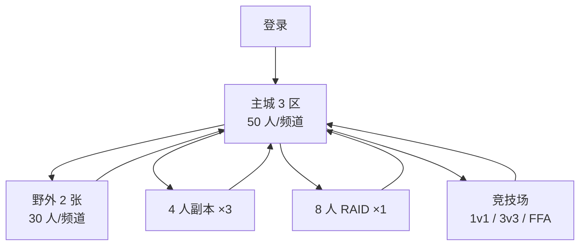

# 产品设计文档 02b — MMO / 内容 / 经济 / 商业化 / 路线图

> `docs/02` 分册草稿（TASK-012 / C3）。章节号按合并后的 `docs/02` 排布：§1–§3 见 02a（C2），§9 美术见 04（C6），§10 UX 合并时补，§11–§14 为本册。
>
> 边界：不复述帧数据/伤害公式/装备词条（02a）；不写接口/数据模型/部署（03a/03b）；不承诺收入；不编造数据；与 `docs/00` 冲突即以基线为准并升级。

## 0. 结论先行

1. **结构**：1 主城 3 区（50 人/频道）+ 2 张野外（30 人/频道）+ 4 副本（含 1 个 8 人 RAID）+ 3 张 PvP 图；全部实例化，不做无缝大世界（ADR-006）。
2. **内容**：EA 2 副本；1.0 4 副本（2 普通 + 1 困难 + 1 RAID）；4 人本 8–15 分钟，RAID 15–25 分钟；每季 +1 副本或 RAID、+1 PvP 图、+1 武器、+1 核心、+20 外观。
3. **模式**：1v1 排位、3v3 排位、8 人 FFA 休闲；竞技场强制归一化，PvE 数值不带入 PvP。
4. **社交**：好友/队伍/公会/聊天/邮件/导师/表情；公会 100 人、4 级权限、周常活动；公会战列为 1.0 后待决。
5. **经济**：金币/荣誉/RAID 代币/晶石四币；晶石只买外观、便利、栏位，**不能换金币/材料/装备**；拍卖税 5%；双录账本 + 日结对账。
6. **成长**：1–50 级（40–60 小时，设计初值）；装备评分只做门槛与展示；mastery 不加属性；赛季 10 周；战令 50 级。
7. **商业化**：F2P + 创始人包 $24.99 + 战令 $9.99/季 + 外观 $4.99–19.99 + 栏位；三档情景只做测算。
8. **风险**：瓶颈是内容与外观产能、地区匹配池、经济审计，不是技术；技术风险归 03。

| 标记 | 含义 | 处理 |
|---|---|---|
| 基线 | `docs/00` 已定 | 不可改；冲突即停 |
| 设计初值 | 本文可调参数 | 待原型/数值验证，可被评审推翻 |
| 情景假设 | 市场/收入/成本测算 | 非预测、非承诺 |
| 待决 | 需 Human/Tech 决策 | 未决不实现、不对外承诺 |

| 基线项 | 值 | 本文落点 |
|---|---|---|
| 主城 / 野外 | 1 个（3 区）/50 人；两张/30 人 | §4.1 |
| 副本 / PvP | 1.0 四个（2+1+1）/ 三种模式、3 图 | §4.2 |
| 单局 | 副本 8–15 min；RAID 15–25 min；PvP 3–5 min | §4.2 |
| 货币 / 税 | 金币、荣誉、RAID 代币、晶石 / 5% | §4.4 |
| 赛季 / 商业化 | 10 周 / $24.99、$9.99、$4.99–19.99 | §6、§11 |
| 团队 / KPI | 12–18 FTE；D1 35–40%、D7 15–20%、D30 8–10% | §12、§13 |

> 本文数字只有四类：`docs/00` 基线、设计初值、情景假设、待决项。未特别标注来源的数字（冷却、门槛、掉落率、上限等）均为设计初值；不放未核验竞品数据，对标由 `docs/01`（TASK-010）提供。

---

## 4. MMO 结构、内容与社交

> 覆盖 REQ-MMO-001（结构/频道）、MMO-002（副本/PvP）、MMO-003（社交）、MMO-004（经济）、MMO-005（UGC）。

### 4.1 世界容器与频道

| 容器 | 容量 | 战斗 | 匹配 | 说明 |
|---|---|---|---|---|
| 主城 3 区 | 50/频道 | 无（安全区） | 否 | 拍卖/银行/邮件/公会/训练/外观 |
| 野外 | 30/频道 | 开放 PvE、世界 Boss | 否（组队前往） | 1.0 两张，事件按频道独立 |
| 4 人副本 | 4 | 是 | 匹配/私人 | 8–15 分钟 |
| 8 人 RAID | 8 | 是 | 匹配/私人 | 15–25 分钟 |
| 竞技场 | 2 / 6 / 8 | 是 | 排位/休闲 | 3–5 分钟/局 |

| 主城区 | 设施 | 目的 |
|---|---|---|
| 市场/打造 | 拍卖、银行、邮件、打造、外观店 | 经济与 Build 调整 |
| 公会/社交 | 公会大厅、导师、组队板、表情舞台 | 社交与展示 |
| 训练/排位 | 训练场、木桩、排位入口、战绩 | 练习与进入 PvP |

| 频道规则 | 冷却（设计初值） | 说明 |
|---|---|---|
| 主城切换 | 10 秒 | 显示人数/负载，可任意切 |
| 野外切换 | 30 秒 | 仅同地图；切换即离开事件；Boss 贡献按频道独立 |
| 副本/竞技场中 | 不可 | 实例与频道解耦，结束回原频道或主城 |
| 战斗中 | 不可 | 脱战 5 秒后可切 |
| 频道满员 | — | 排队并提示，可切低负载频道 |

| 跨频道能力 | 规则 |
|---|---|
| 组队 | 队伍是跨频道社交容器，不绑定频道；成员可见状态，不能互相攻击/治疗 |
| 合流 | 队长在副本/竞技场入口发起，全员传送同一实例；30 秒未确认取消 |
| 野外同频 | 队长邀请队员切换；需队员脱战；满员排队 |
| 经济/社交 | 拍卖/邮件/公会全区共享，不受频道限制 |

> 容量（情景假设）：城镇在线 30%、副本 12%、野外 10%；据此 1.0 的 10k CCU ≈ 60 个城镇频道、300 个并发副本实例。规格与成本见 03b。
>
> 大区：NA/EU/SEA 各自独立世界，账号数据不跨区；经济是否互通见 Q8。

### 4.2 内容与模式

**EA / 1.0（与 `docs/00` §7 一致）**

| 内容 | EA | 1.0 | 赛季增量 |
|---|---|---|---|
| 城镇 | 1 | 1（3 区） | 活动装饰 |
| 野外 | 1 | 2 | 1/年 |
| 副本/RAID | 2 | 4（2 普通 + 1 困难 + 1 RAID） | 1/季 |
| PvP 地图 | 2 | 3 | 1/季 |
| 武器原型 | 4 | 8 | 1/季 |
| 战斗核心 | 6 | 12 | 1/季 |
| 防具套 | 10 | 20 | 2/季 |
| 敌人 | 15 | 30 | 4/季 |
| Boss | 2 | 5 | 1/季 |
| 等级 | 25 | 50 | — |
| 任务 | 35 | 70 | 10/季 |
| 外观 | 30 | 80 | 20/季 |
| 赛季 | 0 | 1 | 10 周 |

> 构成（设计初值）：EA 为灰烬铸炉、霜印矿坑（各 1 Boss）；1.0 为灰烬铸炉（2 Boss）、霜印矿坑、灰烬·困难（复用地图 + 追加机制）、深潮圣所 RAID（2 Boss），Boss 合计 5，与基线一致。

#### 4.2.1 4 人副本示例：灰烬铸炉（普通，1.0 版）

| 段 | 内容 | 时长（设计初值） |
|---|---|---|
| 入口 + 熔渣通道 | 集合、2 波小怪 | 2:00 |
| Boss 1 熔渣守卫 | 单体 + 场地火 | 2:30 |
| 铸炉桥 | 窄桥 + 蒸汽喷口 | 1:00 |
| Boss 2 铸炉之母 | 分工压火 + 半场横扫 | 3:00 |
| 结算 | 掉落、退出 | 0:30 |
| 合计 | 首次 11–13 分钟（含重试），熟练 8–10 分钟 | 符合基线 |

| 机制 | 预警 | 应对 | 失败惩罚 |
|---|---|---|---|
| 熔岩裂隙 | 红圈 1.2 秒 | 走位绕开 | 持续伤害 |
| 锤击扇形 | 橙扇 0.9 秒 | 侧移/防御 | 击飞 + 掉架势 |
| 抓取点名 | 紫标 1.5 秒 | 拉远、队友打断 | 持续掉血 |
| 破防窗口 | 架势归零 → 12 秒硬直 | 全队集火 | 无（正反馈） |
| 压火（B2） | 全场读条 3 秒、4 个火口 | 4 人各站 1 口 | 未压 → 全队 AOE |
| 熔渣洪流（B2） | 半场红条 2 秒 | 换半场/躲柱后 | 高伤 + 击退 |

| 掉落（每人，设计初值） | 数量 | 规则 |
|---|---|---|
| 装备 | 1 件 | 必掉，GS 260–280 |
| 材料 / 金币 | 2–3 / 120–180 | 打造与回收 |
| 外观 | 3% | 20 次必出 |

- 保底：每周首通必掉 1 装备；RAID 代币只由 RAID 产出，普通副本不产；复活共享 2 次；全灭重置当前 Boss；中途退出 10 分钟匹配冷却，掉线重连免罚。
- 困难模式：火口固定顺序、洪流双向、数值上调；GS 门槛 420；掉落升一档。
- 入口：匹配与私人房间均可；队长可设 GS 门槛；单人可匹配；房间码 6 位。
- 时长与难度目标：普通队均 10 分钟、困难 15 分钟内；失败 3 次提示降低难度或看攻略。

#### 4.2.2 8 人 RAID 示例：深潮圣所

| 段 | 内容 | 时长（设计初值） |
|---|---|---|
| 入口 + 外庭 | 分组、2 波潮汐怪、水位上升 | 4:00 |
| Boss 1 潮痕守门者 | 分摊 + 断桥 | 4:00 |
| 内殿 + Boss 2 潮汐之母 | 三阶段、8 人分工 | 8:00 |
| 结算 | 掉落、周常记录 | 1:00 |
| 合计 | 首次 20–25 分钟（含重试），熟练 15–18 分钟 | 符合基线 |

| 分工（由核心决定，无固定职业） | 人数 | 职责 |
|---|---|---|
| 承伤 | 1–2 | 拉朝向、吃单体重击、带位 |
| 打断 | 2 | 蓝色读条、召唤物 |
| 机动 | 2 | 场地机制、救人、补位 |
| 支援 | 1–2 | 治疗/护盾/增益，兼副打断 |

| 掉落与限制（设计初值） | 规则 |
|---|---|
| RAID 代币 | 30–40/周/角色，周上限 60 |
| 装备 | 每人 1 件史诗保底；传说机制装备 8% |
| 外观 | 每周首通 1 件（账号绑定） |
| 锁定 | 每角色每周 1 次拾取，可重复挑战不掉落 |
| 门槛/匹配 | GS 500；可私人房间码；匹配等待上限 5 分钟 |

#### 4.2.3 Boss 示例：潮汐之母

阶段：P1 涨潮（100–70%，水位与湿滑区）、P2 分流（70–35%，场地断两半，各 4 人）、P3 决堤（35–0%，全场读条 + 8 人分摊）。

| 技能 | 预警 | 预警时长（设计初值） | 应对 | 失败惩罚 |
|---|---|---|---|---|
| 潮涌重击 | 橙扇 | 1.0 秒 | 侧移/防御 | 击飞 + 破防 |
| 深海印记 | 紫标 + 连线 | 2.0 秒 | 拉出人群、传递 | 爆炸 AOE |
| 潮汐球 | 蓝读条 + 落点 | 2.5 秒 | 8 人分摊或打断 | 全队高伤 |
| 决堤 | 红色全场 + 倒数 | 3.0 秒 | 进安全柱/减伤 | 灭团级 |
| 召唤潮灵 | 敌方绿圈 | 1.5 秒 | 机动优先击杀 | 自爆叠易伤 |

> 帧数据、伤害系数、破防值归 02a 与数值表；本文只定可读性、分工与失败反馈。

#### 4.2.4 PvP：1v1 / 3v3 / 8 人 FFA

| 模式 | 人数 | 局制 | 时长（基线） | 地图 | 奖励 |
|---|---|---|---|---|---|
| 1v1 排位 | 2 | 三局两胜，每回合 60 秒（设计初值） | 3–5 分钟 | 3 张轮换 | 荣誉、段位、赛季外观 |
| 3v3 排位 | 6 | 单局 4 分钟，先 5 杀或比比分 | 4–5 分钟 | 3 张轮换 | 同上 |
| 8 人 FFA | 8 | 单局 5 分钟，击杀计分，3 秒复活 | 5 分钟 | 沉钟庭院/风蚀斗场 | 荣誉、日常 |

- 地图：熔炉天桥（60×40m，双层 3m）、沉钟庭院（50×50m，中央钟塔）、风蚀斗场（70×50m，柱阵 + 2m 台地）。
- **归一化**：装备数值压缩到赛季基准，核心机制与武器原型保留；禁用消耗品/外部增益；公式见 02a，产品只要求「PvE 数值不带入 PvP」可审计。
- 段位 7 档（青铜→宗师），MMR 初始 1000，赛季软重置回归 50%（设计初值）。
- 惩罚：逃跑/挂机 5/15/60 分钟冷却 + 信誉分；挂机 = 60 秒无有效输入且无伤害/治疗。
- 观战/回放：1.0 后评估；排位录像先做本地，不做实时观战（待决）。

| 异常 | 1v1 | 3v3 | FFA |
|---|---|---|---|
| 断线 | 30 秒内重连恢复，超时判负 | 30 秒重连，超时该队员判负、队伍继续 | 30 秒重连，超时退出计负 |
| 投降 | 回合间可投 | 需 2/3 同意 | 无，可退出计负 |
| 重连 | 恢复血量/冷却/比分（服务器权威） | 同左 | 恢复计分与名次 |

| 匹配 | 队伍 | 放宽（设计初值） | 等待上限 | 补位 |
|---|---|---|---|---|
| 1v1 | 单人 | ±100 → ±300 | 90 秒 | 无 |
| 3v3 | 1–3 人 | ±150 → ±400 | 120 秒 | 必须 6 人满编 |
| FFA | 单人 | ±200 → ±500 | 60 秒 | 待决（是否 bot） |
| 副本/RAID | 1–8 人 | GS 门槛 | 180/300 秒 | 可补齐 |

> 目标：匹配完成率 ≥95%（基线）；NA/EU/SEA 分池，跨区默认关闭（待决）。

### 4.3 社交

| 系统 | 上限（设计初值） | 关键功能 | 键盘入口 |
|---|---|---|---|
| 好友 | 100 | 备注、状态、邀请 | 社交面板 |
| 队伍 | 4 / 8 | 队长、标记、就位、合流 | 面板 + 快捷键 |
| 公会 | 100 人 | 金库、任务、排行、活动 | 面板、`/g` |
| 聊天 | 7 频道 | 世界/频道/队伍/公会/私聊/系统/招募 | Enter、Tab、`/w` `/p` `/g` |
| 邮件 | 附件 5 格 | 系统/玩家邮件、金币附件 | 面板 |
| 导师 | 1 对 3 | 新手引导、奖励 | 面板 |
| 表情 | 8 个基础 | 舞台动作、聊天表情 | `/e` + 快捷键（待决） |

- 聊天：世界频道需 ≥10 级且账号 ≥24 小时（设计初值）；每分钟 1 条；可屏蔽/举报；不显示真实姓名或支付信息。
- 公会：创建需 10,000 金币 + 20 级；7 天未登录标记；金库留审计日志；**公会战不做**（1.0 后待决）。

| 权限 | 会长 | 副会长 | 官员 | 成员 |
|---|---|---|---|---|
| 邀请/审批 | ✓ | ✓ | ✓ | — |
| 踢人 | ✓ | ✓ | 仅可踢成员 | — |
| 公告/门槛 | ✓ | ✓ | — | — |
| 金库取用 | ✓ | ✓ | 限额 | — |
| 金库存入 | ✓ | ✓ | ✓ | ✓ |
| 解散/转让 | ✓ | — | — | — |

| 公会活动 | 频率 | 参与 | 奖励 |
|---|---|---|---|
| RAID 周常队 | 每周 | 8 人 | RAID 代币、装备 |
| 公会任务 | 每周 5 条 | 全员 | 公会等级、金币 |
| 公会排行 | 每季 | 全员 | 称号、外观、荣誉 |
| 节日活动 | 每季 | 全员 | 限定装饰、表情 |

- 导师：导师 ≥40 级、新手 ≤20 级；每周上限 3 名；同 IP 多账号不计（待 03b 校验）。
- 招募：组队板按副本/段位/语言筛选，可跨频道报名；信息 30 分钟过期，防刷屏。
- 表情：免费基础 8 个，付费表情只做表现、不做嘲讽；键位与 02a 键位表联合评审（待决）。
- 邮件：大额金币附件触发审计；系统邮件不可回复。

### 4.4 经济

| 货币 | 产出 | 消耗 | 可交易 | 赛季处理 |
|---|---|---|---|---|
| 金币 | 任务、副本、野外、拍卖 | 拍卖税 5%、强化、打造、公会、邮件费 | 是 | 不清零 |
| 荣誉 | 排位、日常、赛季目标 | PvP 外观、称号、兑换 | 否 | 转换（待决） |
| RAID 代币 | RAID、周常 | RAID 装备/材料 | 否 | 保留（待决） |
| 晶石 | 充值、战令返还 | 外观、战令、栏位、便利 | 否 | 不清零 |

**硬约束**：晶石不能换金币/材料/装备，金币不能换晶石；不卖金币、材料、经验、强化成功率；掉落/伤害/交易由服务器判定（REQ-TECH-001）。

| 产销（每活跃小时，设计初值） | 产出 | 回收 | 净 | 主阀门 |
|---|---|---|---|---|
| 金币 | 任务 400 + 副本 500 + 野外 300 = 1,200 | 强化 500 + 税 200 + 外观 200 + 杂项 100 = 1,000 | +200 | 拍卖税、强化费 |
| 荣誉 | 排位 200 + 日常 100 = 300 | 赛季兑换 280 | +20 | 兑换上限 |
| RAID 代币 | 30–40 + 周常 20 = 50–60/周 | 50–60/周 | 0 | 周上限 60 |

| 拍卖规则 | 设计 |
|---|---|
| 税 | 成交价 5%（基线），卖家承担；流拍不收 |
| 上架 | 20 位、24/48 小时、可取消；参考价 ±50%（设计初值） |
| 结算 | 邮件发放，延迟 10 分钟到账（风控窗口） |
| 货币 | 仅金币；晶石、荣誉、RAID 代币不可上架 |
| 绑定 | 副本装备装备后绑定、强化 +1 后绑定；RAID 装备拾取绑定；外观账号绑定 |
| 限制 | 新账号 72 小时不可交易；单日交易额按信誉分档（待决）；玩家直交**待决**（建议只开拍卖 + 邮件） |

| 风险 | 信号 | 处置 |
|---|---|---|
| RMT | 固定对手、价格长期偏离、新号大额、金币单向汇聚 | 延迟结算、审计、冻结、回收、封禁 |
| 工作室 | 同设备多账号、异常在线、重复路线 | 收益递减、限制上架、人工复核 |
| 复制 | 物品对账不平、同一唯一 ID 多次入库 | 立即冻结、回滚、全服审计 |
| 退款套利 | 充值后立即转移 | 追回、负余额、限制交易 |

**防复制底线**：物品唯一 ID + 状态机（获得→绑定→上架→成交→邮件→删除）全程审计；经济操作幂等；掉落由服务器生成；每日四项对账（物品、货币、托管、税收）差异必须为 0；保留回滚与申诉。

| 账本账户 | 类型 | 示例（拍卖 100 金币） |
|---|---|---|
| 玩家钱包 | 负债 | 买家 −100，卖家 +95 |
| 拍卖托管 | 过渡 | +100 / −100 |
| 税收 | 系统收入 | +5 |
| 系统产出 / 回收 | 来源/去向 | 发放与销毁 |
| 公会金库 / 活动池 | 托管 | 独立审计 |

> 日结差异 0；周报看货币池、人均中位数、价格指数、前 1% 持有占比；月审抽样 200 笔。审计日志 ≥180 天（待法务确认）。

| 通胀指标 | 目标（设计目标） | 干预 |
|---|---|---|
| 金币池周增长 | ≤3% | 提高回收/下调掉落 |
| 人均金币中位数 | 周波动 ≤10% | 活动回收、税 |
| 关键材料价格指数 | 月 ±15% | 调整产出、限时商店 |
| 前 1% 持有占比 | ≤25% | 定向回收、交易审查 |

> 阀门优先级：外观/便利回收 > 强化费 > 活动回收 > 掉落调整；**掉率调整必须公告，且不参与 A/B**；禁止暗改经济参数。

### 4.5 UGC（S2）

| 阶段 | 能力 | 商业化 |
|---|---|---|
| 1.0 | 调色、贴花皮肤（官方模板） | 官方售卖，不分成 |
| S2 | 编辑器、市场、分成 | 分成见 §11 的 UGC 表 |
| S3+ | 特效皮肤、地图主题 | 待决 |

- 审核：自动扫描 → 人工复核 → 上架；下架与申诉；不改数值、不改判定、不做地图玩法。
- 性能：UGC 资产受性能预算与内存上限约束（见 04）。

---

## 5. 成长

| 阶段 | 时长（设计初值） | 解锁 | 说明 |
|---|---|---|---|
| 1–10 | 1.5–2 小时 | 教程、主城、首个核心 | 学会 ZXCV/防御/冲刺 |
| 11–25 | 8–12 小时 | 野外、2 副本、PvP、公会 | EA 上限 |
| 26–40 | 15–20 小时 | 困难副本、RAID、赛季目标、mastery | 进入终局 |
| 41–50 | 15–25 小时 | 排位全开、RAID 周常、外观收集 | 1.0 满级 |
| 合计 | 40–60 小时 | — | 不靠刷怪拉时长 |

- 经验来源：首次通关全额、任务约 50%、副本每日前 3 次全额（4–6 次 50%、之后 10%）、PvP 按局、赛季目标每周 3 条；重复刷怪递减。
- **装备评分（GS）**：由稀有度/强化/装等加权（公式归 03b）；用途为副本门槛、匹配参考、组队展示；不用于 PvP 强度、掉落率、定价。1.0 上限 600、EA 上限 300（设计初值）。
- **门槛**：EA 普通 120；1.0 普通 260、困难 420、RAID 500（设计初值）。只做建议值，不硬锁，低于门槛提示风险。
- **Mastery**：武器/核心各 1–10 级；经验来自使用该装备完成内容；周上限 2 级；奖励外观变体/称号/训练挑战；**不给属性、伤害、掉落率、GS**；新赛季旧装备 1.5× 经验。
- 反 grind：纵向有上限、横向无上限；每周 3–5 小时可完成赛季主线；无签到强制、无体力、无离线收益；商城不卖经验/进度。

| 装备来源 | 获取 | 保底 | 可交易 |
|---|---|---|---|
| 4 人副本 | 通关掉落 | 每周首通 1 件 | 装备后绑定 |
| RAID | 周常拾取 | 每周 1 件史诗 | 拾取绑定 |
| 打造 | 材料 + 金币 | 无随机词条 | 可交易 |
| 赛季 | 战令/段位/荣誉 | 赛季结束前可补 | 账号绑定 |
| 外观店 | 晶石/活动 | — | 纯外观 |

---

## 6. 赛季与战令

| 周 | 主题 | 内容 |
|---|---|---|
| W1 | 开季 | 新副本/RAID、新战令、排位定级 |
| W2–W3 | 稳定 | 平衡观察、首个补丁 |
| W4 | 中期 | 中期活动、外观上新、任务第二章 |
| W5–W6 | 社区 | 社区赛事、双倍荣誉周末 |
| W7–W9 | 冲刺 | 高难挑战、战令追赶 1.5×、排位冲刺 |
| W10 | 结算 | 段位结算、奖励发放、下季预告 |

| 每季增量（基线） | 分配（设计初值） |
|---|---|
| 副本/RAID ×1 | S1 普通、S2 RAID、S3 困难、S4 RAID |
| PvP 图 ×1、武器 ×1、核心 ×1、Boss ×1 | 每季各 1 |
| 防具 ×2、敌人 ×4、任务 ×10、外观 ×20 | 每季固定 |
| 野外 ×1/年 | S4 或年度版本 |

- 奖励：段位外观/称号、战令、荣誉兑换、赛季成就；**无属性奖励**。
- 赛季目标：每周 3 条（副本/PvP/收集），给经验、荣誉与战令进度；不做每日强制。
- 重置：等级/GS/mastery 保留；MMR 软重置；战令清零；荣誉/RAID 代币赛季处理（待决）；周常重置。

| 战令 | 设计 |
|---|---|
| 价格 | $9.99/季（基线） |
| 等级 | 50 级，10 周（设计初值） |
| 免费轨 | 每 5 级 1 项（表情/称号/少量晶石），共 10 项 |
| 付费轨 | 每级 1 项：外观 12、表情 6、称号 4、晶石返还 300、其余便利/晶石 |
| 进度 | 周任务 3 条 + 赛季目标 + 日常，约 40–60 小时/季（设计初值） |
| 追赶 | 末 2 周 1.5×；不做卖等级（待决，建议不卖）、不卖强度、不做随机箱 |

| 段位/进度 | 奖励 | 说明 |
|---|---|---|
| 青铜–黄金 | 荣誉、基础外观 | 参与即可 |
| 铂金–钻石 | 段位外观、称号 | 赛季结算发放 |
| 大师–宗师 | 限定外观、头像框 | 不额外给属性 |
| 战令 50 级 | 终极外观、晶石 | 免费/付费轨各一 |

---

## 7. LiveOps 与内容节奏

| 周期 | 动作 | 备注 |
|---|---|---|
| 每日 | 经济对账、举报处理、公告 | 差异非 0 即升级 |
| 每周 | 周常重置、平衡观察、社区赛 | 看板复盘 |
| 每 2 周 | 小补丁（平衡/修复/活动） | 可回滚 |
| 每 10 周 | 赛季更新 | 内容 + 战令 |
| 每 6 个月 | 大版本（新野外/系统） | Human 门 |
| 每年 | 年度内容与商业化复盘 | 范围重估 |

| 活动 | 频率 | 奖励 | 限制 |
|---|---|---|---|
| 世界 Boss | 每周 2 次 | 金币、材料、外观 | 按频道独立 |
| 双倍荣誉/经验 | 每 2 周 | 荣誉、经验 | 不叠加 |
| 节日活动 | 每季 | 限定外观、表情 | 不做限时属性 |
| 社区赛事 | 每月 | 称号、外观 | 官方奖金待决 |
| 回归加成 | 按需 | 7 天经验加成 | 每账号 90 天一次 |

- 活动奖励只给金币/材料/外观/称号，不给属性。
- 平衡：赛季中期一次大调，其余每 2 周小调；改动公告 + 理由。
- 事故：经济/复制类立即停相关功能，24 小时公告、72 小时补偿方案（设计初值）。
- 产能不足时优先砍外观数量，不砍副本与手感。

---

## 8. 地图与关卡（MMO 侧）

| 地图 | 类型 | 尺寸（设计初值） | 高低差 | 模式 |
|---|---|---|---|---|
| 主城 3 区 | 城镇 | 80×60 / 60×50 / 70×70m | 台阶 0.5–1.5m | 社交/训练 |
| 灰烬荒原 | 野外 | 200×200m | 崖 4–8m | PvE/事件 |
| 潮汐滩涂 | 野外 | 180×220m | 水位/浅滩 | PvE/世界 Boss |
| 灰烬铸炉 / 困难 | 副本 | 线性 3 段 | 桥/平台 2m | 4 人 |
| 霜印矿坑 | 副本 | 环形 2 层 | 竖井 6m | 4 人 |
| 深潮圣所 | RAID | 3 平台 | 断桥/升降 8m | 8 人 |
| 熔炉天桥 / 沉钟庭院 / 风蚀斗场 | PvP | 60×40 / 50×50 / 70×50m | 2–3m | 1v1/3v3/FFA |

- 战斗区 ≥20×20m，主通路 ≥3 个角色宽度；可跳 0.5–2m，≥4m 视为悬崖；所有高度差有影子/边缘提示。
- 遮挡：屋顶/树冠/高墙淡出；**地面预警不被装饰遮挡**；颜色不作唯一信息通道（配合形状/音效/描边，REQ-QA-004）。
- 复用：普通/困难共用地图；PvP 三图轮换；野外事件复用同图区域。
- 评审清单：进图 30 秒内遇到第一波敌人；岔路 ≤1 条；Boss 房无小怪干扰；退出重进可恢复；预警不被地形遮挡。

| 预警色 | 形状 | 含义 | 预警时长（设计初值） | 应对 |
|---|---|---|---|---|
| 红 | 实心圆/矩形 | 致命 AOE | 1.2–2.0 秒 | 离开/进安全区 |
| 橙 | 扇形/直线 | 高伤方向技 | 0.8–1.2 秒 | 侧移/防御 |
| 紫 | 标记/连线 | 点名/追踪 | 1.5–2.5 秒 | 拉远/传递/打断 |
| 蓝 | 环形/读条 | 可打断施法 | 2.0–3.0 秒 | 打断 |
| 黄 | 箭头 | 冲锋路径 | 0.8–1.0 秒 | 横向规避 |
| 绿 | 地面圈 | 治疗/增益/安全区 | — | 进入 |

---

## 11. 商业化

> 覆盖 REQ-BIZ-001（不卖属性）、BIZ-002（价格带/三档情景）、BIZ-003（UGC 分成）。

**原则**：卖表达不卖强度，卖便利不卖进度，卖内容访问不卖胜负；竞技场归一化是商业化的技术前提；定价透明、无概率箱；收入只做情景不做承诺。

| SKU | 价格（基线） | 内容（设计初值） |
|---|---|---|
| 创始人包 | $24.99 | 外观套、称号、战令 S1、500 晶石、角色栏 +1（限时待决） |
| 战令 | $9.99/季 | 50 级付费轨 + 免费轨 |
| 外观单品 | $4.99 | 武器皮肤/披风/染色 |
| 外观套装 | $9.99–14.99 | 套装 + 表情 |
| 传奇外观 | $19.99 | 带 VFX 套装 |
| 角色栏 | $4.99/个 | +1 角色位 |
| 仓库/配装栏 | $2.99–4.99 | +1 页 / +1 预设 |
| 改名/整形 | $4.99–9.99 | 一次性 |

**不卖**：属性（伤害/防御/攻速/暴击）、装备/材料/强化石/成功率、金币/经验/等级/战令等级（待决）、随机箱/抽奖/保底强度、副本门票、赛季专属属性、PvE 复活币。

| 阶段 | 主推 | 价格点 |
|---|---|---|
| EA | 创始人包 + 外观 | $24.99 / $4.99–19.99 |
| S1–S4 | 战令 + 每季外观 | $9.99 / $4.99–19.99 |
| 年度 | 周年外观、捆绑包 | 单品不高于 $19.99 |

| 情景（情景假设） | CCU | MAU | 付费率 | ARPPU | 月流水 |
|---|---|---|---|---|---|
| 低 | 5,000 | 50,000 | 3% | $25 | ≈ $37.5k |
| 中 | 20,000 | 200,000 | 4% | $30 | ≈ $240k |
| 高 | 50,000 | 500,000 | 5% | $35 | ≈ $875k |

> 与 `docs/00` §9.1 同组数字，只用于测算与敏感性，**不是预测或承诺**；隐含 MAU/CCU ≈ 10。

| 敏感性（中档基准） | 变化 | 月流水（情景假设） |
|---|---|---|
| 付费率 −1pp | 3% / $30 | ≈ $180k |
| 付费率 +1pp | 5% / $30 | ≈ $300k |
| ARPPU ±20% | 4% / $24 或 $36 | ≈ $192k / $288k |

| 成本假设（情景假设，需财务核实） | 取值 |
|---|---|
| 月成本 | $250k–$420k（12–18 FTE + 服务器 + 外包 + 营销） |
| 平台分成 / 税与支付 | 30%（行业通行值，**待核实条款**）/ ≈3% |
| 净收入率 | ≈67% |
| 盈亏平衡月流水 | ≈ $373k–$627k |
| 对应规模（$30、4%） | MAU ≈ 31 万–52 万，CCU ≈ 3.1 万–5.2 万 |

> 结论（非承诺）：中档情景 $240k 在成本区间上限不足以覆盖。可行路径是控制成本/外包、提高外观产能与 ARPPU、扩大 CCU——**不是回到卖属性**。预算决策走 Human 门。

| UGC 分成（S2，提案待决） | 建议 | 批准 |
|---|---|---|
| 分成比例 | 创作者 70% / 平台 30% | Human + 法务 |
| 结算 | 累计 $100 起提，月度 | 财务 |
| 审核 | 自动扫描 + 人工 + 申诉 | 运营 |
| 税务/侵权 | 按地区代扣；三振出局 + 收益追回 | 法务 |

**合规**：无概率箱；地区定价、退款、青少年/家长控制待法务确认；不向未成年人推限时付费；商店页明确「纯外观/便利」。

---

## 12. 路线图

> 落点：REQ-ART-003（风格测试）、REQ-TECH-005（容量/成本模型）；节奏数字见 `docs/00` §10。

| 里程碑 | 时间（基线） | 内容 | 退出标准 |
|---|---|---|---|
| M0 | 0–2 月 | 战斗 + 联网原型；1 图、2 核心、2 人 | 100ms/2% 丢包可连段/防御/击杀；键盘-only |
| M1 | 2–5 月 | 垂直切片；4 人副本、城镇、持久化 | 2k CCU 压测；风格测试通过 |
| M2 | 5–9 月 | Alpha；3 副本、2 PvP 模式、匹配/反作弊 | 8 人规模 PvP 可玩（基线「8v8」口径待澄清） |
| M3 | 9–15 月 | Beta；内容完成、LiveOps、本地化 | 5k CCU；崩溃-free ≥99.5% |
| M4 | 15–18 月 | 上线、多区 | 10k CCU；匹配完成率 ≥95% |

> 基线同时写「1.0 18–24 个月」与「M4 15–18 月上线」，二者关系（M4 是否为 EA 上线）**待澄清**，本文不自行调和。

| 项 | EA | 1.0 |
|---|---|---|
| 时间（基线） | 12–15 月 | 18–24 月 |
| 等级 / 城镇 | 25 / 1（3 区） | 50 / 1（3 区） |
| 野外 / 副本 | 1 / 2 普通 | 2 / 4（2+1+1） |
| PvP | 2 图、三模式 | 3 图、全模式 |
| 武器 / 核心 | 4 / 6 | 8 / 12 |
| 商业化 | 创始人包 + 外观 | 战令 S1 + 全 SKU |

| 赛季 | 主题 | 副本/RAID | PvP 图 | 武器/核心 | 系统/商业化 |
|---|---|---|---|---|---|
| S1 | 灰烬季 | 普通 ×1 | +1 | +1 / +1 | 战令 S1、赛季段位 |
| S2 | 深潮季 | RAID ×1 | +1 | +1 / +1 | UGC 市场 + 分成 |
| S3 | 风蚀季 | 困难 ×1 | +1 | +1 / +1 | 公会活动升级、赛事（待决） |
| S4 | 终局季 | RAID ×1 | +1 | +1 / +1 | 年度野外 ×1、战令 S4 |

| 职能 | 人数（基线） | 分工 |
|---|---|---|
| 程序 | 4–5 | 战斗/联网 2、后端/经济 1–2、工具 1 |
| 美术 | 4–6 | 角色/装备 2、环境 2、VFX/UI 1、TA 1 |
| 策划 | 2–3 | 系统/经济 1、内容/关卡 1、叙事 1 |
| 制作/运营 + QA/社区 | 2–3 | 排期、LiveOps、全键盘/网络/经济回归 |

| 每季产能（情景假设） | 人月 |
|---|---|
| 1 副本或 RAID | 3–4 |
| 1 PvP 图 | 1.5 |
| 1 武器 + 1 核心 | 2–3 |
| 2 防具套 + 20 外观 | 3–4 |
| 10 任务 + 活动 | 1–2 |
| 合计 | ≈ 11–15（≈3.7–5 FTE 持续） |

> 推论：12–18 人可支撑每季内容但无余量做公会战/电竞/大地图；5–10 人须缩范围。

| 规模 | 内容 | 功能 |
|---|---|---|
| 5–10 人 | 1 城镇、1 野外、2 副本、2 PvP 图、6 核心（基线） | 砍公会战/赛事/UGC，战令简化 |
| 12–18 人 | 基线 1.0 全量 | 基线功能 |
| 25+ 人 | +2 副本、+4 核心、+2 赛季内容（基线） | 公会战/电竞/UGC 扩展 |

- 裁减顺序：外观数量 → PvP 图 → 野外 → 副本难度分层 → 赛季任务数；**不砍** 4 人本、手感、全键盘、归一化、经济审计。
- 关键路径：手感（M0）→ 可信联网（M0–M1）→ 4 人本循环（M1）→ 经济与拍卖（M2）→ 赛季/LiveOps（M3）→ 多区（M4）；经济审计先于交易开放，UGC 先于分成。

---

## 13. KPI、遥测与实验

| 指标 | 目标（基线） | 口径 |
|---|---|---|
| D1 / D7 / D30 | 35–40% / 15–20% / 8–10% | 新增留存 |
| 单次会话 | 60–90 分钟 | 登录到登出 |
| 匹配完成率 | ≥95% | 开始匹配到进入对局 |
| 崩溃-free | ≥99.5% | 无崩溃会话占比 |
| CCU | 软 launch 2k；1.0 10k | 峰值同时在线 |
| Steam 愿望单 | 100k（首年） | 平台后台 |

| 补充（设计目标） | 目标 |
|---|---|
| 付费率 | 3–5%（情景假设，监控口径） |
| ARPPU | $25–35（情景假设，监控口径） |
| 教程完成率 | ≥80% |
| 首日首战胜率 | 40–60% |
| 战令完成率 | 25–35% |
| 拍卖参与率 | ≥30% |
| 举报响应 | ≤24 小时 |
| 经济日结差异 | 0 |

- 漏斗：安装→登录→教程→首战→首件装备→首次副本→首次 PvP→加公会→首次付费；断点优先于总量。
- 付费率/ARPPU 只作监控与情景对照，不是承诺；异常波动先查渠道与退款。

| 埋点 | 关键字段 | 用途 |
|---|---|---|
| session_start/end | 角色、频道、版本 | 会话时长 |
| tutorial_step | 步骤、耗时、失败 | 新手漏斗 |
| dungeon_start/end | 副本、队伍、GS、时长、死亡 | 难度/时长 |
| boss_wipe | Boss、阶段、组成 | 调参 |
| loot_roll | 物品、来源、稀有度 | 掉落分布 |
| matchmaking_result | 模式、MMR、等待、结果 | 池健康 |
| pvp_match_end | 模式、比分、断线、投降 | 平衡/惩罚 |
| purchase | SKU、价格、渠道、币种 | 收入结构 |
| currency_change | 币种、数量、来源/去向 | 经济监控 |
| auction_sale | 物品、价格、税 | 市场健康 |
| trade_blocked | 原因、物品、金额 | 风控 |
| report_submitted | 类型、对象 | 社区安全 |
| crash/perf | 版本、场景、帧率 | 稳定性 |

- 命名/字段由 03b 数据字典定稿；不采集真实姓名/邮箱/卡号；角色 ID 与账号 ID 分离；保留期按隐私政策。
- 指标口径写死（如 CCU = 5 分钟粒度峰值）；事件版本化，字段变更设兼容期；导出脱敏、访问最小权限、查询留审计。

| 可 A/B | 不可 A/B |
|---|---|
| 引导顺序、提示样式 | 掉率、伤害、MMR 算法 |
| 商店陈列与排序 | 价格、经济税率 |
| 战令奖励预览 | 归一化系数 |
| 匹配放宽阈值（带护栏） | 任何影响强度的参数 |

- 护栏：崩溃率、匹配完成率、D1、退款率，任一恶化即停；每组 ≥5,000 或 2 周；预注册假设，结果存档，不做暗改。
- 流程：假设 → 指标 → 分流 → 护栏 → 结论归档；失败实验同样记录，避免重复试错。
- Playtest：M0 10–20 人（键盘/连段）、M1 50–200（副本节奏）、M2 500–1,000（PvP/匹配）、M3 2,000+（赛季/付费意愿，问卷 + 假商店，不真实扣费）。

---

## 14. 风险、开放问题与待决

| # | 风险 | 概率/影响 | 缓解 | Owner |
|---|---|---|---|---|
| R1 | 内容产能不足、赛季断档 | 高/高 | 模块化复用、外包、砍外观数量 | 制作 |
| R2 | 外观审美/产能不足、收入不够 | 高/高 | 风格测试前置、外包、UGC S2 | 美术/商业 |
| R3 | 通胀或通缩 | 中/高 | 回收阀、审计、公告调参 | 策划/后端 |
| R4 | RMT/工作室/复制 | 中/高 | 双录账本、延迟结算、封禁 | 后端/运营 |
| R5 | 地区匹配池不足 | 中/高 | 分池阈值、时段活动、跨区（待决） | 后端/运营 |
| R6 | CCU 不及预期 | 中/高 | 愿望单、Demo、创作者合作 | 发行 |
| R7 | 赛季疲劳/内容消耗过快 | 中/中 | 横向收集、节奏、追赶 | 策划 |
| R8 | PvP 平衡失控 | 中/高 | 赛季调参、归一化、禁用列表 | 战斗（C2） |
| R9 | 键盘冲突/可用性回归 | 中/中 | 重映射、冲突检测、QA 回归 | QA |
| R10 | UGC 审核/法律/税务 | 中/高 | 审核流程、法务评估、S2 再开 | 法务/运营 |
| R11 | 服务器成本超预算 | 中/中 | 容量规划、区域调度（03b） | 后端 |
| R12 | 团队不足 12 FTE | 中/高 | 缩范围、外包 | 制作/Human |

| # | 开放问题 | 现状 | 需要 |
|---|---|---|---|
| Q1 | 产品名/品牌 | 未定 | Human |
| Q2 | 首版手柄 | 1.0 后（基线假设） | Human |
| Q3 | UGC 上线时间与审核 | S2 提案 | 产品/法务 |
| Q4 | 国服发行商/版号 | 后置 | Human |
| Q5 | 电竞投入 | 先社区赛 | Human |
| Q6 | AI NPC/生成内容 | 另立专题 | Human |
| Q7 | 竞品价格带核验 | 待 `docs/01` | Researcher |
| Q8 | 跨大区经济是否互通 | 建议独立 | Tech/Human |

| # | 待决（未决不实现） | 建议 | 批准 |
|---|---|---|---|
| D1 | 创始人包内容与是否限时 | 含战令 S1，限时到 1.0 | Human |
| D2 | 战令等级是否直购 | 不可 | Human |
| D3 | 荣誉/RAID 代币赛季末处理 | 荣誉 50% 转金币；RAID 代币保留 | 产品/经济 |
| D4 | 公会人数与公会战 | 100 人；公会战 1.0 后 | 产品 |
| D5 | 玩家直交 | 只开拍卖 + 邮件 | 产品/安全 |
| D6 | UGC 分成 | 70/30 | Human/法务 |
| D7 | EA 是否含困难本 | 不含 | 产品 |
| D8 | M2「8v8」口径 | 以 3v3 + 8FFA 为准 | Orchestrator |
| D9 | M4 与 1.0 时间关系 | 先澄清再写死 | Orchestrator/Human |
| D10 | 低峰机器人补位 | 仅 FFA 休闲 | 产品 |
| D11 | 表情快捷键位 | 与 02a 联合定 | 产品/QA |
| D12 | 是否卖经验加成 | 否 | Human |

| # | 假设 | 验证 |
|---|---|---|
| A1 | 月成本 $250k–$420k | 财务/HR 复核 |
| A2 | 平台分成 30%、税/支付 3% | 法务/财务 |
| A3 | 每季内容 ≈11–15 人月 | M1 后按工时校准 |
| A4 | 40–60 小时满级 | M2 遥测 |
| A5 | 金币净增 +200/活跃小时 | 经济模拟 + 上线监控 |
| A6 | 玩家接受无属性奖励 | Playtest/Beta |

| 新术语 | 定义 | 状态 |
|---|---|---|
| 装备评分（GS） | 稀有度/强化/装等的加权分，只用于门槛与展示 | 待并入 `docs/00` 术语表 |
| mastery | 武器/核心熟练度，只给表达奖励，不给属性 | 待并入 |
| 合流 | 队长把跨频道队伍带入同一实例 | 待并入 |
| 信誉分 | 逃跑/挂机/举报形成的匹配与交易权限评分 | 待并入 |
| 大区 | NA/EU/SEA 独立世界，账号与数据不跨区 | 待并入 |

| 交接对象 | 需承接 |
|---|---|
| C2（02a） | 归一化规则、GS 与战斗数值边界、表情键位冲突 |
| C4（03a） | 匹配/实例/断线的客户端表现、键盘-only 社交与拍卖 |
| C5（03b） | 经济账本、审计、风控、容量与成本 |
| C6（04） | 预警语言、地图尺寸/遮挡、外观产能与 UGC 预算 |
| Orchestrator | D1–D12、M2/M4 口径、REQ 追溯更新 |

> 草稿，待独立评审；数字/术语以 `docs/00` 为准，冲突升级。
>
> 依赖顺序：经济审计（03b）先于交易开放；反作弊（03a）先于排位；UGC 审核（04 + 法务）先于分成。
