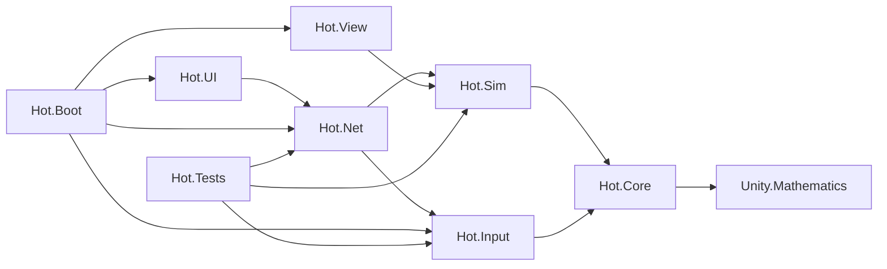
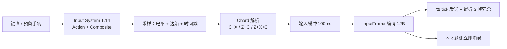
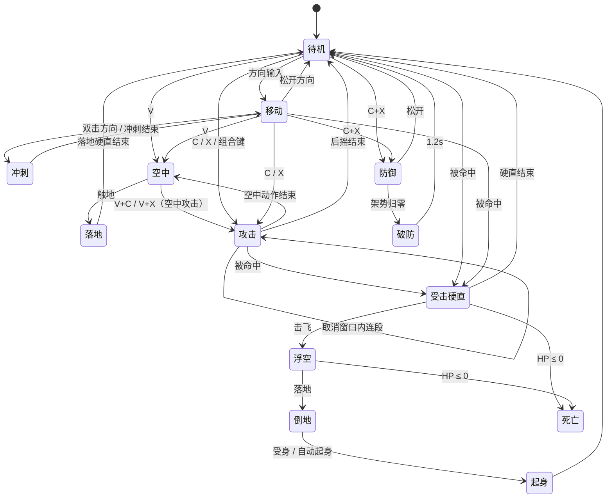
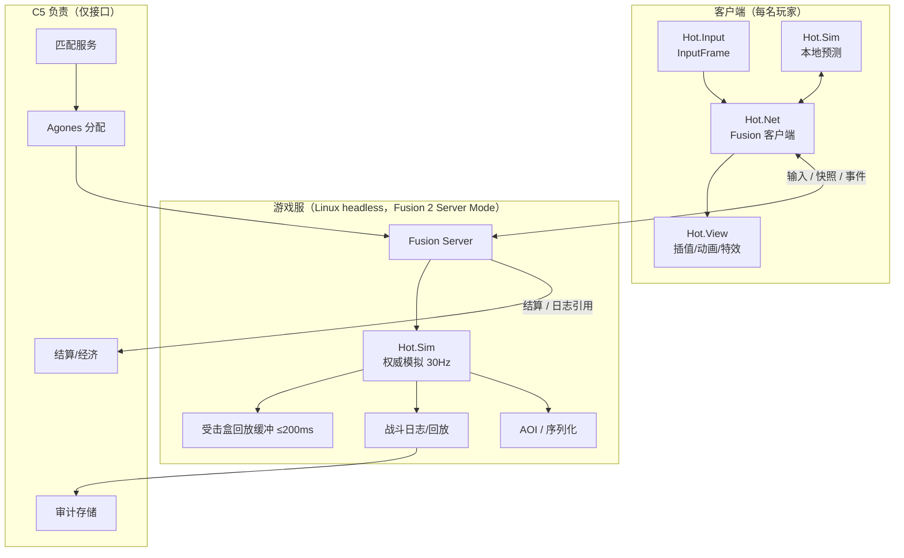
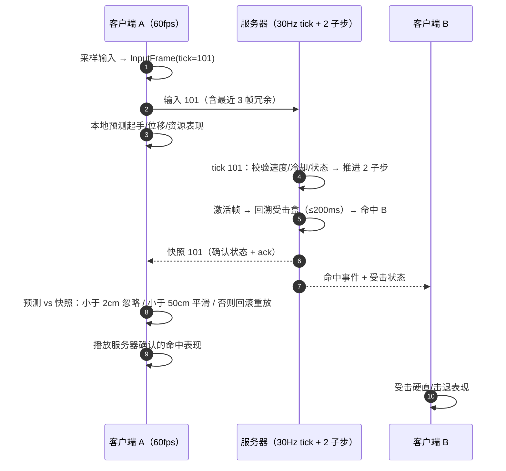
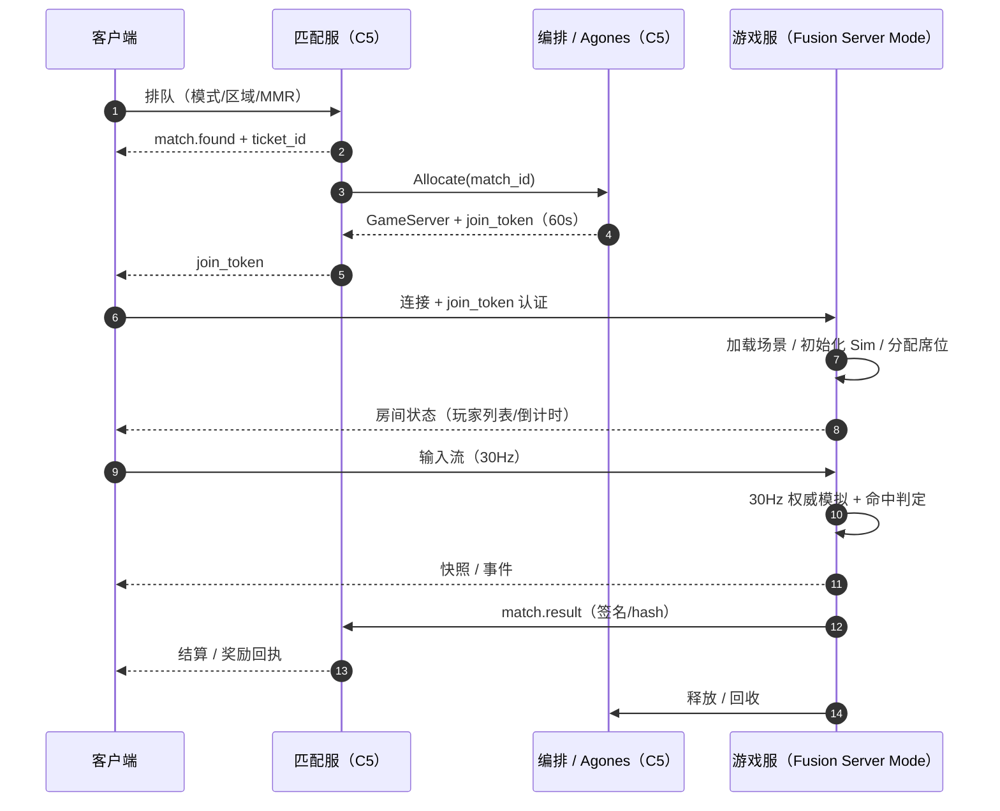

# 技术设计草稿 A — 客户端 / 输入 / 战斗模拟 / 联网

> 本文是 `docs/03` 的 03a 草稿，只覆盖**客户端、输入、战斗模拟、联网、客户端侧反作弊、客户端/房间性能预算与测试**。后端、数据、部署、成本见 03b（C5）。
> 数字以 [`docs/00`](../00-设计基线与术语.md) 为准；本文新增数值标「建议值」，需拍板的标「待决」，未核实的标「待核实」。结论先行，图为 Mermaid，伪代码只表达结构。

---

## 0. 结论先行

**一句话**：客户端只做三件事——**采集输入、预测自己的动作、把服务器的真相演出来**；命中、伤害、掉落、结算全部由 30Hz 服务器权威裁定，客户端预测只负责手感，不负责结果。

| # | 决策 | 内容 | 依据 / 状态 |
|---|---|---|---|
| TD-01 | 时间模型 | 逻辑与网络 tick 固定 **30Hz**；每 tick 内跑 **2 个 1/60s 子步**，帧数据仍以 60fps 帧计（`docs/00` §3.5），命中窗口在子步判定 | 与 ADR-008 一致，不改变同步频率（是否纳入基线：P-01） |
| TD-02 | 共享核心 | 一份 `Hot.Sim`（纯 C#，零 `UnityEngine` 依赖）同时编译进客户端与 Linux headless | ADR-008；REQ-TECH-001 |
| TD-03 | 只发输入 | 客户端上行只有 `InputFrame`，**不发位置、不发伤害、不发命中** | AGENTS.md §3.7；REQ-TECH-001 |
| TD-04 | 命中权威 | 命中盒、伤害、硬直、破防、连段衰减全部服务器计算；客户端只预测动作与位移 | REQ-CBT-002/004；预测命中预告是否默认开：P-05 |
| TD-05 | 延迟补偿 | 服务器保存 **≤200ms** 受击盒历史，按攻击方 RTT 回溯；超窗 clamp 并记录 | `docs/00` §8；REQ-TECH-002 |
| TD-06 | 输入层 | Input System 1.14 只做设备抽象与重映射；战斗输入自研 `InputFrame`，C+X 用 ±40ms 窗口 + 防御优先 | ADR-004；REQ-CTL-003 |
| TD-07 | 相机 | 单正交相机，pitch 默认 50°，ortho size 默认 8、缩放 clamp 在 7–9；不旋转、无鼠标、不跟高度 | ADR-002；`docs/00` §3.1 |
| TD-08 | 反作弊 | M0–M2 只做服务器校验 + 回放审计 + 客户端加固；EAC/BattlEye 在 1.0 前评估（Human 门） | `docs/00` §8；P-08 |

**关键数字（引自 `docs/00`，不新增基线）**：

| 维度 | 基线 |
|---|---|
| 客户端 | PC/Steam；1080p 60fps @ GTX 1060 / RX 580；安装包约 10GB |
| 服务器 | 30Hz；16 人房 <10ms/tick；50 人城镇 <20ms/tick；RTT 目标 <80ms |
| 手感 | 客户端预测 + 服务器校正；命中盒回放 ≤200ms；M0 验收 100ms/2% 丢包 |
| 规模 | 城镇 50 人/频道；野外 30；PvE 4/8；PvP 8–16；CCU 情景 5k/20k/50k |
| 带宽 | 下行约 10KB/s、上行约 2KB/s 每玩家 |
| 相机 | 45–55° 正交；size 7–9；角色占屏 8–12%；缩放 0.8–1.2× |

---

## 1. 范围、非范围、与 C5 的分工

### 1.1 本文范围

客户端架构（工程/程序集/场景流、URP 与像素 shader、Addressables、UI Toolkit、8–12fps 动画、相机）；输入（布局、重映射、C+X、rollover、输入帧、手柄预留）；战斗（30Hz 固定步、状态机、数据驱动招式、地面 capsule + 高度、命中盒、伤害/硬直/取消、AI、共享 core、回放）；联网（Fusion 2 Server Mode、预测/校正、延迟补偿、AOI、重连、房间生命周期）；客户端反作弊、性能预算、测试。

### 1.2 非范围

账号/好友/公会/聊天/排行/MMR 算法、匹配池与分配器实现；数据库 schema、缓存、消息队列、经济账本；K8s/Agones 部署拓扑、区域容量、成本模型；商业化、拍卖、UGC 审核、法务与版号；美术资产生产、音频、本地化、最终平衡。

### 1.3 与 C5（03b）的分工与接口

| 主题 | C4（本文） | C5（03b） | 接口（以 03b 为准） |
|---|---|---|---|
| 匹配 | 客户端排队 UI/状态机/失败退避/取消 | 匹配候选（Nakama）、MMR、编排 | `ticket_id`、`match.found` |
| 房间分配 | 连接、加载、断线重连表现 | Agones 分配、健康、回收 | `join_token`（60s、单次） |
| 登录/会话 | 登录态消费、令牌刷新、断线提示 | Nakama 认证、会话、封禁 | 会话 JWT |
| 战斗日志 | 事件格式、本地日志、上报触发 | 存储、审计管道、保留期 | `match.result` 事件 |
| 结算 | 结算演出、奖励展示 | 权威结算、掉落、货币 | `MatchResult`（签名/hash） |
| 性能/成本 | 客户端帧/内存、房间 tick、带宽 | 服务器规格、CCU、成本 | 本文 §8 |

**边界规则**：本文不写后端数据模型与 API 细节，只写「客户端需要什么、何时需要、失败怎么办」；合并进 `docs/03` 时接口表以 C5 正文为准。

---

## 2. 技术目标与约束

### 2.1 目标（可验收）

| 维度 | 目标 | 验收口径 | 来源 |
|---|---|---|---|
| 平台 | Windows/Steam，1080p | GTX 1060 / RX 580 稳定 60fps | `docs/00` §8 |
| 帧率 | 客户端 60fps；服务器 30Hz | 1% low ≥50fps；tick 不超预算 | 同上 |
| 延迟 | 同区 RTT <80ms；M0 100ms + 2% 丢包可完成连段/防御/击杀 | 网络矩阵（§9.3） | REQ-QA-003 |
| 回放 | 命中盒回放 ≤200ms | 回溯窗口与命中一致性测试 | REQ-TECH-002 |
| 输入 | 全流程无鼠标 | 键盘-only 脚本 + 人工 | REQ-CTL-001/QA-001 |
| 规模 | 8–16 人战斗、50 人城镇、5k–50k CCU | 连接/排队/重试可用；房间预算达标 | `docs/00` §8 |
| 相机 | 45–55° 正交，size 7–9 | PRD/TDD/美术参数一致 | REQ-VIS-001 |

**「100ms」口径**：RTT 100ms（单向约 50ms）+ 2% 丢包。目标是**本地反馈 ≤1 帧、服务器确认 ≤1 RTT**；PvP 允许被 200ms 内回放命中，须在教学/UI 明示。

### 2.2 约束

- **不改基线**：相机、30Hz、8 方向、ZXCV、200ms 回放、带宽/包体均来自 `docs/00`，本文只做实现展开。
- **服务器权威**：客户端不产生可信状态，其计算结果可被服务器否决。
- **2.5D 映射**：逻辑 `(x, y, h)` → Unity `(x, h, y)`，Y 承载高度、Z 承载玩法 Y（ADR-003）。
- **全键盘**：鼠标不参与战斗/镜头，UI 键盘可完成（ADR-004）。
- **原创 IP**：不复制竞品代码/资产/名称，只引用公开文档与机制。

### 2.3 客户端侧规模与区域

5k–50k CCU 的容量由 C5 负责，但客户端必须把「排队/失败/换区」做成可理解的状态，而不是无限转圈。

| 场景 | 客户端行为 | 指标（建议值） |
|---|---|---|
| 登录排队 | 显示位次/预计等待/取消；超过 5 分钟提示换区 | 登录→可操作 p95 ≤30s（无排队） |
| 区域选择 | 启动时对 NA/EU/SEA 探测 RTT，推荐最优区，可手动改 | 探测 ≤3s，不阻塞进游戏 |
| 城镇/频道满 | 提示切换频道或排队；切换频道保持队伍 | 切换 ≤5s |
| 匹配/连接失败 | 指数退避重试（1/2/4/8s，上限 10s），不叠加惩罚 | 失败后 3 步内可恢复 |
| 跨区组队 | 1.0 不支持；UI 明确禁用并说明（待决 P-13） | — |

原则：所有失败都给「重试 / 换区 / 回大厅」三条明确出路；不把后端错误码直接抛给玩家。

---

## 3. 客户端架构

### 3.1 工程结构

```text
Assets/
  Hot/
    Runtime/
      Core/    # Hot.Core：数学、位域、序列化原语、确定性 PRNG
      Sim/     # Hot.Sim：状态机、帧数据、命中、伤害、AI 决策、回放
      Net/     # Hot.Net：Fusion Runner、输入收发、预测校正、AOI 适配
      Input/   # Hot.Input：设备→InputFrame、重映射、chord、rollover 检测
      View/    # Hot.View：动画、特效、相机、插值、角色表现
      UI/      # Hot.UI：UI Toolkit、HUD、键盘导航
      Boot/    # Hot.Boot：启动、登录、场景流、Addressables 生命周期
    Content/   # Addressables 根：关卡、角色、招式 JSON、VFX、音频、本地化
    Settings/  # URP Asset/Renderer、Quality、Input Actions、Shader 变体集合
  Tests/
    EditMode/  # 纯 C# 战斗/输入/帧数据测试
    PlayMode/  # 场景、UI、相机、动画
    NetSim/    # 本地双客户端 + 网络条件注入
Packages/manifest.json
ProjectSettings/
```

规则：业务代码只在 `Assets/Hot`；第三方 SDK 走 UPM，不复制源码入库；编辑器工具放 `Assets/Hot/Editor`（独立 asmdef，仅 Editor）。

### 3.2 程序集划分与依赖

| 程序集 | 职责 | 允许依赖 | 禁止 |
|---|---|---|---|
| `Hot.Core` | 数学、量化、位域、哈希、确定性 PRNG | `Unity.Mathematics` | `UnityEngine` 对象 |
| `Hot.Sim` | 状态机、帧数据、命中、伤害、AI、回放 | `Hot.Core` | `UnityEngine`、`Physics`、`Time`、`MonoBehaviour` |
| `Hot.Input` | 设备抽象、Action、重映射、chord、InputFrame | `Hot.Core`、Input System | 战斗规则、网络 |
| `Hot.Net` | Fusion 适配、输入收发、预测/校正、AOI、重连 | `Hot.Sim`、Fusion | 直接改 View |
| `Hot.View` | 动画、特效、相机、插值、表现 | `Hot.Core`、`Hot.Sim`（只读） | 写 Sim 状态 |
| `Hot.UI` | UI Toolkit、HUD、菜单、键盘导航 | `Hot.Core`、`Hot.Net`（只读） | 战斗判定 |
| `Hot.Boot` | 启动、登录、场景流、Addressables | 以上 | 具体玩法 |
| `Hot.Tests.*` | 单元/集成/网络测试 | 全部（测试程序集） | 进 Player 构建 |



**强制手段**：asmdef 白名单 + CI 扫描 `Hot.Sim` 是否出现 `UnityEngine` 符号；`Hot.Sim` 的测试在 EditMode 直接跑、不依赖场景。共享核心必须是同一份代码，而不是复制后各改各的。

### 3.3 启动、场景与资源

- **常驻层**：`Persistent` 场景（网络、UI、相机、音频）不卸载；玩法场景 additive 加载。
- **切换即断旧连新**：按 ADR-006 不做无缝大世界；城镇/副本/竞技场各自一个 Fusion 会话，先结算再连接。
- **加载顺序**：服务器先加载玩法场景并初始化 Sim，客户端并行加载表现资源；客户端未就绪不可操作，倒计时以服务器 tick 为准。

| Addressables 组 | 内容 | 加载/释放 |
|---|---|---|
| `Boot` | 启动 UI、字体、核心 shader | 启动/常驻 |
| `Town` | 城镇场景、NPC、摊位 | 进城镇/离开 |
| `Field-XX` | 野外地图 | 进频道/离开 |
| `Dungeon-XX`、`PvP-XX` | 副本/竞技场 | 匹配确认后预载/结算后 |
| `Characters` | 角色模型、动画 | AOI 预取/引用计数 |
| `Moves` | 招式 JSON、帧数据 | 房间初始化/房间结束 |
| `VFX`、`SFX` | 特效、音频 | 按需/引用计数 |
| `Localization` | 本地化表 | 启动/常驻 |

**卡顿控制**：Shader 变体集合预热（角色/场景/描边/色板/技能），每组温加载，目标首次技能零编译卡顿。**版本**：内容 hash 随房间下发，不一致拒绝进战斗并提示更新。

### 3.4 渲染（URP）

| 项 | 决策 | 理由 |
|---|---|---|
| 管线 | URP、Forward+、Render Graph | Unity 6.3 LTS 主路径，自定义 Renderer Feature 成熟 |
| 抗锯齿 | MSAA 4x，关闭 TAA/FXAA | 像素贴图不能被 TAA 糊掉 |
| HDR/Bloom | 默认关闭（建议值） | 色板风格不需要 HDR；发光用自发光 + 叠加 |
| 阴影 | 1 盏方向光 + 2048 阴影图 + blob 阴影，距离 30m | 低模像素风，阴影只做落地感 |
| 后处理 | LUT 调色 + 轻暗角，关闭 DOF/运动模糊 | 可读性优先 |
| 批处理/光照 | SRP Batcher、GPU Instancing、静态合批；全烘焙 lightmap + Probe | 城镇 50 人也要稳 60fps |

**5 个自定义 shader**：`Hot/PixelLit`（简化光照 + 色板量化 + Point 采样）、`Hot/Outline`（优先屏幕空间边缘，避免硬边低模外扩裂开）、`Hot/PaletteSwap`（8/16 色 LUT，支撑外观与强度分离）、`Hot/OcclusionFade`（dither 淡出）、`Hot/HeightBar`（高度条/落点）。

**遮挡**：URP Render Objects 在 `AfterRenderingOpaques`、`Depth Test = Greater` 二次绘制被遮挡部分，得到 X-ray 轮廓（[官方示例](https://docs.unity3d.com/6000.3/Documentation/Manual/urp/renderer-features/how-to-custom-effect-render-objects.html)）。**像素稳定**：正交 + Point 采样 + 关动态分辨率，相机目标点量化到 1/16 逻辑单位（建议值），参数由 `docs/04` 收敛。

### 3.5 动画：8–12fps 阶梯

- **判定由帧数据驱动，动画只是表现**；服务器不加载动画。
- **阶梯**：8–12fps，按动作分配（待机 8 / 移动 10 / 攻击 12 / 受击 10 / 死亡 8，建议值，`docs/04` 定稿）。
- **实现**：`PlayableGraph` + `AnimationClipPlayable` 手动求值，时间量化到 `floor(t × fps) / fps` 后 `Evaluate(0)`；混合也量化，不做每帧 crossfade；根运动关闭，位移由 Sim 驱动。
- **事件**：Animation Event 只触发 VFX/SFX；命中/取消窗口由招式数据在子步触发。每个招式带 `animFrameMap`，把 60fps 帧映射到动画阶梯帧。

### 3.6 UI Toolkit

- UI Toolkit（UXML/USS）做全部 HUD 与菜单，不用 UGUI 做战斗 HUD。
- **键盘导航**：焦点系统 + 显式焦点顺序（[官方文档](https://docs.unity3d.com/Manual/UIE-focus-order.html)）；可交互元素必须可聚焦、有焦点环；Tab/方向键移动，Enter/Space 确认，Esc 返回，弹窗默认聚焦安全项。
- **输入切换**：`Combat`/`UI`/`Chat` 三套 Map；进 UI 停采样但保留缓冲，避免关闭菜单吞键。
- **IME**：战斗禁用、聊天启用（`SetIMEEnabled`，[Keyboard 文档](https://docs.unity3d.com/Packages/com.unity.inputsystem@1.14/manual/Keyboard.html)），避免中文输入法吞 ZXCV。
- **性能**：增量绑定、伤害数字对象池；世界空间 UI 仅必要时使用（待验证）；PanelSettings 用 Constant Pixel Size + 1920×1080。

### 3.7 相机

| 项 | 值 |
|---|---|
| 投影/角度 | 正交；pitch 默认 50°（45–55°），yaw 固定 0 |
| Ortho size | 默认 8（7–9）；角色 1.5m 时占屏约 9.4%，符合 8–12% |
| 缩放 | `+/-`，0.8–1.2×，结果 **clamp 到 7–9**（避免 8×1.2=9.6 越界） |
| 跟随 | 目标 = 角色 X/Y + 速度前瞻 0.15s、死区 0.6m、阻尼 0.12s（建议值）；**不跟高度** |
| 高度/遮挡 | 影子 + 缩放 + 高度条；屋顶/树冠 dither 淡出 + 角色 X-ray 轮廓 |

**相机不跟高度**：2.5D 的可读性来自稳定构图；跳跃/击飞时相机上下追会破坏距离感。高度用影子与高度条表达（`docs/00` §3.2）。

### 3.8 加载、内存与失败处理

- 场景三件套：`Persistent`（常驻）+ `Gameplay`（关卡）+ `Lighting`（光照数据）；顺序为「描述 → 依赖 → 激活 → 预热」，激活帧不跨帧分配。
- Addressables 句柄一律引用计数；场景卸载后 `Dispose`，角色/特效走 LRU 缓存（上限建议 256 个实例）。
- 匹配确认即后台预载战斗场景与 `Moves` 数据，取消匹配则释放；预载失败不阻断，进房后重试一次。
- 内存峰值目标：城镇切换 ≤2.5GB、战斗 ≤2.0GB（建议值，含纹理流式）；超限先降纹理档位，不崩溃。
- 加载失败：重试 1 次 → 回大厅并提示；CDN 断点续传由 C5 提供，客户端只负责校验 hash 与重试。

### 3.9 内容管线与 CI 校验

- 招式 JSON 由 ScriptableObject 烘焙，CI 跑 schema、引用完整性与数值范围校验（§5.3），不过不合并。
- Addressables 构建产物生成内容 hash；进房前与服务器比对，不一致拒绝进战斗并提示更新。
- Shader 变体收集随构建产出；场景/预制体导入检查面数、贴图尺寸、材质槽，超预算阻断。
- 每夜出「内容预算报告」：包体增量、显存估算、draw call、加载时长；回归超阈值即告警。

---

## 4. 输入系统

### 4.1 两套布局

| 功能 | 经典（默认） | 现代（可选） |
|---|---|---|
| 8 方向移动 | 方向键 / WASD | 同左 |
| 轻击 / 重击 | C / X | Z / X |
| 跳跃 | V | V |
| 防御 | C+X（Space 替代） | Space |
| 软锁定 | Z（120° 锥） | Z |
| 特殊 / 必杀 | Z+C、Z+X / Z+X+C | C、X+C、方向+C / Z+X+C（02a D-05） |
| 冲刺 / 交互 / 切目标 | 双击方向（Shift）/ F / Q·Tab | Shift / F / Q·Tab |
| 缩放 / 菜单 | `+`·`-` / Esc·Enter | 同左 |

> 来源 `docs/00` §4.1–4.2；现代布局的特殊/必杀组合为建议值，由 C2 在 PRD 定稿（P-03）。

### 4.2 输入管线



- **采样**：按渲染帧记录边沿与时间戳，进入 tick 时把本 tick 内所有边沿合并成一个 `InputFrame`，不丢帧间按键。
- **缓冲**：100ms（建议值）只影响「何时起手」，不影响服务器对动作生效的判定。
- **一致性**：客户端与服务端共用 chord/双击算法；客户端算的是预测，服务器用输入历史独立重算。

### 4.3 重映射、冲突与恢复

| 能力 | 方案 |
|---|---|
| 重绑定 | `PerformInteractiveRebinding`（[API](https://docs.unity3d.com/Packages/com.unity.inputsystem@1.14/api/UnityEngine.InputSystem.InputActionRebindingExtensions.html)），支持组合键与取消 |
| 冲突检测 | `Key→Action` 表；同 Map 重复提示、跨 Map 警告；系统键与 Esc 禁止绑定 |
| 布局无关 | 物理位置（`Key` 枚举），显示名跟 `displayName`（[文档](https://docs.unity3d.com/Packages/com.unity.inputsystem@1.14/manual/Keyboard.html)） |
| 持久化 | 覆盖序列化存本地，登录后与云端合并（C5）；升级做迁移 |
| 恢复默认 | 清除覆盖 + 回到预设；支持仅重置本页/全部 |
| 导入导出 | 生成分享字符串，便于客服排查 |

保存时校验必填动作（轻/重/跳/防御/交互），未绑定则阻止；改键后可直接进训练场试。

### 4.4 C+X 同时按：冲突、检测与兜底

**事实**：键盘硬件对同时按键数量与组合有限制，某些组合会丢键（[Input System 文档](https://docs.unity3d.com/Packages/com.unity.inputsystem@1.14/manual/Keyboard.html)）。C+X 是最高频组合，必须专项处理。

**规则（与 02a §3.3/§3.8 对齐）**：C+X 判定窗口 **±40ms**；成立即防御并**抑制攻击**（组合优先于单键、防御优先于攻击）；窗口外按先按下的键生效。Space 为等价替代，Shift 可替代双击冲刺。

| 情况 | 处理 |
|---|---|
| C/X 在 ±40ms 内都按下 | 防御；轻/重击不生效 |
| 只有 C 或只有 X | 单键动作，按正常帧数据 |
| 窗口内先 C 后 X | 服务器在输入层改判为防御；若 C 已进前摇，在前摇内取消（未到判定帧，无伤害） |
| Z 已按住时再按 C+X | 按防御处理，不触发必杀（02a §3.8 边界） |
| Z+X+C | 必杀优先（优先级 1） |

**为什么不是「先出轻击再转防御」**：防御优先要求轻击被抑制；服务器在输入层重判，客户端可能先播 1–2 tick 前摇再回滚，观感仍是「按出防御」。

**完美格挡**：按**输入时间戳回溯**判定，不按防御状态生效时间。服务器保留 200ms 输入历史，命中时回溯到受击 tick，检查 100ms 内是否有防御边沿；chord 的 1 tick 级延迟因此不会吃掉完美格挡窗口（与 02a 的 100ms/3 tick 口径一致）。

**检测与引导**：设置内置「键盘检测器」，实时显示 C+X、方向+C+X、WASD+ZXCV 的注册与丢失；丢键时建议改用 Space、现代布局或 NKRO 键盘；匿名统计（可关闭）决定 Space 是否升默认（P-04）。测试见 §9.4。

### 4.5 输入帧结构

```csharp
// 伪代码：网络输入帧，12 字节；30 帧/秒 ≈ 0.36KB/s，3 帧冗余 ≈ 1.1KB/s
public struct InputFrame {
    public uint   ClientTick;  // 4B 客户端 tick，用于回放对齐与去重
    public ushort Sequence;    // 2B 单调递增，防重放/乱序
    public sbyte  MoveX;       // 1B -1/0/1
    public sbyte  MoveY;       // 1B -1/0/1
    public ushort Buttons;     // 2B 位域：Z X C V F Q Tab Dash Guard...
    public byte   Flags;       // 1B：新按下边沿/双击窗口/chord 标记
    public byte   Checksum;    // 1B：轻量校验（防位翻转，不是安全边界）
}
```

| 字段 | 语义 | 服务器校验 |
|---|---|---|
| `ClientTick` | 客户端渲染 tick | 落在窗口内；过旧丢弃、过新拒绝 |
| `Sequence` | 单调序号 | 必须递增；重复丢弃；跳变过大记录 |
| `MoveX/MoveY` | 8 方向 | 只收 -1/0/1；对角线在 Sim 内归一化 |
| `Buttons` | 按钮电平 | 状态机合法性、冷却、资源校验 |
| `Flags` | 边沿/chord 标记 | 只作提示，服务器按输入历史重算 |
| `Checksum` | 位校验 | 失败即丢弃并计数 |

- 冗余：每帧携带最近 3 帧（100ms）；若 Fusion 已内建输入冗余则关闭应用层重复（P-02）。上行约 1.2KB/s，预算 2KB/s。

### 4.6 手柄预留（1.0 后）

- 手柄是并列 Control Scheme，不改键盘-first、不重排 UI；输出同样的 `InputFrame`，服务器不区分设备。
- 建议映射：左摇杆移动、X/Y 轻/重、A 跳、RB 冲刺、LT/RT 防御、LB 锁定。
- UI 用 `InputGlyph` 按当前设备返回图标，避免写死「C」。

### 4.7 无障碍与键位分享

- 左手/单手布局：方向键与 ZXCV 可整体镜像，不改变「全键盘」原则。
- 键位分享码：导出字符串含布局、覆盖与版本；导入时校验冲突并预览差异。
- 色觉辅助：色板 shader 提供高对比/色盲 LUT（与 `docs/04` 联动）；危险预警不只靠颜色。
- UI 缩放 80–150%，字幕/提示可关；所有提示都有键盘可达的「详情」。
- 与 REQ-QA-004 对齐；验收在 §9.4 键盘矩阵中加一档「左手布局」。

---

## 5. 战斗模拟

### 5.1 时间模型：30Hz tick + 2×1/60s 子步

`docs/00` 的帧数据以 **60fps 帧**计（8f 前摇、3f 判定），而 tick 是 **30Hz**；只在 tick 判定会让 50ms 窗口损失一半精度。方案：**tick 仍 30Hz（同步频率不变），每 tick 跑 2 个 1/60s 子步**，命中窗口在子步判定。

```csharp
// 伪代码：固定步长主循环（客户端与服务器共用 Hot.Sim）
const int   TICKS_PER_SEC     = 30;
const int   SUBSTEPS_PER_TICK = 2;      // 1/60s，命中窗口精度
const float DT                = 1f / (TICKS_PER_SEC * SUBSTEPS_PER_TICK);

void Advance(float elapsed) {
    _acc += elapsed;
    while (_acc >= DT) {
        StepSim(DT);                    // 纯逻辑推进，不读 Time/Unity API
        _acc -= DT;
        if (++_substep == SUBSTEPS_PER_TICK) {
            _substep = 0;
            TickBoundary(++_tick);      // 采样输入/发网络/快照/日志
        }
    }
    _alpha = _acc / DT;                 // 仅表现层插值使用
}
```

- **换算**：`tick = frame60 / 2`；奇数帧在子步边界拆分（3f 判定 = 1.5 tick）。这是实现规则，不改 `docs/00` 帧数据表（P-01）。
- **服务器**只跑 tick 与子步，不插值；**客户端**同频，渲染用 `_alpha` 插值远端、本地直接用预测状态。
- **卡顿**：单帧超过 250ms 丢弃累积时间并记一次 hitch，避免补帧爆炸。

### 5.2 状态机



| 规则 | 说明 |
|---|---|
| 优先级 | 死亡 > 破防 > 受击 > 主动动作；同 tick 多事件按优先级裁决，双端一致 |
| 朝向 | 攻击/受击期间锁定；前摇内 ≤30° 微调（02a PD-05） |
| 状态携带 | 剩余子步、取消掩码、重力/摩擦、位移锁定、受击盒缩放；无敌帧由招式/核心数据定义 |
| 非法转换 | 服务器拒绝并计数；连续非法触发审计标记（§7） |

### 5.3 数据驱动招式

**双层结构**：编辑期用 ScriptableObject 提升策划效率；构建期烘焙成**规范化 JSON**，客户端与服务端读同一份并用内容 hash 校验。

| 资产 | 内容 |
|---|---|
| `WeaponDefinition` | 8 种武器原型的 C/X 动画、范围、速度 |
| `CoreDefinition` | 12 种核心的 4 指令技 + 必杀 + 被动 |
| `MoveDefinition` | 帧数据、命中盒、取消窗口、消耗 |
| `ArmorSet` / `Rune` | 防御/HP/抗性/词条 |
| `EnemyDefinition` | AI 参数、技能组、掉落引用 |

```json
{
  "id": "sword.light.1",
  "weapon": "sword",
  "input": "C",
  "frames60": { "startup": 8, "active": 3, "recovery": 12 },
  "hitstunFrames": 14,
  "damage": 30,
  "guardDamage": 10,
  "cancel": { "into": ["sword.light.2", "sword.special.1"], "openFromRecoveryFrame": 4 },
  "hitboxes": [
    { "group": 0, "activeFrames": [0, 3], "offset": [0.9, 0.0, 1.1],
      "size": [1.2, 1.0, 0.9], "hitId": "h1", "maxTargets": 1 }
  ],
  "cost": { "mp": 0, "guard": 0 },
  "animFrameMap": { "startup": 0, "active": 4, "recovery": 6 },
  "version": 1
}
```

> 上例帧数/伤害取自 `docs/00` §3.5 剑原型；`guardDamage`、`maxTargets` 等仅为字段示意，最终由 02a 帧数据/PRD 定。

**校验器（编辑器 + CI）**：帧数 >0、`active` 在 `startup` 之后、取消窗口不早于判定结束、`activeFrames` 不越界、`id` 唯一、引用完整、消耗非负、每招式至少 1 个命中盒或标记为纯位移。任何一条不过 CI 拒绝合并。

**60→30 换算**：`startupTicks = ceil(startupFrames / 2)`，判定窗用子步保留半帧；换算函数有单元测试（§9.1）。

### 5.4 地面判定与高度状态

| 项 | 方案 |
|---|---|
| 坐标 | 逻辑 `(x, y, h)` → Unity `(x, h, y)`；Sim 只认逻辑坐标 |
| 角色体 | 竖直 capsule（或 cylinder，半径 0.4m、高 1.5m，建议值）；不用 Rigidbody |
| 地面 | 每子步向下 capsule cast，步高 0.4m、坡度 ≤45°（建议值） |
| 场景/角色 | 简化 box/capsule + 空间哈希；角色间软推挤、不阻挡判定 |
| 高度状态 | `Grounded / Airborne / Launch / Knockdown`；`h` 由跳跃、击飞、重力决定 |
| 高度带 | 判定用 0–0.5 / 0.5–2 / >2 三档（建议值），不做逐像素高度 |

自研而非 PhysX：2.5D 要可预测、可回放、可审计；代价是斜坡/复杂地形由关卡工具标注。

### 5.5 命中盒与受击盒

| 项 | 方案 |
|---|---|
| 受击盒 | 3–5 个简化盒（头/躯干/腿），随姿态更新，服务器按 60Hz 存快照 |
| 命中盒 | 数据定义（center/size/rotation）+ 激活子帧 + `hitId` + `maxTargets` |
| 判定 | 子步上 OBB vs 受击盒，空间网格裁剪候选 |
| 朝向/高度 | 8 方向离散朝向矩阵；命中盒带 `h` 范围，与高度带重叠才成立 |
| 去重 | `(attackerId, moveInstanceId, hitId, targetId)` 唯一；多段用 `intervalFrames` |

同一招式对同一目标默认只命中一次；穿透类显式配 `maxTargets`，PvE 队友伤害默认关闭。

### 5.6 伤害、硬直与取消

公式以 `docs/00` §3.6 为准，这里只定实现顺序：

1. 防御：正面 120° 锥内 Guard → HP ×0.2、架势 ×1.0；背后 +20%（`docs/00` §3.4）。
2. 完美格挡：受击前 100ms 内有防御边沿 → HP 0、架势 +10、0.4s 反击窗。
3. 修正按公式相乘，`PvPMod` 0.75 最后乘；四舍五入取整、最小 1，中间值用 `double`。
4. 连段：同目标间隔 ≤800ms（建议值）算同一连段，`ComboScale` 最低 0.5。
5. 取消：只在数据声明的窗口与 `into` 列表内成立，服务器校验，非法取消拒绝并记录。
6. 资源：MP/架势/必杀槽服务器扣减；客户端只做 UI 预测，快照后回正。

### 5.7 AI

- **只在服务器跑**（`Hot.Sim` 内），客户端只表现：权威、可回放、防不同步。
- **输出与玩家相同的 `InputFrame`**（合成设备 ID），走同一状态机与校验——无特权路径，天然可测。
- 感知 15Hz；行为含巡逻/追击/攻击/防御/撤退/集火，Boss 用数据驱动阶段机。
- 寻路在 X/Y 平面（映射 Unity XZ）；难度靠反应延迟、预判率、连段长度，不靠加数值。

### 5.8 共享 core 与确定性取舍

| 选项 | 优点 | 代价 | 结论 |
|---|---|---|---|
| 浮点 + 服务器权威 | 开发快、性能好 | 非 bit 级确定性 | **采用** |
| 全定点 | 跨平台确定性 | 数学/物理/动画全改 | 备选（要求 bit 级一致时） |
| Rollback 框架 | 天然确定性 | 与 Fusion 冲突、重写成本高 | 否决（ADR-008） |

**结论**：不做 lockstep，做**服务器权威 + 浮点 + 阈值校正 + 回放哈希审计**；回放用于发现异常而非逐帧判决，未来需要严格重演再评估定点（P-06）。

**纪律**：`Hot.Sim` 不读 `Time.deltaTime`、不查场景、不发事件；随机数用确定性 PRNG，种子由服务器下发；可变量全进 `SimState`；服务器逻辑用 `HOT_SERVER` 隔离。

### 5.9 回放与战斗日志

| 缓冲 | 内容 | 长度 | 用途 |
|---|---|---|---|
| 受击盒历史 | 每实体每子步姿态 | ≥200ms（12 子步） | 延迟补偿/命中回溯 |
| 预测历史 | 本地状态 + 已发输入 | ≥400ms（12 tick） | 和解、重放未确认输入 |
| 战斗日志 | 输入、状态、命中、伤害、RNG、hash | 整局 | 审计、申诉、平衡模拟 |
| 关键帧 | 每 1s 一次完整状态 | 整局 | 定位与回放跳转 |

日志条目建议 `{matchId, tick, subStep, entityId, type, payload, hash}`；5 分钟 16 人局约 1–2MB。**回放工具**用 headless `Hot.Sim` + 同数据版本 + 日志逐 tick 重算比对 hash，差异超阈值标记「可疑」，并复用于平衡模拟。

### 5.10 帧数据换算示例

| 招式 | 60fps 帧（前摇/判定/后摇） | 30Hz tick（前摇/判定/后摇） | 备注 |
|---|---|---|---|
| 轻击 1 | 8 / 3 / 12 | 4 / 1.5 / 6 | 判定跨半 tick，用子步 |
| 重击 | 18 / 5 / 24 | 9 / 2.5 / 12 | 判定 2.5 tick |
| 必杀 | 30 / 8 / 36 | 15 / 4 / 18 | 前摇 0.5s |
| 防御 | 2 / 持续 / 6 | 1 / 持续 / 3 | 按住生效 |

规则：前摇向上取整到 tick，判定与后摇保留半 tick（子步）；换算偏差在 CI 里对表校验（§9.1）。

---

## 6. 联网

### 6.1 拓扑与房间



| 房间类型 | 人数 | tick | AOI | 预测范围 |
|---|---|---|---|---|
| 城镇 | 50/频道 | 30Hz | 分层 AOI | 仅移动/朝向 |
| 野外 | 30/频道 | 30Hz | 半径 AOI | 移动 + 轻战斗 |
| 副本 | 4 / 8 | 30Hz | 全量 | 全预测 |
| 竞技场 | 8–16 | 30Hz（排位 60Hz 待决 P-09） | 全量 | 全预测 |

### 6.2 Server Mode 的职责边界

| 项 | 服务器 | 客户端 |
|---|---|---|
| 输入 | 接收、校验、去重、补帧 | 采样、编码、发送、预测 |
| 移动/状态机 | 权威推进（30Hz + 2 子步） | 预测推进 + 和解 |
| 命中/伤害 | 唯一判定者 | 只播表现；可预告但可回滚 |
| 资源/冷却 | 唯一扣减者 | UI 预测后回正 |
| 掉落/结算 | 唯一决定者 | 展示 |
| 场景 | 加载玩法场景、初始化 Sim | 加载表现资源，未就绪不可操作 |
| AOI | 决定谁同步给谁 | 按收到的实体渲染 |

Fusion 2 Server Mode 由专用服务器持有权威状态，客户端以输入与快照交互；预测、回滚、快照是既有能力（[拓扑](https://doc.photonengine.com/fusion/v2/fusion-choose)、[专用服务器](https://doc.photonengine.com/fusion/v2/concepts-and-patterns/dedicated-server-overview)）。实现以 SDK 版本为准（P-02）。

### 6.3 预测与校正



```csharp
// 伪代码：客户端和解（阈值与平滑时长为建议值）
void OnServerSnapshot(Snapshot s) {
    var predicted = _history.Get(s.AckedTick);
    if (predicted == null) { HardSnap(s); return; }

    float err = Distance(predicted.Position, s.Position);
    if (err < 0.02f) return;                        // 2cm 内不校正，避免抖动
    if (err < 0.50f && predicted.State == s.State) {
        _view.SmoothTo(s, 0.2f);                    // 200ms 视觉平滑
        return;                                     // 逻辑仍以服务器为准
    }
    _sim.Restore(s);                                // 回滚
    foreach (var input in _unackedFrom(s.AckedTick + 1))
        _sim.Step(input);                           // 重放未确认输入
    _view.HardSnap(_sim.State);
    _history.Trim(s.AckedTick);                     // 保留 ≥400ms
}
```

| 误差 | 处理 | 说明 |
|---|---|---|
| <2cm | 忽略 | 避免逐帧抖动 |
| 2–50cm 且状态一致 | 视觉平滑 200ms | 逻辑不插值，只平滑表现 |
| >50cm 或状态不一致 | 回滚 + 重放 | 穿墙、被推、状态机拒绝时触发 |
| 连续 3 次硬回滚 | 上报异常 + 记录 | 可能网络异常或作弊（§7） |

### 6.4 延迟补偿与命中盒回放

| 项 | 方案 |
|---|---|
| 回溯依据 | 攻击方 RTT/2 + 客户端插值延迟，换算成 tick |
| 回溯上限 | 200ms（6 tick），超出 clamp 并计数 |
| 受击盒历史 | 每子步快照（60Hz × 200ms = 12 份/实体），16 人约 19KB |
| 防御判定 | 同样回溯：用受击方在该 tick 的输入历史判断 100ms 内是否有防御边沿 |
| 一致性 | 命中日志记录「当前 tick / 回溯 tick / 误差」，供审计 |
| 公平性 | 超窗命中率、被回放击杀率进监控，不无限放大攻方优势 |

```csharp
// 伪代码：服务器命中判定（含回溯）
void ResolveHits(int tick) {
    foreach (var atk in _attackers) {
        foreach (var hb in atk.ActiveHitboxes(tick)) {
            int rewind = Clamp(tick - RewindTicks(atk.OwnerRtt), tick - 6, tick); // ≤200ms
            foreach (var def in _candidates) {
                var hurt = _hurtHistory.Sample(def.Id, rewind);
                if (!hb.Overlaps(hurt)) continue;                  // 含高度带
                if (!_hitRegistry.TryRegister(atk, hb, def, tick)) continue;
                ApplyHit(atk, def, hb, hurt, tick);                // 伤害/硬直/击退
            }
        }
    }
}
```

> 概念参考：[Source Multiplayer Networking](https://developer.valvesoftware.com/wiki/Source_Multiplayer_Networking)；Fusion 2 的命中盒/延迟补偿文档：[Lag Compensation & Hitbox Queries](https://doc.photonengine.com/fusion/v2/manual/advanced/lag-compensation)、[HitboxManager API](https://doc-api.photonengine.com/en/fusion/current/class_fusion_1_1_hitbox_manager.html)。具体组件以 SDK 为准。

### 6.5 AOI（兴趣管理）

| 场景 | 策略 | 更新频率（建议值） |
|---|---|---|
| 战斗房 ≤16 | 全量同步 + 简单距离裁剪 | 30Hz（变化即发） |
| 野外 30 | 半径 25m + 战斗相关强制同步 | 近 10Hz / 中 5Hz / 远 2Hz |
| 城镇 50 | 同区域 + 视野半径 + 社交优先（好友/队伍/公会） | 近 10Hz / 中 5Hz / 远 1–2Hz |
| 事件 | 进入/离开/受击/死亡即时 | 事件驱动 |

**路线**：先自研「房间全量 + 城镇分层」AOI（实体网格 + 优先级 + 频率分级），Fusion Interest Management 作对照；M0 不做，M1 城镇压测前完成（P-12）。

**原则**：AOI 只影响「同步什么」，不影响「谁被命中」——判定永远基于服务器全量状态，避免「看不见的攻击」。

### 6.6 重连

| 项 | 方案 |
|---|---|
| 心跳 | 1s（建议值）；5s 无响应判定断线 |
| 席位保留 | 90s（建议值，P-10）；副本/PvP 可配置 |
| 重连凭证 | C5 签发的一次性 `join_token`；客户端不存长期密钥 |
| 状态恢复 | 服务器下发完整快照 + 最近事件；客户端丢弃旧预测历史 |
| 战斗中断线 | PvE：AI 托管；PvP 判负/暂停由 C2/C3 定（P-10） |
| 客户端表现 | 「重连中」遮罩 + 倒计时 + 取消；键盘可操作 |

### 6.7 房间生命周期



**超时与失败**：分配超时 10s（建议值）回退排队；连接失败重试 2 次后回大厅，且不因此吃匹配惩罚；最后一名玩家离开后服务器保留 30s 再回收（便于重连，建议值）。

### 6.8 带宽预算（估算，假设见 §8）

| 方向 | 场景 | 计算 | 估算 |
|---|---|---|---|
| 上行 | 战斗 | 12B × 30Hz + 3 帧冗余 ≈ 1.1KB/s + 头 | ~1.2KB/s（预算 2KB/s） |
| 下行 | 16 人战斗 | 15 远端 × 14B × 30Hz ≈ 6.3KB/s + 事件/头 30% | ~8.2KB/s（预算 10KB/s） |
| 下行 | 50 人城镇 | 近 20 人 × 14B × 10Hz + 远 30 人 × 8B × 2Hz ≈ 3.3KB/s + 事件 | ~4–5KB/s |
| 服务器出口 | 16 人房 | 16 × 8.2KB/s | ~1.05Mbps/房 |

### 6.9 消息类型与可靠性

| 消息 | 通道 | 可靠性 | 频率 | 说明 |
|---|---|---|---|---|
| 输入 | 客户端→服务器 | 不可靠 + 序号 | 30Hz | 可丢，靠 3 帧冗余补 |
| 快照 | 服务器→客户端 | 不可靠 | 30Hz/分级 | 丢了等下一帧，不重传 |
| 事件 | 服务器→客户端 | 可靠有序 | 事件驱动 | 命中/死亡/拾取/技能 |
| 结算 | 服务器→C5 | 可靠 + 幂等 | 每局一次 | 签名 + `match_id` 去重 |
| 匹配/聊天 | 客户端↔C5 | 可靠（WSS） | 事件驱动 | 不在 Fusion 通道内 |

原则：**输入可丢、事件不可丢**；结算幂等且不依赖客户端确认；网络层不为快照做重传，避免延迟雪崩。

### 6.10 预测边界与降级

| 内容 | 是否预测 | 说明 |
|---|---|---|
| 移动/朝向 | 是 | 本地立即响应，服务器校正 |
| 动作起手/前摇 | 是 | 只预测状态，不预测命中 |
| 命中/伤害/硬直 | 否 | 服务器确认后播放 |
| 资源/冷却 | UI 预测 | 收到快照后回正 |
| 掉落/结算 | 否 | 服务器唯一决定 |

降级策略：RTT >200ms 或丢包 >5% 时，关闭命中预告、加大视觉平滑、减少远端外推；重连后丢弃旧预测历史。降级必须可见（网络状态图标 + 提示），不静默改变手感。

---

## 7. 反作弊与安全（客户端侧）

### 7.1 威胁模型

| 威胁 | 表现 | 主要防线 |
|---|---|---|
| 加速/瞬移 | 速度或位移超上限 | 服务器速度/加速度与碰撞校验 |
| 冷却绕过 | 技能连发 | 服务器冷却表、资源校验 |
| 伤害/命中伪造 | 客户端报伤害 | 客户端不发伤害；命中服务器算 |
| 改包/重放 | 重复输入、旧包 | 序号单调、tick 窗口、校验和 |
| 宏/自动连招 | 输入间隔异常规律 | 频率分布检测、回放审计 |

### 7.2 服务器侧校验（客户端只发输入的前提）

| 校验 | 规则 | 触发动作 |
|---|---|---|
| 频率 | ≤32 帧/秒（30 + 容差）；间隔过密计数 | 丢弃 + 计数；持续触发审计 |
| 序号 | 严格递增；重复丢弃 | 记录 |
| 速度 | 位移 ≤ 最大速度 × dt × 1.05 | 拒绝该段位移 + 校正 |
| 加速度 | 方向突变 ≤ 阈值 | 拒绝 + 记录 |
| 状态 | 只接受状态机允许的动作 | 拒绝 + 记录 |
| 冷却/资源 | 服务器计时；不足拒绝 | 拒绝 + 记录 |
| 朝向/组合 | 转向速率上限；软锁定目标在 120° 锥内；只接受已定义 chord | 忽略目标或拒绝 |

### 7.3 回放审计

1. 服务器记录全部输入与关键事件（§5.9），每 tick 一个 hash。
2. 抽样 1%（建议值）+ 全部被举报对局用 headless 重演比对；异常指标含命中率、完美格挡率、输入间隔方差、移动速度、技能间隔、转身速率，异常进人工复核，封禁由 C5/运营执行。

### 7.4 客户端加固

- IL2CPP + 代码剥离；注意 Fusion weaving 与 `link.xml` 保留，避免「Release 才崩」；Release 不含调试符号与作弊命令。
- 不把关键逻辑放客户端：加固只提高成本，服务器权威才是防线。

### 7.5 EAC / BattlEye 评估（1.0 前，Human 门）

| 维度 | Easy Anti-Cheat | BattlEye | 备注 |
|---|---|---|---|
| 形态 | 内核级 + 平台集成（[EOS Anti-Cheat](https://dev.epicgames.com/docs/epic-online-services/trust-and-safety/anti-cheat-interfaces/anti-cheat-interfaces)、[easy.ac](https://www.easy.ac/)） | 内核级反作弊（[battleye.com](https://www.battleye.com/)） | 均需法务/隐私评估 |
| 覆盖 | 内存修改、注入、调试器 | 同类 | 服务器权威仍是第一道防线 |
| 成本 | 商业授权（待核实） | 商业授权（待核实） | 由 C5 做成本模型 |
| 兼容 | Steam Deck/Proton 可能受限（待核实） | 同类 | 影响掌机用户 |
| 结论 | M0–M2 不引入；1.0 前用真实作弊样本做 PoC（P-08） | 同左 | 不阻塞原型 |

### 7.6 举报与申诉（客户端侧）

- 对局内一键举报：带 `match_id`、tick、被举报者、原因分类；不上传聊天以外的 PII。
- 结果页提供「对局记录」入口，显示日志保留期与复核状态；客服与封禁由 C5/运营执行。
- 申诉只提交通道与凭证，不在客户端做判决；误封复核时限由运营承诺（待决 P-14）。

---

## 8. 性能预算

### 8.1 客户端（1080p60，GTX 1060 / RX 580）

| 线程 | 预算 | 拆分（建议值） |
|---|---|---|
| 主线程 | 6.0ms | Sim 1.5 / 输入 0.3 / 网络 0.8 / 动画 1.2 / UI 0.8 / 音频杂项 0.7 / 余量 0.7 |
| 渲染线程 | 5.0ms | Culling 0.8 / 排序 0.5 / 提交 2.5 / 其他 1.2 |
| GPU | 14.0ms | 阴影 2.5 / 不透明 5.5 / 透明 2.0 / 后处理 1.0 / UI 1.0 / 余量 2.0 |
| 帧预算 | 16.7ms | 三条线程并行、取最大者；1% low ≥50fps |

| 资源 | 预算 |
|---|---|
| 显存 / 内存 | ≤4.5GB（目标卡 6GB）/ ≤8GB；单场景驻留 ≤1.5GB |
| 同屏角色 | 战斗 16；城镇 50（LOD + 动画降频） |
| 包体 / 加载 | 约 10GB；进战斗 ≤8s、城镇切换 ≤5s（SSD，建议值） |

### 8.2 服务器 tick 与房间

| 房间 | 预算 | 拆分（建议值） |
|---|---|---|
| 16 人战斗 | <10ms/tick | 移动/状态机 3 / 命中 1 / AOI+序列化 3 / 网络+日志 1.5 / 余量 1 |
| 50 人城镇 | <20ms/tick | 移动 6 / AOI 6 / 序列化 4 / 其他 2 / 余量 1 |
| 4/8 人副本 | <6ms/tick | AI 2 / 战斗 2 / 序列化 1 / 余量 0.5 |

> 城镇余量薄：靠 AOI 分级、不跑动画、AI 降频、只同步变化守住；超预算优先降 AOI 频率，不降 tick。

### 8.3 网络带宽目标与验收

| 指标 | 目标 | 来源 |
|---|---|---|
| 下行/玩家 | ~10KB/s | `docs/00` §8 |
| 上行/玩家 | ~2KB/s | 同上 |
| 服务器出口/16 人房 | ~1.0–1.3Mbps | 本文估算 |
| 峰值抖动容忍 | 200ms 回放窗口内 | REQ-TECH-002 |

**验收**：固定输入回放 + Unity Profiler/Frame Debugger/Memory Profiler + 自建网络条件注入；CI 夜间跑性能场景，超预算即失败。

---

## 9. 测试策略

### 9.1 战斗单元测试（EditMode，纯 C#）

| 组 | 用例 | 对应 |
|---|---|---|
| 帧数据 | 60→30 换算、半帧判定、取消窗口边界 | TEST-021/023 |
| 伤害 | 公式顺序、取整、最小 1、PvPMod、连段衰减 | TEST-023 |
| 防御 | 120° 锥、背后 +20%、破防 1.2s、完美格挡 100ms | TEST-021 |
| 命中 | 去重、多段、`maxTargets`、高度带重叠 | TEST-055 |
| 状态机/输入 | 非法转换拒绝、优先级、无敌帧；chord、双击、8 方向归一化 | TEST-012/021 |
| 回放 | 同日志 + 同数据版本 → hash 一致（容差内） | TEST-050 |

每个招式数据都要过「校验器 + 单元测试」，新增内容不能只靠手测。

### 9.2 集成/PlayMode

场景启动、Addressables 加载/释放、相机参数断言（45–55°、size 7–9）；键盘-only 全流程（登录→城镇→匹配→战斗→结算→退出）；UI 焦点顺序与 Esc 逐级返回；动画阶梯时间量化正确。

### 9.3 网络矩阵

| 维度 | 取值 |
|---|---|
| 延迟 RTT | 0 / 50 / 100 / 200ms |
| 丢包 | 0 / 1 / 2 / 5% |
| 抖动 | 0 / ±10 / ±30ms |
| 重排/重复 | 0 / 1% |

| 档位 | 通过标准 |
|---|---|
| 绿（0–100ms，≤2%） | 连段、防御、格挡、击杀可完成，无可见抖动 |
| 黄（100ms+5% 或 200ms+2%） | 可玩；校正可见但不影响胜负 |
| 红（200ms+5%） | 允许降级，不得「命中不生效」或「穿墙」 |

M0 退出：**100ms / 2% 丢包可完成击杀**（`docs/00` §10）。工具：本地双客户端 + UDP 代理注入；Linux 用 `tc netem`；Fusion 自带模拟优先（P-02）。

### 9.4 键盘与 rollover

| 用例 | 通过标准 |
|---|---|
| 全流程无鼠标 | 战斗/菜单/匹配/聊天/结算均可完成 |
| 6KRO | 方向 + C + X 可注册，丢键有提示与替代键 |
| 全键无冲/薄膜 | 任意组合可用；薄膜至少 3 键同按可防御 |
| 重映射 | 即时生效、冲突提示、可恢复默认 |
| 布局/IME | US/UK/JP 显示正确；战斗不吞键，聊天可输入中文 |

### 9.5 压测、泡测、混沌

| 类型 | 内容 | 通过标准 |
|---|---|---|
| 压测 | 16 人房 ×N、50 人城镇、机器人输入 | tick 预算内；内存不增长 |
| 泡测 | 连续 8h 战斗 + 场景切换 | 内存/句柄稳定 |
| 混沌/兼容 | 杀服、断网、重连风暴、包洪泛、时钟偏移、hash 不匹配；多显卡/DPI | 有降级提示；不崩、不刷道具；1080p60 或明确降级 |

### 9.6 测试映射

TEST-010/012 → §4、§9.4；TEST-021/023 → §5.2–5.6；TEST-050/051 → §6.2–6.3、§9.3；TEST-055 → §5.4–5.5；TEST-082 → §9.3。

### 9.7 测试环境与工具

| 环境 | 用途 | 说明 |
|---|---|---|
| 本地双开 | 功能/输入/相机 | 一台机器两个客户端 + 本地服务器 |
| 网络代理 | 延迟/丢包/抖动/重排 | UDP 代理或 `tc netem`，参数与 §9.3 一致 |
| 机器人房 | 压测/泡测 | 合成 `InputFrame`，可脚本化连段 |
| 测试服 | 集成/匹配/重连 | 固定 build，每日重置数据 |
| 自动化 | CI 回归 | EditMode/PlayMode + 夜间网络矩阵，失败留存日志 |

失败用例必须附：build 版本、网络参数、输入日志、服务器 tick 日志；否则无法复现。

### 9.8 M0 验收清单

- [ ] 键盘-only 完成连段、防御、完美格挡、击杀（TEST-010/021）
- [ ] 100ms / 2% 丢包可完成击杀（TEST-051）
- [ ] 命中盒回放 ≤200ms，日志可离线复演（TEST-050）
- [ ] 16 人房 <10ms/tick、50 人城镇 <20ms/tick（TEST-054）
- [ ] C+X 六类键盘识别率 ≥99%（02a §3.5）
- [ ] 相机 45–55°、size 7–9，全流程无鼠标（TEST-001/080）
- [ ] 断线 90s 内可重连并恢复战斗

---

## 10. 风险、备选与开放问题

### 10.1 风险

| ID | 风险 | 概率/影响 | 缓解 | 触发信号 |
|---|---|---|---|---|
| R-01 | 30Hz + 200ms 回放保不住近战手感 | 高/高 | M0 A/B（30 vs 60Hz、150 vs 200ms）；排位 60Hz 备选 | 「打不中/被回放打死」 |
| R-02 | 浮点预测偏差导致抖动/回滚 | 中/中 | 阈值校正、平滑、单测、日志 | 硬回滚率 >1% |
| R-03 | C+X 硬件冲突 | 高/中 | ±40ms 窗口 + 防御优先 + Space 兜底 + 检测器 | 丢键上报率高 |
| R-04 | 50 人城镇超 20ms/tick | 中/高 | AOI 分级、逻辑 LOD、只同步变化 | 城镇 tick p99 超预算 |
| R-05 | Fusion 锁定/成本 | 中/中 | 抽象 `Hot.Net`；设定迁移触发 | 成本超自建/上限不足 |
| R-06 | UI Toolkit HUD 性能 | 中/中 | 增量绑定、对象池、局部回退 UGUI | HUD 主线程 >1ms |
| R-07 | 8–12fps 动画与 60fps 判定可读性冲突 | 中/中 | 判定与动画解耦；美术联合测试 | 玩家误判攻击距离 |
| R-08 | 内核反作弊的隐私/兼容 | 中/高 | 延后到 1.0、披露、PoC | 差评/退款/法务问询 |

### 10.2 备选

| 主题 | 主方案 | 备选 | 切换条件 |
|---|---|---|---|
| tick | 30Hz + 2 子步 | 纯 30Hz；排位 60Hz | 手感/成本 |
| 网络库 | Fusion 2 Server Mode | FishNet / 自研 | 成本/上限/条款（ADR-008 复访） |
| 数值 | 浮点 | 定点 | 回放要求 bit 级一致 |
| AOI | 自研分层 | Fusion Interest Management | 城镇带宽/开发成本 |

### 10.3 待决（需拍板）

| ID | 事项 | 建议 | 决策者 |
|---|---|---|---|
| P-01 | 30Hz tick 内 2 子步是否纳入基线 | 纳入 | Tech Review + Orchestrator |
| P-02 | Fusion 输入冗余/网络模拟能力 | 按 SDK 能力 | Netcode + C5 |
| P-03 | 现代布局技能 2/3 映射 | 02a D-05：X+C / 方向+C，待输入测试 | C2 + QA |
| P-04 | Space 是否升为默认防御 | 保留替代 | C2 + Human |
| P-05 | 客户端预测命中预告默认开启 | M0 默认关 | C2 + Tech |
| P-06 | 是否需要 bit 级确定性回放 | 暂不需要 | Tech + Human |
| P-07 | PvP 回放窗口是否 clamp 到 150ms | 先 200ms | C2 + Tech |
| P-08 | EAC / BattlEye 选型 | 1.0 前 PoC | Human（安全例外） |
| P-09 | 排位 1v1/3v3 是否 60Hz | 原型后评估 | Tech + Product |
| P-10 | 重连席位保留/AFK/判负 | 90s + AI 托管 | C2 + C5 |
| P-11 | 战斗日志保留期与隐私 | 最小化 + 明示 | Human + C5 |
| P-12 | AOI 自研 vs Fusion 插件 | 先自研 | Tech |
| P-13 | 跨区组队/跨区匹配是否支持 | 1.0 不支持 | C2 + C5 |
| P-14 | 误封申诉复核时限 | 先 72h | C5 + Human |

### 10.4 待核实

- Fusion 2 的 tick 配置、输入冗余、AOI 能力边界（[文档](https://doc.photonengine.com/fusion/v2/concepts-and-patterns/network-simulation-loop)）。
- UI Toolkit 6.3 的键盘/手柄导航接法（[焦点系统](https://docs.unity3d.com/Manual/UIE-focus-order.html)、[运行时 UI](https://docs.unity3d.com/6000.3/Documentation/Manual/UIE-support-for-runtime-ui.html)）。
- URP 17.3 patch、Shader Graph 兼容性、Addressables 2.10.3 vs 4.x（[6.3](https://docs.unity3d.com/Manual/WhatsNewUnity63.html)、[Addressables](https://docs.unity3d.com/6000.3/Documentation/Manual/com.unity.addressables.html)）。
- EAC/BattlEye 价格、Steam Deck/Proton、封禁 API（P-08）。
- 8–12fps 阶梯与 30Hz 判定的可读性（`docs/04`）。

### 10.5 假设与依赖

- 假设 Fusion 2 在 Linux headless 的 tick 抖动 <2ms、输入冗余可用；否则启用应用层冗余（P-02）。
- 假设 Unity 6.3 LTS + URP 在目标卡上达到 §8 预算；否则先降分辨率/阴影，不降 tick。
- 假设 6KRO 键盘可覆盖「方向+C+X」；低端薄膜键盘靠 Space 兜底（§4.4）。
- 依赖 C5 的 `join_token`、匹配 SLA 与结算幂等；任一延迟都会放大客户端等待体验。
- 依赖 `docs/04` 收敛动画阶梯与色板参数；本文相关数值在合稿时复核。

---

## 11. 来源

| 主题 | 来源 |
|---|---|
| 引擎 | [New in Unity 6.3 LTS](https://docs.unity3d.com/Manual/WhatsNewUnity63.html) |
| URP | [Render Objects 示例](https://docs.unity3d.com/6000.3/Documentation/Manual/urp/renderer-features/how-to-custom-effect-render-objects.html)、[URP Asset](https://docs.unity3d.com/6000.3/Documentation/Manual/urp/universalrp-asset.html) |
| 输入 | [Input System 1.14 Keyboard](https://docs.unity3d.com/Packages/com.unity.inputsystem@1.14/manual/Keyboard.html)、[Rebinding API](https://docs.unity3d.com/Packages/com.unity.inputsystem@1.14/api/UnityEngine.InputSystem.InputActionRebindingExtensions.html) |
| 资源/UI | [Addressables](https://docs.unity3d.com/6000.3/Documentation/Manual/com.unity.addressables.html)、[UI Toolkit 运行时](https://docs.unity3d.com/6000.3/Documentation/Manual/UIE-support-for-runtime-ui.html)、[焦点系统](https://docs.unity3d.com/Manual/UIE-focus-order.html) |
| 测试 | [Unity Test Framework](https://docs.unity3d.com/6000.3/Documentation/Manual/com.unity.test-framework.html) |
| Fusion | [选择拓扑](https://doc.photonengine.com/fusion/v2/fusion-choose)、[专用服务器](https://doc.photonengine.com/fusion/v2/concepts-and-patterns/dedicated-server-overview)、[仿真循环](https://doc.photonengine.com/fusion/v2/concepts-and-patterns/network-simulation-loop)、[延迟补偿](https://doc.photonengine.com/fusion/v2/manual/advanced/lag-compensation)、[重连样例](https://doc.photonengine.com/fusion/v2/technical-samples/fusion-disconnect-reconnect)、[Interest Management](https://doc.photonengine.com/fusion/v2/addons/interest-management/architecture) |
| 延迟补偿概念 | [Source Multiplayer Networking](https://developer.valvesoftware.com/wiki/Source_Multiplayer_Networking) |
| 反作弊 | [EOS Anti-Cheat](https://dev.epicgames.com/docs/epic-online-services/trust-and-safety/anti-cheat-interfaces/anti-cheat-interfaces)、[Easy Anti-Cheat](https://www.easy.ac/)、[BattlEye](https://www.battleye.com/) |

> 版本核对时间：2026-10-17。标「待核实」「建议值」「待决」的条目不在基线内，合并进 `docs/03` 前须由对应决策者确认。
