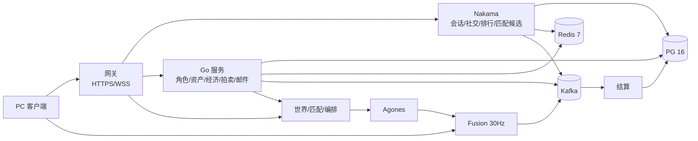
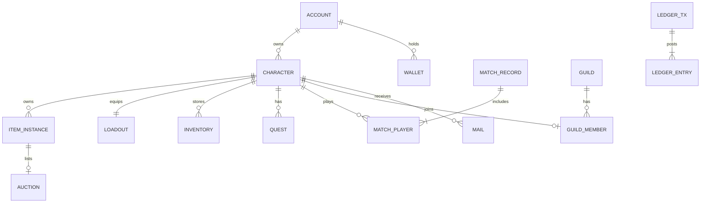
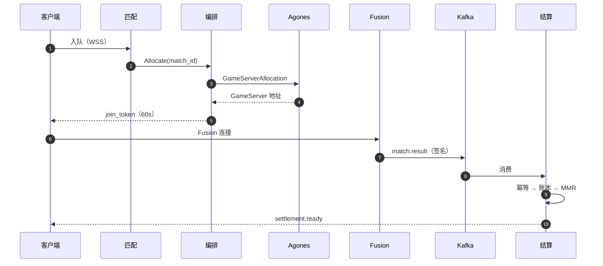

# 03b — 后端 / 数据 / API / 匹配 / 部署 / 成本（TDD 草稿）

> TASK-014，`docs/03` 后端分册，对应 REQ-TECH-003/004/005、REQ-MMO-003/004。客户端/输入/相机/战斗模拟/预测/同步/AOI 见 C4 `03a`；本稿只写服务端与契约。基线 `docs/00` §6/§8、ADR-008/009；不改基线，新决策标 **待决**。

## 0. 结论先行

1. **三分边界**：Nakama 管会话/社交/排行/匹配候选；Go 管角色/资产/经济/拍卖/邮件；Fusion 只算战斗、只产签名结果。
2. **数据**：PG 16 单主库（NA，D2 待决）+ 区域只读副本；Redis 只存可重建数据；Kafka 是结算/审计唯一持久总线。
3. **经济**：双录账本、每笔净额 0、outbox + 幂等消费、拍卖税 5%。
4. **匹配/成本**：Nakama Matchmaker 候选 + 自研 Orchestrator；Fleet 预热池按队列 p95 扩缩。Hiro 1.0 不做资产权威（D4 待决）；主成本杠杆是 Photon CCU+流量+出网（50k 约 50%），§10 单价**以官方报价为准**。

**待决**：D1 三分边界 + owner 矩阵（ADR-013 + Tech Review）；D2 账号全球单主库、游戏面区域化（法务 + Human）；D3 Kafka 单总线（Tech Review）；D4 Hiro 不用于资产权威（许可 + Human）；D5 城镇频道传输（ADR-008 复访）；D6 首发支付仅 Steam（商业化 + Human）；D7 公会权威：Nakama Groups 起步或 Go 自定义（ADR-013）。

## 1. 范围 / 非范围 / 与 C4 分工

**范围**：账号会话、角色、背包/装备、钱包账本、拍卖、公会、聊天、排行、邮件、任务、匹配、编排、结算、多区部署、观测、成本、后端测试。
**非范围**：输入/键位/相机/战斗模拟/预测/回滚/快照与战斗服 tick/命中（C4）；客户端反作弊内核；UGC（S2）；国服合规。

| 领域 | C4 | C5 | 契约 |
|---|---|---|---|
| 输入/相机 | 全部 | 不涉及 | — |
| 战斗模拟/命中 | 战斗服内 | 不写战斗逻辑 | `MatchResult` |
| 预测/AOI | 全部 | 会话、`join_token` | `join_token` |
| 战斗服进程 | 镜像内 | Agones 分配/健康/回收 | Fleet 标签 |
| 账号/社交/经济 | 调用 API | 实现与数据 | OpenAPI/proto |

契约：`join_token` Ed25519 60s 单次绑定 match/character/server；`MatchResult` 含 hash 与签名，只信白名单字段；兼容 N-1（待定）。

## 2. 总体拓扑



多区：NA 主区（账号主库、支付、审计），EU/SEA 游戏区；战斗流量不出区；仅网关与 Photon 对公网暴露。

| 区域 | 角色 | 数据 |
|---|---|---|
| NA-East | 主区 | 账号主库 + 游戏库主 |
| EU-West | 游戏区 | 只读副本（驻留待决） |
| SEA | 游戏区 | 只读副本 |

## 3. 服务拆分

| 服务 | 职责 | 数据 owner |
|---|---|---|
| 网关（Envoy/Go） | TLS/限流/鉴权/路由/WSS | — |
| 账号（Nakama） | 登录/会话/封禁/合并 | account |
| 角色 | 创建/等级/位置/外观 | character |
| 背包装备 | 物品/槽位/装备校验/属性重算 | item/inventory/loadout |
| 经济 | 余额/账本/发放/对账 | wallet/ledger |
| 拍卖 | 挂单/竞价/成交/托管/税 | auction |
| 公会 | 创建/成员/职位/聊天（D7） | guild/guild_member |
| 世界/频道 | 城镇/野外实例、频道切换 | Redis + match_record |
| 聊天（Nakama） | 频道/DM/队伍/公会 | Nakama chat |
| 排行（Nakama） | 赛季榜 | leaderboards |
| 邮件 | 系统/玩家邮件/附件 | mail |
| 任务 | 进度/领奖 | quest |
| 匹配 | 队列/队伍/MMR/区域 | Redis + PG |
| 编排 | 分配/join token/回收 | match_record |
| 结算 | 校验/幂等/入账/MMR | match_player |

**边界**：单域单 owner；跨域只用 gRPC/Kafka，不跨库事务；Nakama groups 可作公会聊天容器（权威归属见 D7）；Nakama wallet/storage 不作资产权威；战斗服不写 DB；客户端不可信。
**Hiro**：Inventory/Wallet、Auctions 不能作权威（无双录/托管/审计）；Mailbox 可参考但附件接我方账本；Progression 可原型；Battle Pass 可加速（D4）。

## 4. 数据模型

金额 `bigint` 最小单位；主键 UUIDv7；时间 `timestamptz`；账本不可改；`ledger_entry`/`match_record` 按月分区；缩写 `PK/UQ/IX/FK/CK`。



| 表 | 关键字段 | 索引/约束 |
|---|---|---|
| account | `id PK, steam_id, email, status, region` | `UQ(steam_id/email)`；PII 加密 |
| character | `id PK, account_id FK, slot, name, level, zone_id, pos_x/y` | `UQ(account_id,slot)`、`UQ(name)`、`CK 1–50` |
| item_instance | `id PK, def_id, owner_id, enhance, version` | `IX(owner_id)`、`CK 0–10`；owner 空=托管 |
| inventory | `character_id, container, slot, item_id` | `PK(character_id,container,slot)`、`UQ(item_id)` |
| loadout | `character_id PK, weapon_id, core_id, head/body/legs_id, rune1/2_id, version`（装备=招式） | FK；类型服务校验；乐观锁 |
| wallet | `id PK, owner_type, owner_id, currency（金币/荣誉/RAID 代币/晶石）, balance, version` | `UQ(owner_type,owner_id,currency)`、`CK balance>=0` |
| ledger_entry | `id PK, tx_id FK, seq, wallet_id FK, delta, balance_after, prev_hash, hash, created_at` | `UQ(tx_id,seq)`、`IX(wallet_id,created_at)`、`CK delta<>0` |
| auction | `id PK, seller_id, item_id, currency, start_price, buyout_price, status, expires_at` | 部分 `UQ(item_id) WHERE active`、`CK buyout>=start>0` |
| match_record | `id PK, mode, region, status, server_id, result_hash, created_at, ended_at` | `IX(status,created_at)`；月分区；非保留字 |
| match_player | `match_id, character_id, team, outcome, mmr_before/after` | `PK(match_id,character_id)` |
| quest | `id PK, character_id, quest_def_id, cycle_key, state, progress jsonb` | `UQ(character_id,quest_def_id,cycle_key)` |
| guild | `id PK, name, tag, leader_id, member_count` | `UQ(name/tag)` |
| mail | `id PK, character_id, attachments jsonb, status, expires_at` | `IX(character_id,status,expires_at)` |

支撑表：`ledger_tx`、`guild_member`、`outbox_event`。
**不变量**：一物最多一个 owner/位置；`wallet.balance = SUM(ledger_entry.delta)`；每 tx 净额 0；`match_id` 只结算一次；一物最多一个 active 拍卖；所有权变更写 `item.transfer` 审计。

## 5. API / 协议

**协议**：meta 用 REST/JSON `/v1`（网关 → Nakama/Go）；聊天/在线/匹配/结算推送用 WSS（Nakama socket）；服务间 gRPC + mTLS + 内部 JWT 5min；战斗结果/审计走 Kafka `match.result.v1`（幂等）。
**约定**：`/v1` 前缀、破坏性变更 `/v2`；写接口带 `Idempotency-Key`（24h，重放返回原响应）；限流登录 5/min/IP、聊天 5/10s、拍卖 10/min、队列 1 ticket。

```http
POST /v1/auth/login {"provider":"steam","ticket":"…"} → 200 {"session":"<JWT>","characters":[{"id":"chr_…","level":7}]}
POST /v1/characters {"slot":1,"name":"Ash"} → 201 {"character_id":"chr_…"}
```

```http
PUT /v1/characters/chr_…/loadout {"weapon":"itm_A","core":"itm_B","armor":["itm_C","itm_D","itm_E"]}
→ 200 {"version":42}｜409 {"code":"INV_002"}
GET /v1/characters/chr_…/inventory?container=bag → 200 {"items":[{"item_id":"itm_A","enhance":3}]}
```

```http
POST /v1/match/queue {"mode":"ranked_3v3","region":"EU"} → 202 {"ticket_id":"tkt_…"}
WSS ← {"type":"match.found","join_token":"…"}
```

```proto
rpc SubmitResult(MatchResult) returns (SubmitAck);
message MatchResult { string match_id=1; string server_id=2; bytes signature=3; repeated PlayerResult players=4; }
```

错误码：`AUTH_001/002` 会话过期/封禁；`VER_001` 版本不支持；`RATE_001` 限流；`INV_001/002` 物品不存在/托管中；`LOAD_001` 槽位不符；`ECO_001` 余额不足；`MATCH_001/002` 已在队列/无可用服；`BATTLE_001` token 无效。

## 6. 匹配与战斗编排

```text
E = 1/(1+10^((R_opp-R_self)/400))；R' = R + K×(S-E)，K=32，新号 48
team_rating = mean(R) - 0.05×(max(R)-min(R))
```

- 1v1/3v3 分队列；赛季软重置 `1500+0.5×(R-1500)`；队伍 MMR 差 ≤400（初值）；区域锁定；>60s 放宽 ±100→±400，>180s 提示换区（跨区待决）；PvE 可私人房，PvP 不补人。
- Agones：每区×模式一套 Fleet（标签 `region/mode/build`）；预热 `max(10, 峰值 15%)`；FleetAutoscaler Buffer + 队列 p95/分配延迟；分配 2s 超时重试 3 次；心跳 10s、失联 30s 回收；结束 30s 优雅退出。
- 生命周期 `Pending→Allocated→Live→Settling→Closed`；分配 5s、加载 60s、结算 120s 超时由 reaper 回收并审计；弹性用 HPA + cluster autoscaler + 独立 taint 池，缩容延迟 10min。



## 7. 一致性与经济安全

- **双录**：每 tx ≥2 条 entry，`SUM(delta)=0`；系统钱包 `FAUCET/SINK/ESCROW_AUCTION/ESCROW_MAIL/TAX` 必须存在，禁止无对手方加钱。
- **余额/事务**：`FOR UPDATE` 锁钱包行，同事务写 wallet + ledger；余额非负；`prev_hash/hash` 成链；跨服务 outbox + saga，不用 2PC；relay 用 `FOR UPDATE SKIP LOCKED`。
- **幂等/防复制/防 RMT**：`match_id` 是结算自然键，`Settling→Settled` 只一次；消费端按 `event_id` 去重；物品无客户端 ID，托管期 owner 指向系统钱包；拍卖价相对目录价上下限、等级/时长门槛、交易图分析、人工审核、补偿追回。
- **审计/回滚**：GM 操作带 ticket、超阈值双人审批；每日 faucet/sink 对账；回滚只做补偿分录，PITR 仅最后手段。

```text
tx 7f3a… auction_sold
  buyer -1,000 → 4,000 ｜ seller +950 → 12,950 ｜ tax +50 → 1,050,050 ｜ Σ=0
```

复制/双花/刷金/内鬼分别由幂等、托管单事务、`match_id` 唯一、双人审批拦截。

## 8. 部署 / 运维 / 可观测性

- **K8s/CI-CD**：游戏节点独立 taint 池，data 优先托管；GitHub Actions → Testcontainers → Trivy/cosign → Argo CD → Argo Rollouts 金丝雀；迁移 expand/contract。
- **发布/容灾**：meta 金丝雀 5%→25%→100%（SEA 先行）；Nakama 滚动排空；Fusion 新 Fleet 蓝绿、旧 Fleet drain；PG PITR + 跨区副本，RPO 5min/RTO 1h；Redis 可重建；Kafka RF=3。
- **观测**：Prometheus/Grafana（CCU、队列 p95、分配延迟、tick、结算滞后、账本不平衡）、Loki（脱敏日志 30 天）、OTel（网关→Nakama→服务→Kafka→结算）、Sentry（异常 + release）。SLO：可用性 99.9%、匹配 p95<30s、结算 p95<60s、账本不平衡 0。

## 9. 反作弊 / 安全 / 隐私 / 支付

| 面 | 控制 |
|---|---|
| 服务器权威/校验 | 伤害/掉落/位置/经济/匹配全由服务器判定；客户端只发输入（C4）；schema/边界/频率/状态机/归属/签名，拒绝重放 |
| 客户端反作弊 | EAC/BattlEye 1.0 前评估（`docs/00` §8）；内核驱动需 Human + 法务（待决） |
| 账号/隐私 | Steam 主认证、2FA/SSO、KMS、mTLS；GDPR/CCPA、PII 加密、日志 30/90 天、账本 7 年（待法务）、删除=假名化、驻留见 D2 |
| 支付 | 仅 Steam MicroTxn（D6）；`InitTxn/FinalizeTxn` 校验后入账；`order_id` 幂等；退款反向分录；每日对账 |

支付流程：选 SKU → 校验不含属性（`catalog.stat_delta={}`，不卖属性）→ `InitTxn` 建单 → Steam 覆盖层支付 → `FinalizeTxn` 校验 → 订单 + 账本（FAUCET→晶石）→ 发货；退款反向并收回未消费晶石。

## 10. 成本模型

> 仅基础设施/平台费，不含人力、Steam 30% 分成、市场、客服、法务、税费；单价除注明外为假设，**需以官方报价为准**。

假设：平均在线/峰值 40%；70% 在 16 人房（2 房/vCPU）、30% 在 50 人城镇（1 房/vCPU）+30% 余量 → 0.036 vCPU/CCU；流量按 10KB/s 下行 + 2KB/s 上行；vCPU $0.03/h；出网 $0.07/$0.06/$0.05/GB。

```text
每 CCU 月流量 ≈ 12KB/s × 2,628,000s × 40% ≈ 12.6GB
战斗 vCPU = CCU×0.036；Photon = max(最低消费, Σ区域峰值×单价)
单位成本 = Σ(算力+存储+流量+观测+杂项) ÷ CCU
```

| 项（USD/月） | 1k | 10k | 50k |
|---|---|---|---|
| 算力（战斗 36/360/1,800 vCPU + Meta） | 1,080 | 9,636 | 46,720 |
| PG 16 | 400 | 1,800 | 7,000 |
| Redis + Kafka | 370 | 1,900 | 7,500 |
| 观测 + 存储 | 430 | 2,200 | 8,500 |
| 云出网 | 735 | 6,300 | 26,250 |
| Photon CCU | 250 | 5,000 | 25,000 |
| Photon 流量 | 330 | 3,300 | 16,500 |
| 杂项 | 300 | 800 | 2,000 |
| **合计** | **3,895** | **30,936** | **139,470** |
| **USD/CCU·月** | **3.90** | **3.09** | **2.79** |

Photon 公开价（2026-10-17 抓取，**以官方报价为准**）：500/1000/2000 CCU 为 $125/$250/$500 每月；Premium $0.50/CCU（最低 $1,000/月），含 3GB/峰值 CCU/月，超出 $0.05–0.10/GB（亚洲 $0.10）；50k 按 $0.50 外推仅作基线。[定价](https://www.photonengine.com/fusion/pricing)

敏感性：在线/峰值 25–60% → 总成本 ±10–15%；CPU 密度 ±30% → ±8–12%；Photon ±30% → 10k ±5%/50k ±9%。结论：单位成本 $3.90→$2.79；50k 时 Photon + 出网 ≈50%，是最大杠杆；约占 `docs/00` §9 示意收入的 16%（非预测）。迁移 FishNet 10k 仅省 ~$8.3k/月，<20k 不划算。

## 11. 里程碑与测试

| 里程碑 | 时间 | 后端范围 | 退出标准 |
|---|---|---|---|
| M0 | 0–2 月 | 登录/角色/背包读取/结果 stub；单区 dev | 端到端持久化 |
| M1 | 2–5 月 | schema v1、装备、账本、4 人副本 | 2k CCU 压测、PITR |
| M2 | 5–9 月 | 匹配、结算、拍卖、邮件、公会、反作弊遥测 | 8v8、匹配 p95<30s、混沌 |
| M3 | 9–15 月 | 多区、蓝绿/金丝雀、DR、GDPR、支付沙箱 | 5k CCU 72h soak |
| M4 | 15–18 月 | 10k CCU、3 区、值班、成本护栏 | 上线/回滚演练 |

**后端测试**

| 类型 | 方法 | 对应 |
|---|---|---|
| 集成/契约 | Testcontainers + OpenAPI/proto | TEST-052 |
| 压测 | k6 2k/5k/10k | TEST-054 |
| 混沌 | Chaos Mesh（Pod/节点/PG 切换） | TEST-053 |
| 安全 | 授权矩阵/重放/模糊 | TEST-053 |
| 账本 | 净额 0/幂等/并发 | TEST-033 |

## 12. 风险、备选与开放问题

风险：Photon 成本/锁定（→抽象网络层/年比价）、单主库瓶颈（写 p95>50ms→读写分离/按 account 分区）、经济漏洞（→双录 + 图分析 + 补偿）、多区合规（D2/EU 独立库）、结算竞态（`match_id` 唯一 + 状态机）。

备选：PlayFab/Edgegap（托管/锁定）、Hiro（资产不自主）、FishNet（省 Photon/工程大）、CockroachDB（强一致/运维重）。开放：云厂商/报价、Fusion Enterprise、EU 驻留、公会 groups、跨区、账本年限、EAC、支付渠道。

## 13. 来源

- [Nakama](https://heroiclabs.com/docs/nakama/)｜[Hiro](https://heroiclabs.com/docs/hiro/concepts/introduction/)｜[PostgreSQL 16](https://www.postgresql.org/docs/16/index.html)｜[Redis](https://redis.io/docs/latest/)｜[Kafka](https://kafka.apache.org/documentation/)
- [Agones](https://agones.dev/site/docs/overview/)｜[Fusion 2](https://doc.photonengine.com/fusion/v2/fusion-intro)｜[Fusion 定价](https://www.photonengine.com/fusion/pricing)｜[K8s](https://kubernetes.io/docs/home/)｜[Argo Rollouts](https://argoproj.github.io/rollouts/)
- [OpenTelemetry](https://opentelemetry.io/docs/)｜[Steam 微交易](https://partner.steamgames.com/doc/features/microtransactions)｜[GDPR](https://eur-lex.europa.eu/eli/reg/2016/679/oj)
