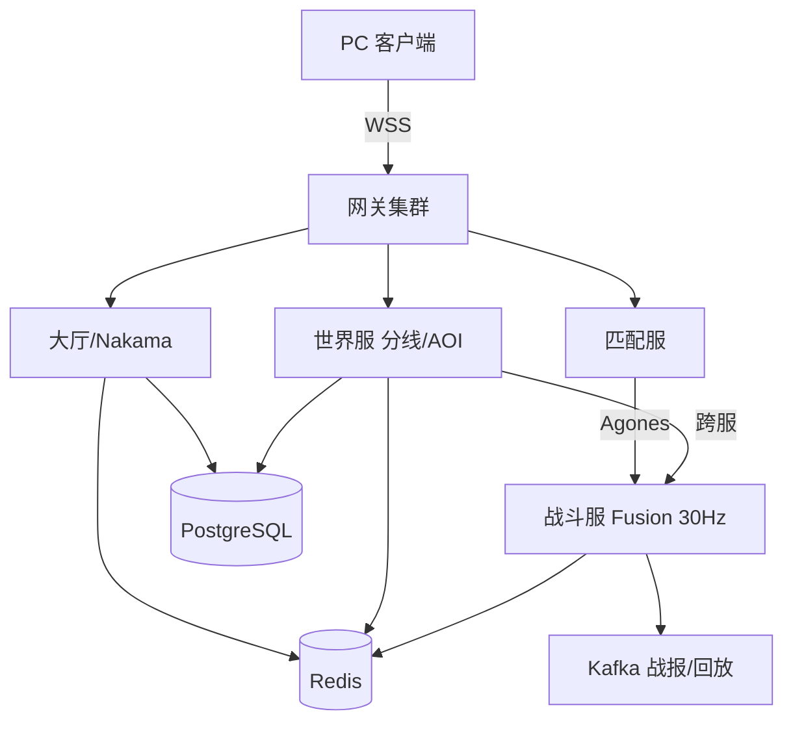

# 3D/2.5D 动作 MMO 技术路线研究

> 早期技术研究（TASK-013/014 输入）。最终以 `docs/03` 为准。

## 结论

Unity 6.3 LTS + Fusion 2 Server（30Hz，客户端预测 + 命中盒回放）+ Nakama + Agones/K8s + Redis/PostgreSQL。C# 前后端同栈、手感迭代最快、像素 3D 兼顾、可平滑扩 MMO。

## 引擎

- **Unity 6.3 LTS（推荐）**：C# 迭代快，动画/物理/URP+Pixel Perfect 适配 2.5D/3D 动作+像素风；Fusion/Quantum/FishNet/NGO 全覆盖；PC/主机/移动一套工程。
- **UE 5.7**：GAS/Niagara/动画最强；偏写实、团队/包体重；像素风需后处理；分成 5%。
- **Godot 4.6**：MIT、2D 像素强；3D 动作/联网/MMO 生态弱；主机需移植商。

## 联网

- **Fusion 2（首选）**：tick 同步、Server/Host/Shared、CSP、AOI、Linux headless；按峰值 CCU 订阅。
- **Quantum 3**：确定性 ECS+rollback，适合 1v1/2v2；16 人 3D 房全确定性与定点数成本高。
- **Mirror/FishNet**：开源/自托管无 CCU 费；预测/延迟补偿需自建；FishNet 更现代，降本备选。
- **NGO/自研**：NGO 缺成熟 CSP/延迟补偿；自研 C# 需 6–12 个月追平；不首发。

→ 近战连招用「服务器权威+客户端预测+延迟补偿」，不做全量 rollback：服务器留 1s 命中盒快照，按 RTT/2+插值回放到客户端时刻做 capsule overlap，回滚上限 200ms；客户端 60Hz 采输入并缓冲，服务器 30Hz 校验连招窗口；同区目标 RTT<60ms。

## 后端分层

网关（无状态：鉴权/限流/路由/会话）→ 大厅社交（Nakama：账号/好友/公会/聊天/排行/匹配）→ 世界服（频道分线/AOI/NPC/持久化）→ 战斗服（8–16 人 PvP；4 人 PvE 复用镜像，AI/掉落权威）→ 匹配服（MMR/组队/跨区）。Redis 管会话/在线/队列，PostgreSQL 管账号/背包/经济账本；Agones 管战斗服舰队与分配，K8s 管无状态服务；PlayFab 可替 Nakama，但实时弱、规模化贵、锁定强。

## 架构

## MVP→量产

- M0（0–2 月）：单区 Fusion Server + Nakama，4v4 一张图，先调手感/延迟补偿/连招。
- M1（2–5 月）：Agones、匹配服、Redis/PG，8v8、重连、基础反作弊，压测 2k CCU。
- M2（5–9 月）：世界服分线、跨区匹配、经济账本、LiveOps，1 万 CCU。
- M3（9–18 月）：多区域、灰度/容灾、内核反作弊、赛季量产。

## 关键风险

- 外挂：只收输入；速度/瞬移/输入频率校验；PC 上 EAC/BattlEye；经济流水审计+回放。
- 一致性/回滚：3D 物理不确定，只回滚命中判定（≤200ms）；服务器校正+平滑，不依赖跨平台确定性物理。
- 物理：固定 tick、自写角色控制器、capsule 命中盒，少用刚体堆叠。
- 跨区：战斗区域化、社交全局、延迟阈值、最终一致、全局 ID。
- 成本：空房回收、弹性伸缩、AOI/量化降带宽；出网常比算力贵。

## 容量与成本

R=CCU×在战率/(房容量×填充率)；单节点房数=核数×利用率/(ms/tick×tick/1000)；节点=⌈R/单节点房数⌉×1.3 冗余。例：1 万 CCU×60%、16 人房、85% 填充≈440 房；2ms/tick、30Hz、8 核@60%≈80 房/节点→约 8 台 8c16g；带宽 16×10KB/s≈160KB/s/房→70MB/s（≈180TB/月），常高于算力。成本=算力+出网+CCU+DB+观测，按峰值 CCU 而非 DAU 计。

## 来源

- Unity 6.3 LTS: https://unity.com/blog/unity-6-3-lts-is-now-available
- Unity Runtime Fee 取消: https://support.unity.com/hc/en-us/articles/30322080156692-Cancellation-of-the-Runtime-Fee-and-Pricing-Changes
- UE 5.7: https://www.unrealengine.com/news/unreal-engine-5-7-is-now-available
- Godot 4.6: https://godotengine.org/download/archive/4.6-stable/
- Fusion 2: https://doc.photonengine.com/fusion/v2/fusion-intro
- Photon 价格: https://doc.photonengine.com/photon/current/pricing
- Quantum: https://doc.photonengine.com/quantum/v3/quantum-intro
- FishNet: https://fish-networking.gitbook.io/docs
- NGO: https://docs-multiplayer.unity3d.com/netcode/current/about/
- Nakama: https://heroiclabs.com/nakama/
- Agones: https://agones.dev/site/docs/overview/
- PlayFab: https://learn.microsoft.com/en-us/gaming/playfab/
