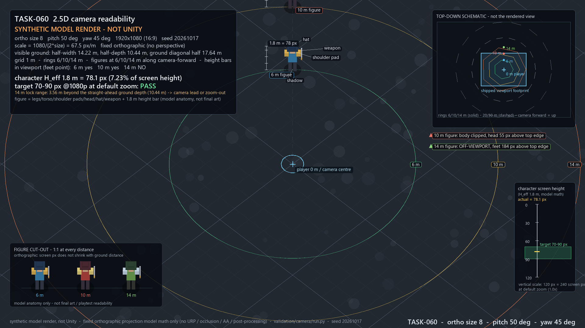

# 技术验证汇总（M0-lite）

> 日期：2026-10-18 ｜ Owner：Lead ｜ 复核：validation-reviewer（TASK-063）
> 范围：2.5D 相机/可读性、完美格挡/延迟补偿、键盘 rollover/组合。
> **证据等级：模型/合成级**，不是 Unity/URP、不是 Photon Fusion、不是玩家 playtest、不是真实键盘实测。
> 一句话：**不是 “validation passed”，而是 “conditional go to M0”**——三路模型都给出了可执行的结论，但有 6 个 blocker 必须先决策/实测。

---

## 0. 结论

| Stream | 判定 | 可以拿来做什么 | 不能拿来做什么 |
|---|---|---|---|
| TASK-060 相机/可读性 | **pass（模型级）** | 改相机基线、定默认参数、写 M0 URP 对账 | 证明 90/85/80% 可读性；证明 14m 正前方可见 |
| TASK-061 完美格挡/延迟补偿 | **conditional** | 定 M0 测试矩阵、排除“按到达时间判”等错误方案 | 证明 150ms 已公平/可上线；替代 Fusion 实测 |
| TASK-062 键盘 rollover/组合 | **conditional（硬件证据不足）** | 键数矩阵、2KRO 回退、解析器行为、人工测试工具 | 证明真实键盘可稳定触发；替代 3 款键盘 QA |

**总判定：Conditional Go。** 允许进入 M0 的**引擎/QA 验证**，不允许把当前模型结论写成“已通过”或直接进入量产。

### 0.1 六个 blocker（必须先处理）

| # | Blocker | 证据 | 处理 |
|---|---|---|---|
| B1 | docs/00 §3.1 “1.5m 基准”与 1.8m 有效高度冲突 | 1.8m size8=78.1px；1.5m=65.1px，70–90 不成立 | DR-002 D1：统一 1.8m；70–90 只对默认相机 |
| B2 | docs 未定义 yaw | docs/00–04 + ADR-002 均无 yaw；drafts 0°/45° 冲突 | DR-002 D2：写死 yaw=45° |
| B3 | docs/02 §3.1 的 14m ≥80% 在居中相机下不可达；20/30m 固定 15/23 不成立 | 14m 正前方 0/9 参数可见；默认超 3.56m；size15/p50 20m 出屏 11.6px | DR-002 D3：14m 改边缘指示，或 camera anchor；20/30 改公式 |
| B4 | 经典布局 C+X 防御 > Z+X+C 必杀，必杀被抢判 | X 按住、C−X≤40ms → GUARD；干净窗口仅 (40,50]ms | DR-002 D4：Z 按住时防御让位；±50ms 统一 |
| B5 | “1 tick 容差 / 误判≤5%”无定义 | σ=25 时 FP 0.5–5.7%；σ=50 时 8.5%；0.5 tick 4.4–4.9% | DR-002 D5：定义容差/人群/单双边 |
| B6 | 无真实键盘数据 | 3 款键盘×100 次 ≥99% 未执行；manual_test.html 仅页面逻辑 | 人工 QA；AI 不能替代 |

> 详细问题、claim audit、M0 矩阵：`validation/review/REVIEW.md`；决策请求：`docs/decisions/DR-002-validation-baseline-fixes.md`（**approved 2026-10-18**）。
>
> **关闭状态（2026-10-18）**：B1–B5 已按 DR-002 推荐值写入 `docs/00` v0.3.0 / `docs/02` / `docs/03` / `docs/04` / `docs/07`，ADR-002/004/008 已复访；**B6 仍 open（TASK-066，3 款键盘人工 QA）**。模型级结论仍不是游戏验证通过。

---

## 1. 证据与边界

- 三路脚本：Python 3.12.14 + numpy 2.3.5 + Pillow 12.3.0，seed 20261017，确定性可复现。
- 独立复核：三个 `run.py` 全部 exit 0；camera 4 文件、netcode `results/sensitivity/sanity/svg`、input 3 CSV **SHA-256 逐字节一致**；`verify_numbers.py` **462 checks / 0 failures**；`manual_test.html` 页面逻辑 28/28（仅页面逻辑）。
- 唯一非逐字节一致：netcode `summary_tables.md` 的 runtime 秒数一行；不影响数据。
- 复核结论：**6 blocker / 5 major / 9 minor；不能写 validation passed**。
- 评审后作者已修 M1（netcode 引用数字）与 M3（input 顺序必杀条件）；数据文件未变，结论方向不变。M1/M3 的最终文本由 Lead 抽查，未再走第二轮 reviewer。

**不包含**：Unity/URP 渲染、Fusion 2 实际回放、真实命中盒/位置、玩家反应/学习、真实键盘 ghosting、服务器成本。

---

## 2. 相机（TASK-060）

### 2.1 关键数字（1080p，H_eff=1.8m，yaw=45°）

| 项 | 结果 |
|---|---|
| 默认 78.1px | size 8 / pitch 50° = **78.1px（7.23%）**，70–90 成立 |
| 参数敏感 | size7/p50=89.3、size9/p50=**69.4（严格低于 70）**；9 个 size×pitch 组合严格 5/9 通过 |
| 1.5m 口径 | size8=65.1px、size9=57.9px → **70–90 不成立**（B1） |
| 可见地面半深 | size7/8/9 @p50 = 9.14 / 10.44 / 11.75m |
| 6m 正前方 | 9/9 参数在屏内 |
| 10m 正前方 | 5/9 在屏内；默认 8/50 脚点 y=22.9px、头顶被裁 55px |
| 14m 正前方 | **0/9**；默认 8/50 超出可见地面 3.56m；仅世界轴/对角 6/9 贴边裁头 |
| 20/30m | 必须 zoom-out；size 15/23 在 p50 下 20m 出屏 11.6px、30m 贴边 0.4px |

### 2.2 结论

- **默认参数建议保持 size 8 / pitch 50° / yaw 45° / 1.0×**，但必须写入基线（目前 yaw 缺失）。
- 70–90px 是**默认相机目标**，不是 size 7–9 × pitch 45–55° 全域成立。
- **14m 正前方在居中相机下不可见**；必须二选一：
  - **B（推荐）**：14m 只做屏幕边缘指示器/小地图，剪影识别验收只覆盖 6/10m。
  - **A**：camera lead/anchor（8/50：脚点 anchor≥0.670、全身+24px≥0.765），代价是后方只剩 6.89/4.91m。
- 20/30m zoom 改为公式：`S ≥ d·sin(pitch)`（脚点）或 `S ≥ (d·sin p + 1.8·cos p)·1080/1032`（全身）；p50 建议 17/26，不写死 15/23。
- 90/85/80% 是 **playtest 指标**，模型/合成图不能证明。

---

## 3. 联网（TASK-061）

### 3.1 关键结果（主配置：cap200、defender-favoring on、缓冲2、jitter10、loss2%、interp33、σ25）

| tick/窗口 | RTT 80 成功/误判 | RTT 100 成功/误判 | RTT 150 成功/误判 |
|---|---|---|---|
| 30Hz/100ms | 99.7% / **5.7%** | 99.4% / **5.7%** | 82.1% / 0.7% |
| 30Hz/150ms | **100.0% / 0.5%** | **99.7% / 0.2%** | 81.7% / 0.0% |
| 60Hz/100ms | 99.1% / 5.4% | 99.0% / 5.1% | 73.2% / 0.6% |
| 60Hz/150ms | 99.9% / 0.4% | 99.5% / 0.1% | 74.1% / 0.1% |

- **100ms/30Hz 在线不可直接上线**：成功率达标，但 1 tick 容差下误判 5.7% > 5%；100ms 只保留本地/离线。
- **150ms 在线 + 1 tick** 在 RTT 80/100 通过；但真正的约束是 **cap 200ms**：cap150 时 RTT100 82.4%、RTT150 18.4%；cap200 为 99.7%/81.7%。
- **60Hz 不是 M0 硬前提**，但排位推荐：量化 p95 25.8→12.9ms，误判更低。RTT 200ms 失败（18.4%）。
- **必须用 ClientTimeMs + defender-favoring**；按到达时间判会跌到 RTT100 27.3%（30Hz）/6.1%（60Hz）。
- 人群敏感：σ=50 时 150ms/1 tick RTT80 误判 8.5% > 5%；M0 必须定义测试人群。

### 3.2 推荐参数（DR-002 D5）

在线 150ms；本地/离线 100ms；cap 200ms；容差 **0.5 tick**（30Hz≤16.7ms/60Hz≤8.3ms）；输入缓冲 2 帧；ClientTimeMs + defender-favoring；禁止按到达时间判；排位目标 RTT≤100ms、容忍≤150ms。

> 这些是模型建议，不是已批准基线；cap 150→200、60Hz 排位默认需 ADR-008 + Human。

---

## 4. 键盘（TASK-062）

### 4.1 关键结果

| 键盘 | 15 组合可同按 | 结论 |
|---|---|---|
| NKRO | 15/15 | 全部安全 |
| 6KRO | 15/15（最大 5 键斜向；极限 6 键无余量） | 计数安全，但厂商“6KRO”区域差异需实测 |
| 2KRO | **10/15 正交、9/15 斜向** | Z+X+C、方向+Z+C、方向+Z+X、方向+Z+X+C、方向+X+C 必须顺序/改键/Space |

- 3f 方向窗口模型可行：50ms 闭区间判方向版，66.7ms 回退基础版，移动中 >3f 回退基础版。
- **B4 优先级 blocker**：经典布局字面“C+X 防御 > Z+X+C 必杀”导致 X 按住 + C 近同时 → GUARD；干净必杀窗口仅 (40,50]ms。候选修正：**Z 按住时防御让位/必杀优先**。
- **M4**：docs/03 §4.1 ±40ms vs §4.3 ±50ms 冲突，建议统一 ±50ms（3f）。
- **M3 已修**：顺序必杀干净条件不是“X 松开后 3f”，而是“C 按下距 X 按下 ≤3f 且不触发防御抢判”；X 松开时 C−X≤50ms 即可；X 仍按住时仅 40<C−X≤50ms 窄带干净。
- **B6**：没有真实键盘数据；`manual_test.html` 只验证页面逻辑，AI 无法替代物理键盘测试。

---

## 5. 独立复核

- `validation/review/REVIEW.md`：camera **pass（模型级）**；netcode **conditional**；input **conditional（硬件不足）**。
- 6 blocker / 5 major / 9 minor；`verify_numbers.py` 462 checks 全过；三路产物可逐字节复现。
- 复核明确：**不能写 “validation passed”**；TASK-064 必须逐 stream 标“模型级/非引擎/非玩家实测”。

---

## 6. 对 docs 的修正请求

见 [DR-002](../docs/decisions/DR-002-validation-baseline-fixes.md)：

- D1 相机高度 1.8m；D2 yaw=45°；D3 14m 边缘指示/相机 lead + 20/30 公式；D4 Z 按住时必杀优先、C+X ±50ms；D5 150ms/cap200/0.5 tick/人群定义；D6 3 款键盘人工 QA。
- **DR-002 已批准并同步 docs；B6 真实键盘 QA 仍 open，不能把 TASK-060/061/062 写成“游戏验证通过”。**

---

## 7. M0 前置（模型不能替代）

| Stream | 必测 | 验收/对账 |
|---|---|---|
| Camera | URP `orthographicSize=8` 语义；1.8m 包围盒 78px@1080p；6/10/14m feet y 与 metrics 对齐 ±2px；yaw=45° 实现；anchor/边缘指示器；真实美术/遮挡后真人识别率 | 几何 ±2px；90/85/80% 是 playtest，不由合成图通过 |
| Netcode | Fusion 2 Server Mode 30/60Hz；C1/C2 负对照先过；A1/A2/A3/B1/B2 决策格；A5 时钟 p95≤16.7ms；A6 输入缓冲；C5 chord p95≤16.7ms；5–10 人真人 cohort | 成功 ≥70%、FP≤5%（按 D5 定义）；p95 30Hz≤33ms/60Hz≤17ms；与 results.csv 对账，>10pp 先查 A3/A5/A6 |
| Input | 3 款键盘（NKRO/6KRO/薄膜）×100 次 ≥99%；低 rollover 顺序输入模式；OS/IME/浏览器；X→C 间隔分布 | 成功 ≥99%；顺序输入成功率/中间动作计数；物理 ghosting 以实测为准 |
| Art | 1 角色 + 3 装备 + 1 环境 + 1 Boss；6/10/14m 可读性 | 风格/剪影/遮挡；Art Lead/Human |

---

## 8. 建议下一步

1. **DR-002 D1–D6 已批准（2026-10-18）**；docs/00 v0.3.0、ADR-002/004/008 已复访，REVIEW B1–B5 已按批准值关闭。
2. 执行 M0 引擎/QA 验证；B6 真实键盘 QA 仍 open。
3. 进入 M0 引擎验证（URP + Fusion）；B6 由 QA/人类跑 3 款键盘。
4. **在 M0 通过前，不把本报告写成 “validation passed”，不冻结 1.0 范围/预算。**

---

## 9. 产物索引

- [相机报告](camera/REPORT.md) / [metrics.csv](camera/metrics.csv) / [size8 图](camera/render_size8.png) / [size7](camera/render_size7.png) / [size9](camera/render_size9.png)
- [联网报告](netcode/REPORT.md) / [guard_success.svg](netcode/guard_success.svg) / [results.csv](netcode/results.csv) / [sensitivity.csv](netcode/sensitivity.csv) / [sanity_checks.csv](netcode/sanity_checks.csv)
- [键盘报告](input/REPORT.md) / [combo_matrix.csv](input/combo_matrix.csv) / [manual_test.html](input/manual_test.html)
- [独立复核](review/REVIEW.md) / [verify_numbers.py](review/verify_numbers.py) / [复核日志](review/rerun/)
- [DR-002](../docs/decisions/DR-002-validation-baseline-fixes.md)
